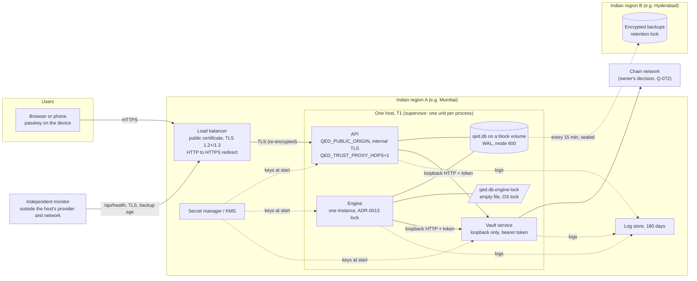

# Production conversion: the runbook

Prepared on 24 Nov 2026 by the qed-systems-architect specialist, on branch `claude/r11-prod`, for owner mandate R11
sections 11 and 12 ("Prepare production conversion locally: HTTPS, origins/RP IDs, sessions/cookies/CSRF,
credentials/vault migration, persistent storage, workers, keys, backups, monitoring and rollback. Verify hosting and
residency assumptions."). **Nothing is deployed.** No host, domain, certificate authority, secret store, monitor or
partner was contacted or bought; no remote was pushed (D-070). QED is **not production-ready**: section 16 lists what
stands between this build and real money, and who decides each item.

**Default scope.** The owner has not chosen the production scope (Q-070: India only, or beyond). This runbook is written
for **India, through licensed partners** (banks, payment aggregators, a SEBI-registered broker or adviser, a mutual fund
registrar) who hold the licences and the money; QED holds authority, never customer funds (D-004). Section 13 says what
changes beyond India.

**How each control is written.** *Control*: what is done. *Standard*: the edition and requirement it answers.
*Acceptance*: what must be true in production. *Evidence*: what shows it today. *State*: **Done here** (built and
verified on this computer; the test or rehearsal check is named), **At deploy** (a setting the operator gives; the server
refuses to start with a weaker one), or **Gap** (not built; section 16 names who decides). Claims carry the labels of
`docs/shared/AGENT_PROTOCOL.md`: **Verified** or **Hypothesis**.

**Standards, as read on 24 Nov 2026** (primary sources, fetched with `curl`; copies kept outside the repository):

| Key | Document | Edition read | Where |
|---|---|---|---|
| ASVS | OWASP Application Security Verification Standard | 5.0.0, May 2025 (repository `OWASP/ASVS`, branch master at `a2ce628f`) | raw.githubusercontent.com/OWASP/ASVS/master/5.0/en/ |
| 63B | NIST SP 800-63B-4, Authentication and Authenticator Management | final, page dated 26 Aug 2025 | pages.nist.gov/800-63-4/sp800-63b.html |
| CSF | NIST Cybersecurity Framework | 2.0 (CSWP 29), from NIST's reference export | csrc.nist.gov CPRT export `csf_2_0_0` |
| SSDF | NIST SP 800-218, Secure Software Development Framework | 1.1 (Feb 2022) final; 1.2 exists only as an initial public draft (SP 800-218 Rev. 1 ipd, 17 Dec 2025) | csrc.nist.gov/pubs/sp/800/218/final |
| WebAuthn | W3C Web Authentication Level 3 | W3C Recommendation, 25 Aug 2026 | w3.org/TR/webauthn-3/ |
| RBI | Storage of Payment System Data, RBI/2017-18/153, DPSS.CO.OD No.2785/06.08.005/2017-2018 | 6 Apr 2018 | rbi.org.in/Scripts/NotificationUser.aspx?Id=11244 |
| RBI-FAQ | RBI FAQ on storage of payment system data | as published | rbi.org.in/commonperson/English/Scripts/FAQs.aspx?Id=2995 |
| Railway | Railway deployment regions | as published | docs.railway.com/reference/deployment-regions |

The DPDP Act 2023, the DPDP Rules 2025 and CERT-In's directions of 28 Apr 2022 could not be read today: MeitY's pages
are script-rendered and the gazette PDFs did not yield text without a PDF tool. They are cited from
`docs/research/qed-fin-infra-compliance/20261121-r7-regulatory-requirements.md` with the grades given there
(Hypothesis-R: a reproduction of the primary text; Hypothesis-S: a summary), not upgraded here.

---

## 0. What changed in the code for this runbook

Every default is unchanged: with none of the settings below, the local build behaves exactly as before
(`server/production-config.test.ts`, first test). Files: `server/core.ts` (settings, checked at start), `server/api.ts`,
`server/passkeys.ts`, `server/auth.ts`, `server/engine.ts`, `server/main.ts`, `server/rail.ts`; new
`server/engine-fixture.ts`, tests `server/engine-lock.test.ts`, `server/production-config.test.ts`,
`server/rail-unknown.test.ts`; the rehearsal `scripts/prod-rehearsal.ts`.

| Setting | Meaning | Unset (local build) |
|---|---|---|
| `QED_PUBLIC_ORIGIN` | the one origin the interface is served at, e.g. `https://wallet.example.in`; must be `https://` (plain `http://` only for `localhost` or `*.localhost`); a host name, not an IP address; origin only | requests from `http://localhost` and `http://127.0.0.1` on ports 5175 and 5174; passkeys at `http://localhost:5175` (and the `QED_WEB_PORT` origin when set) |
| `QED_RP_ID` | passkey relying-party id; must be the origin's host name or a domain it belongs to | the origin's host name (production); `localhost` (local) |
| `QED_TLS_CERT_FILE`, `QED_TLS_KEY_FILE` | serve HTTPS directly (TLS 1.2 at least); both or neither; needs an `https://` public origin | plain HTTP |
| `QED_HSTS` | `off`, or a Strict-Transport-Security value (`max-age=…[; includeSubDomains][; preload]`) | `max-age=31536000; includeSubDomains` under HTTPS; none over HTTP |
| `QED_EXTRA_HOSTS` | extra Host names answered (a platform's health check), comma-separated | none |
| `QED_TRUST_PROXY_HOPS` | reverse proxies in front (0 to 5); the client address is the hops-th X-Forwarded-For entry from the right | 0: the socket's address |
| `QED_SESSION_IDLE_MINUTES`, `QED_SESSION_MAX_MINUTES` | session inactivity and overall limits; a value that is not a positive whole number stops the process | 720 and 10,080 (12 h, 7 days) |
| `QED_HOST` | listen address; anything but `127.0.0.1`, `::1` or `localhost` is refused unless `QED_PUBLIC_ORIGIN` is set | `127.0.0.1` |

Under an `https://` public origin the session cookie becomes `__Host-qed_session` with `Secure`, the API answers only to
that host, accepts the Origin header of that origin only, and the passkey relying party is that origin and id
(`server/core.ts:316-381`, `server/passkeys.ts:45-46`, `server/api.ts:460-489,590`).

---

## 1. Topology

The decision and its rejected alternatives are ADR-0014 (`docs/research/qed-systems-architect/adr/`): **T1**, one host
in an Indian region for a closed pilot; **T2**, multi-zone with managed PostgreSQL before general availability; **T0**,
Railway, rejected for payment data because it has no Indian region (**Verified** 24 Nov 2026: US West, US East, EU West,
Southeast Asia).



Partners (bank, payment aggregator, broker, registrar) replace the paper venues through the same venue contract; each
needs its own adapter, reconciliation and contract (not built: section 16).

---

## 2. HTTPS, TLS and HSTS

| Control | Standard | Acceptance | Evidence | State |
|---|---|---|---|---|
| TLS 1.2 or 1.3 only, 1.3 preferred | ASVS 12.1.1 (L1) | a TLS scan of the public endpoint shows no TLS 1.0/1.1 and prefers 1.3 | rehearsal T1 (TLS 1.3, certificate verified for `qed.localhost`), T2 (a TLS 1.1 client is refused: `EPROTO`) | Done here (API's own TLS); At deploy (edge) |
| Forward-secret cipher suites only | ASVS 12.1.2 (L2; L3: forward secrecy only) | scan lists only ECDHE/TLS 1.3 suites | Node's defaults under TLS 1.3 are forward-secret; TLS 1.2 suites not restricted by QED | At deploy (edge policy); Gap for direct TLS at L3 |
| No plaintext fallback; HTTP redirects to HTTPS at the edge | ASVS 12.2.1 (L1) | `http://` answers only with a redirect; the API speaks no HTTP on its TLS port | rehearsal T3 (plain HTTP to the TLS port: no answer) | Done here; At deploy (redirect) |
| Publicly trusted certificate, renewed automatically | ASVS 12.2.2 (L1) | certificate chain to a public root; renewal alarm 14 days before expiry | the rehearsal uses a self-signed certificate made at run time and pinned by its public key in a temporary Chrome profile | At deploy |
| TLS between load balancer and API with a pinned internal certificate | ASVS 12.3.1, 12.3.3, 12.3.4 (L2) | the API is reachable only over TLS inside the network; its certificate is trusted specifically | `QED_TLS_CERT_FILE` (rehearsal T1) | At deploy |
| OCSP stapling; Encrypted Client Hello | ASVS 12.1.4, 12.1.5 (L3) | stapled OCSP; ECH where the edge supports it | not implemented in the API | Gap (edge provider's) |
| HSTS on every response, one year, subdomains | ASVS 3.4.1 (L1; subdomains from L2) | every response, refusals and redirects included, carries `max-age>=31536000; includeSubDomains` | rehearsal H1 (answer, 421 refusal, 404, the interface), `server/production-config.test.ts` | Done here |
| HSTS preload | — | only by the owner's decision: preload is slow to undo for every subdomain | `QED_HSTS` accepts `preload` | Owner's decision |
| Wallet to vault service: loopback HTTP with a bearer token | ASVS 13.2.1 (L2), 12.3.x | stays on one host (loopback) or moves to mutual TLS when the vault service gets its own host (T2) | `server/rail.ts` refuses a non-loopback `QED_RAIL_URL` | Done for T1; Gap for T2 |

---

## 3. Origin, host names and the passkey relying party

| Control | Standard | Acceptance | Evidence | State |
|---|---|---|---|---|
| One public origin; the API answers to its host only (DNS rebinding) | (no ASVS 5.0 row names Host validation) | any other Host gets 421 | rehearsal O1; tests | Done here |
| Requests from another origin, the `http://` origin of the same host, or marked cross-site, are refused before any handler | ASVS 3.5.1 (L1), 3.5.8 (L3) | 403 `cross_site` | rehearsal O2; tests | Done here |
| Passkeys bound to the origin and the relying-party id; a passkey made elsewhere is refused | 63B §3.2.5 (phishing resistance); WebAuthn §7.1, §7.2 | sign-up and sign-in work at the origin; another origin, `http://`, or another id is refused (401) | rehearsal B2, B5 (Chrome 158 with a virtual authenticator at `https://qed.localhost:7443`), W1 (server refuses forged origin, scheme and id), B6 (browser refuses another id: `SecurityError`) | Done here |
| Separate applications on separate host names | ASVS 3.5.4 (L2) | the wallet's host serves the wallet only | one origin per deployment | At deploy |

**Choose the domain before the first vault exists.** A vault's owner account stores the relying-party id's SHA-256 and
the origin on chain at set-up (`server/rail.ts` `railSetup`: `rpIdHash`, `origin`; the vault service rejects assertions
made at any other origin). A later domain change cannot be fixed by configuration: every vault's signers would have to
be migrated through the owner account's delayed signer change. Passkeys made on `localhost` (the review build) do not
work on a production domain and vice versa (**Verified** by rehearsal W1 and B6). A second domain for the same accounts
would need WebAuthn's related origins (WebAuthn Level 3) and the vault's origin rule changed: not built.

---

## 4. Sessions, cookies and CSRF

| Control | Standard | Acceptance | Evidence | State |
|---|---|---|---|---|
| Cookie `__Host-qed_session`: `Secure`, `HttpOnly`, `SameSite=Strict`, `Path=/`, no `Domain`; unreadable by page scripts | ASVS 3.3.1 (L1), 3.3.2, 3.3.3, 3.3.4 (L2); 63B §5.1.1 | as written, on every sign-up, sign-in and recovery | rehearsal B3 (header and Chrome's cookie jar; `document.cookie` empty); tests | Done here |
| The local build's cookie name is not read under HTTPS | ASVS 3.3.1 | `qed_session=…` gives 401 | `server/production-config.test.ts` | Done here |
| Opaque 256-bit tokens from a CSPRNG; the database keeps only their SHA-256 | ASVS 7.2.1, 7.2.2, 7.2.3 (L1) | — | `server/auth.ts:139`, `server/passkeys.ts:157`, schema `sessions.id_hash` | Done (before this work) |
| CSRF: a per-session token in a header on every change, plus the Origin and Sec-Fetch-Site checks and `SameSite=Strict` | ASVS 3.5.1, 3.5.3 (L1) | a change without the token, or with a wrong one, is refused (403 `csrf`) | rehearsal B4 (in Chrome); tests | Done here |
| Logout ends the session server-side | ASVS 7.4.1 (L1) | the old cookie is refused after sign-out | rehearsal B5 | Done here |
| Inactivity and overall limits at AAL2 | 63B §2.2.3 (SHOULD: inactivity no more than 1 hour, overall no more than 24 hours); ASVS 7.1.1, 7.3.1, 7.3.2 (L2) | production sets `QED_SESSION_IDLE_MINUTES=60`, `QED_SESSION_MAX_MINUTES=1440` | `server/auth.ts:23-38`; tests (defaults kept; production values; invalid values stop the process) | At deploy |
| Every approval, and every change that weakens a protection, needs a fresh passkey assertion over the exact terms | ASVS 7.5.1 (L2), 7.5.3 (L3); 2.3.5 (L3, multi-user approval for high value: business workspaces' signer policy) | — | `server/passkeys.ts`, D-084, D-094, D-105 | Done (before this work) |
| New session token on re-authentication | ASVS 7.2.4 (L1) | a step-up issues a new token and ends the old one | a step-up refreshes `stepup_at` on the same session (`server/auth.ts`) | **Gap** (section 16) |
| Operators can end one user's or all users' sessions | ASVS 7.4.5 (L2) | an audited operator command | none (users can end their own: `POST /api/auth/logout-everywhere`) | **Gap** |
| Password path: top-3,000 and breached-password checks | ASVS 6.2.4 (L1), 6.2.12 (L2) | registration and change refuse listed passwords | `guessable()` holds about 10 passwords and 26 words (`server/auth.ts`) | **Gap** (Q-067) |

The deviation from 63B's AAL2 limits in the local build (12 hours idle, 7 days in all) is documented here as ASVS 7.1.1
asks: the local build is one person on one computer, and every money movement still needs a passkey signature over its
exact terms. Production uses the 63B values.

---

## 5. The client's address behind proxies, and rate limits

Behind a load balancer every request arrives from the balancer's address. The API's limits are per address (sign-ups
20 an hour, password sign-ins 30 and passkey sign-ins 60 in 15 minutes, `QED_REQUESTS_PER_MINUTE` 1,500), so without this setting one client could use
up everyone's allowance and the audit log would name the balancer. `QED_TRUST_PROXY_HOPS=N` takes the N-th
X-Forwarded-For entry from the right; entries the client wrote to its left are ignored; a header shorter than N falls
back to the socket's address (stricter, never looser) (`server/api.ts:477-483`; tests).

| Control | Standard | Acceptance | Evidence | State |
|---|---|---|---|---|
| Limits apply per real client | ASVS 2.4.1 (L2), 6.3.1 (L1) | with N proxies, two clients behind the same proxy have separate allowances | `server/production-config.test.ts` (client address cases) | Done here (logic); At deploy (N) |
| Limits survive a restart and are shared by API instances | ASVS 2.4.1 | durable limits in the database; the in-memory per-address limiter is per process | sign-in, sign-up and questions are durable; the 1,500-a-minute guard is in memory | Gap for T2 (move to a shared store) |

---

## 6. Credentials and keys

This section is the inventory and the production home of each secret. The mechanism (keyrings, sealed backups,
sealed migration copies, the plaintext archive) is `docs/ENCRYPTION.md` and the work in progress on branch
`claude/r11-crypto` (which adds a key folder, `npm run keys:init`, sealed migration copies and a refusal to migrate or
reset without the keys); it is referenced, not repeated, here.

| Secret | Today, on this computer | Production home | Rotation | Standard |
|---|---|---|---|---|
| Backup and migration-copy keys (KEK, keyrings) | files of mode 600 or an environment variable (ENCRYPTION.md section 3; `claude/r11-crypto`) | KMS key in the Indian region wrapping the data keys; unwrap at start | per ENCRYPTION.md; at once on compromise | ASVS 13.3.1, 13.3.2 (L2), 13.3.4 (L3); CSF PR.DS-01, PR.DS-11 |
| Vault service master secret `data/rail/master.key` (HKDF root of the deployer, agent, guardian and relayer keys) | plaintext hex, mode 600 (ENCRYPTION.md section 1) | **Gap.** (a) wrapped under KMS and unwrapped into the process at start: meets 13.3.1, not 13.3.3; (b) one KMS signing key per role (secp256k1 keys that never leave the module), which changes `chain/rail/keys.ts` and the vault service's signing path | on any suspicion; per role in (b) | ASVS 13.3.3 (L3: crypto inside an isolated module) |
| Co-signer keys `data/rail/cosigner.key` | plaintext JSON, mode 600 | as above, in a separate account or module from the agent's keys (separation of duties) | as above | ASVS 13.3.3; CSF PR.AA-05 |
| Vault service bearer token `data/rail.token` | file, mode 600; sent only to loopback | secret manager, injected at start | every deployment | ASVS 13.2.1, 13.2.3 (L2) |
| TLS private keys | rehearsal: made at run time in a private temporary folder and deleted | public certificate at the edge (managed); internal certificate from a private CA | automatic | ASVS 12.2.2, 12.3.4 |
| Model API key (`ANTHROPIC_API_KEY`) | environment, when set | secret manager; `QED_AI_PROVIDER=none` until the owner approves a model and its data terms (Q-051) | 90 days | ASVS 13.3.1 |
| Adviser reviewer token (`QED_ADVISER_TOKEN`, D-088) | environment, when set | secret manager | 90 days | ASVS 13.3.1 |
| Google client secret (`QED_GOOGLE_CLIENT_SECRET`, with `QED_GOOGLE_CLIENT_ID`; R14) | unset: sign-in with Google is off and no button is rendered | secret manager, injected at start. Needs an OAuth 2.0 "Web application" client in a Google Cloud project with the authorized redirect URI `<QED_PUBLIC_ORIGIN>/auth/google/callback`, its consent screen configured, and Google's branded button in place of the plain one (its sign-in branding guidelines). Both variables are set together or not at all | on compromise, and when staff with access change | ASVS 13.3.1 |
| Session tokens, CSRF tokens, passkey challenges | database (token as SHA-256; CSRF token plain) | database | per session | ASVS 7.2.3 |
| Review account password `data/review-account.json` | local only (D-062, D-098) | never in production | — | — |

ASVS 13.1.4 (L3) asks that the critical secrets and their rotation schedule be documented: the table above is that
document. The plaintext pre-v5 database copy and the other plaintext copies are being resolved on `claude/r11-crypto`;
nothing here touches them.

---

## 7. Persistent storage and migrations

| Control | Standard | Acceptance | Evidence | State |
|---|---|---|---|---|
| One SQLite file on a block volume of one host, never a network file system | (SQLite's own locking; ADR-0013 rule 5) | the volume is attached to one host | `server/core.ts` (WAL, `synchronous = FULL`, busy timeout 8 s, defensive mode, files mode 600, new data folder 700) | At deploy |
| Migrations run when the database is opened, inside one transaction, after an encrypted copy | ASVS 2.3.3 (L2); CSF PR.PS-01 | a refused copy means no migration | `server/core.ts` `openDb`; sealed copies on `claude/r11-crypto` | Done (crypto branch) |
| Every migration rehearsed on a copy of the production database before it is applied | CSF PR.PS-01, RC.RP-03 | the rehearsal's `verify` passes on the copy | done for v4 to v5 on 23 Nov (HO-033: `VACUUM INTO` copy, `verify` consistent) | Process |
| No down-migrations: a schema change is undone only by restoring the pre-migration copy | — | section 11 | — | Stated |
| Ledger, receipts and audit are append-only | ASVS 16.4.2 (L2) | update and delete triggers raise | `server/schema.sql` triggers | Done (before) |

---

## 8. The engine: one runner, restart, and interrupted actions

**One runner** (ADR-0013). Three guards, strongest first (`server/engine.ts:46-112,129-155,188-227,232-261,295-308`):

1. An exclusive lock on `qed.db.engine-lock`, an empty file, held through SQLite and so by the operating system for the
   engine's life; released by the kernel when the process ends in any way. A second engine is refused whatever its pid
   (every container's first process is pid 1), its clock or its start time.
2. The heartbeat check at start; a clean stop now says so in its last beat, so the successor starts at once and
   `/api/health` reports the engine down at once (before: "running" for up to 20 s after a stop).
3. Ownership on every tick and beat, and after every wait inside a tick: an engine that finds another engine's instance
   in the heartbeat row stops acting, writes nothing more, lets go of its lock and exits with code 75.

**Evidence (Verified, 24 Nov 2026).** `server/engine-lock.test.ts`, 7 tests, pass; on the code of `main` five of them
fail: the same-pid start, the stale-looking live engine, the clean-stop status and the ownership check fail as
described; the simultaneous start was refused by the old check in each of three tries (the race is a **Hypothesis**; the
test asks for the lock's own refusal). Rehearsal E1 (a second engine exits 1 with "Another engine holds this database's
engine lock") and E2 (after SIGKILL the next engine is healthy 611 ms later in the saved report; 1,026 and 1,049 ms in
two earlier runs). The killed-engine and the unanswered-payment tests also pass on `main`: those paths were already
right.

**Deployment rule.** Stop-first, one instance: Kubernetes `strategy: Recreate`, `replicas: 1`; ECS desired count 1 with
`minimumHealthyPercent: 0, maximumPercent: 100`; systemd one unit with `Restart=always`, `RestartSec=5`,
`KillSignal=SIGTERM`, `TimeoutStopSec=30`. A rolling or blue-green overlap leaves the new engine refused until the old
one exits. A hung engine keeps its lock; the monitor (section 10) must restart it when its heartbeat is older than 60 s.

**What a restart does.** Scheduled occurrences whose time passed while the engine was down are recorded as missed and
never run late (`server/runner.ts:23,113-115`); the gap is recorded and every owner told
(`server/engine.ts` `recordDowntime`; evidence `evidence/20261120-overnight-sleep.json`). An approved order that could not
start in time is refused, not sent late at a new price (`evidence/20261122-recovery.json`, 15 of 15 steps).

**An action interrupted in flight.** Every step is written before the next begins, and every external effect carries the
action's economic id as its idempotency reference (`server/execute.ts:1-10,109-187`). Duplicates are stopped by unique
constraints in the database, whoever retries (`server/schema.sql`: `actions (user_id, economic_id)`, `entries (user_id,
ref)`, `holds (user_id, ref)`, `pv_orders (venue, client_ref)`, `pv_payments (client_ref)`, `runs (program_id,
occurrence)`).

| Where it stops | What the restarted engine does | Why it cannot happen twice | Evidence |
|---|---|---|---|
| Before the reservation commits | plans again | nothing was reserved or sent | — |
| Reserved (`submitting`), before or after the venue accepted | submits with the same economic id; the venue returns the order it has | venue keys on the client reference; holds on their reference | `server/execute.test.ts` "a crash between submitting and working" |
| Submitted; the rail gives no answer; the engine is killed | keeps the action `working`, the money reserved; asks again each tick; neither resends nor releases on a guess; books the return once when the rail answers | as above | `server/engine-lock.test.ts` (child process killed with SIGKILL; `timeout@paper`) |
| The venue says it has no record of a submitted order | resubmits with the same reference | the reference is the idempotency key | `server/execute.ts:231,279` |
| A run claimed but not started | processes it | `runs (program_id, occurrence)` | `server/runner.ts:61-70` |
| A request to the vault service times out | looks the job up by its Idempotency-Key and returns it if found; otherwise reports **unknown outcome** (504), never "not running" | the vault service keeps one job per key | `server/rail-unknown.test.ts` (new: on `main` a timeout was reported as "The on-chain vault service is not running", and the interface's new key per press could start the same work twice) |
| The vault service dies mid-job | on its restart: rerunnable steps check the chain first; a conversion is looked up on chain; anything else is marked interrupted and not re-sent | `chain/rail/service.ts:669-691` (read, not changed) | the chain's own tests (not run here) |

**For real rails (not built).** A partner adapter must offer idempotent creation by client reference and a status
inquiry; QED never retries under a new reference; an outcome still unknown after the rail's stated window is escalated
to the owner and to operations with the money kept reserved (ASVS 16.5.3: no fail-open).

Standards: ASVS 15.4.2, 15.4.3 (L3), 2.3.3, 2.3.4 (L2), 16.5.2, 16.5.3 (L2); CSF PR.IR-03, RC.RP-05.

---

## 9. Availability, backups, restore drills, RTO and RPO

A laptop that sleeps is not an always-available service: while it sleeps nothing is watched or executed, and runs fall
due unexecuted (recorded and disclosed: `evidence/20261120-overnight-sleep.json`). The local review build therefore has
**no availability target**. ENCRYPTION.md section 6 proposed RPO and RTO for backups; this section adds the service
targets and how each is verified.

| Failure | Local review build | T1 pilot (one host, Indian region) | T2 general availability |
|---|---|---|---|
| Engine process crashes | restarts only if someone starts it | supervisor restarts it: **under 1 minute** (measured: 611 ms from SIGKILL to healthy in the saved rehearsal; 1,026 and 1,049 ms in earlier runs) | same |
| Host lost | restore by hand from a sealed backup (technical restore 344 ms at 10.3 MB, 1.16 s at 78.4 MB: ENCRYPTION.md section 6) | **RTO 1 hour, RPO 15 minutes** (backups every 15 min to region B) | RTO 15 minutes, RPO near zero for committed transactions (synchronous standby) |
| Zone lost | — | as host lost | tolerated |
| Region lost | — | RTO 4 hours from region B's copies, RPO 15 minutes | same |
| Monthly availability | none | **99.5%** (about 3 h 39 min a month): one host cannot promise more (the single-instance figure of the cost table's hosting row, 99.5%, is the provider's; Hypothesis for the chosen provider until its terms are read) | 99.9% |

| Control | Standard | Acceptance | Evidence | State |
|---|---|---|---|---|
| Sealed (encrypted, authenticated) backups every 15 minutes and before every migration and reset | CSF PR.DS-11 | the newest backup is never older than 20 minutes | `server/backup.ts`, `scripts/backup.ts`; schedule not installed (ENCRYPTION.md section 7, owner) | Gap (schedule, off-host store) |
| Backups held in a second Indian region with a retention lock | CSF PR.DS-11; RBI (data in India) | deletion within the retention period fails | — | Gap (owner: provider) |
| Restore drill monthly on a scratch host, timed against the RTO | CSF RC.RP-03, RC.RP-05 | `scripts/restore-drill.ts` passes every check and its time is recorded | 13 of 13 checks on fixtures, 22 Nov (ENCRYPTION.md section 6) | Process |
| Game day each quarter: kill the engine, kill the host, restore; measured against the targets | CSF RC.RP-05, ID.IM-04 | measured RTO and RPO within target | rehearsal E2 covers the engine kill only | Process |
| The vault service's `rail.db`, co-signer and master keys are backed up too | CSF PR.DS-11 | restored together with `qed.db` and reconciled with the chain | not covered by `scripts/backup.ts` (ENCRYPTION.md section 7) | **Gap** |
| On-chain state is the chain's; QED's records are reconciled with it after a restore | CSF RC.RP-05 | `npm run verify` and a reconciliation pass after every restore | Hypothesis (ENCRYPTION.md section 6) | Gap (test) |

---

## 10. Monitoring and alerting, and why notification is not monitoring

QED's notifications (`server/notify.ts`) tell an owner about their money: urgency, grouping, quiet hours,
acknowledgement and escalation. They are produced by the engine. When the engine or its host is down, nothing produces
them, so **they cannot report that QED itself is down** (R11 section 12: "Delivery is not independent monitoring").
Monitoring must run outside the monitored system, on another provider's network, and alert a person on call, not the
owner's notice list.

| Signal | How | Alert | Standard |
|---|---|---|---|
| Engine alive | `GET /api/health` over the public origin: 200 while the heartbeat is under 20 s old and the engine did not stop; 503 otherwise | two failures a minute apart; restart the engine at 60 s | CSF DE.CM-09, DE.AE-06 |
| Engine stood down for another engine | exit code 75 and the `engine` event `fenced` | at once | ADR-0013 |
| Backups | age of the newest sealed manifest; the restore drill's result | newest older than 20 min; any failed drill | CSF PR.DS-11, RC.RP-03 |
| Certificate | days to expiry at the edge and internally | under 14 days | ASVS 12.2.2 |
| Errors | 5xx rate at the load balancer; `[api]` server errors | above a baseline | ASVS 16.3.4 |
| Reconciliation breaks | `recon-break` notices (`server/execute.ts`) | any | CSF DE.AE-02 |
| Unknown rail outcomes | actions `working` beyond the rail's window; 504 `rail_outcome_unknown` | any | ASVS 16.5.3 |
| Disk | volume and log store use | 80% | CSF PR.IR-04 |

| Control | Standard | Acceptance | State |
|---|---|---|---|
| Logs shipped to a logically separate store in India; tamper-evident | ASVS 16.4.2, 16.4.3 (L2); CSF PR.PS-04 | the host's compromise does not alter shipped logs | Gap |
| Clocks synchronised; timestamps in UTC or with an offset | ASVS 16.2.2 (L2); CERT-In directions: Indian NTP sources (Hypothesis-S) | NTP from the provider's service; audit rows in milliseconds since the epoch (UTC) | At deploy |
| Log retention: 180 days in India (CERT-In, Hypothesis-S); one year for access logs (DPDP Rule 6, Hypothesis-R) | — | retention configured to the longer | Gap |
| `/api/health` exposes the engine's pid, start time, tick count and open interfaces | ASVS 13.4.5 (L2) | expose `{ ok }` publicly and the detail on the internal network only | Gap |

An independent monitor with alerting is a service with an account; free tiers exist, but choosing one is the owner's
decision (D-070: no spending without approval).

---

## 11. Rollback

| Control | Standard | Acceptance | State |
|---|---|---|---|
| Every release is an immutable, archived image tagged with its commit; the API and the engine run the same revision | SSDF PS.2, PS.3 | the running revision is visible to the operator and in the evidence | Gap (no image build yet; health does not report the revision) |
| Code rollback without a schema change: redeploy the previous image (engine stop-first) | CSF RC.RP-05 | drill: deploy N+1, roll back to N, `npm run verify`, health 200 | Process |
| Code rollback across a migration: forward-only schema, so the previous code cannot open the new database; roll back by restoring the pre-migration sealed copy, which loses what happened since (RPO since the migration) | — | migrations are released in a maintenance window right after a fresh backup; a migration that only adds columns and tables keeps the previous code working where possible | Process |
| Contracts are not rolled back | — | a contract change is a new deployment and a signer-approved migration (owner and qed-solidity-security) | Stated |
| Production settings are environment, not code; secure settings by default when reachable | SSDF PW.9 | the API refuses to listen beyond loopback with the local settings, and refuses weak production settings (`server/core.ts:316-351`; tests) | Done here |

---

## 12. The local rehearsal

```bash
cd apps/qed-demo
node scripts/prod-rehearsal.ts --port 7443 [--dist <built interface>] [--out <report.json>] [--keep]
```

It makes a P-256 certificate for `qed.localhost` with `openssl` in a private temporary folder, starts the engine and
the API with `QED_PUBLIC_ORIGIN=https://qed.localhost:7443` and the certificate (presentation mode: synthetic prices, no
provider contacted; no vault service; no model), then checks with HTTPS requests and with Chrome holding a virtual
authenticator. Chrome resolves `qed.localhost` to 127.0.0.1 and treats it as a secure context; it trusts the one
certificate by its public key (`--ignore-certificate-errors-spki-list`, honoured only with its own profile folder, also
temporary); no trust store is changed. Everything is deleted at the end.

**Result (Verified, 24 Nov 2026 04:16 IST; Node 26.12.0, Chrome 158.0.8127.36, LibreSSL 3.3.6): 16 of 16 checks
passed.** Report: `docs/research/qed-systems-architect/checks/20261124-prod-rehearsal.json` (no token, cookie value,
key or host name in it).

| Check | What was shown |
|---|---|
| T1 to T3 | TLS 1.3 with a verified certificate; a TLS 1.1 client refused; plain HTTP unanswered |
| H1 | HSTS and the security headers on a 200, a 421, a 404 and the interface |
| O1, O2 | only `qed.localhost:7443` answered; other origins, `http://` and another port refused |
| W1 | the server refuses passkeys made at another origin, at `http://`, or for the id `localhost` |
| B1 to B7 | secure context; passkey sign-up and sign-in in Chrome; the `__Host-` cookie's attributes; CSRF refused without the token; sign-out ends the session; the browser refuses another relying-party id; the built interface loads with no CSP violation and no console error |
| E1, E2 | a second engine refused; the next engine healthy 611 ms after a SIGKILL |

Not provable here, by construction: a public certificate authority and renewal, DNS and a real domain, a load
balancer's behaviour (`QED_TRUST_PROXY_HOPS` is tested as logic only), HSTS preload, passkeys on real phones and
computers (R10-005: a virtual authenticator is not device evidence), off-host backups and their restore on another host,
an independent monitor.

---

## 13. Hosting and data residency

**India, through licensed partners (default).**

| Requirement | Source | Grade | What it means for QED's hosting |
|---|---|---|---|
| Payment-system data "stored in a system only in India": the end-to-end transaction details collected, carried or processed for a payment instruction | RBI | **Verified** 24 Nov 2026 | binds payment system operators; partners pass it to QED by contract (regulatory row CUS-07). Every store of payment data, its backups and its logs in Indian regions |
| Processing abroad allowed only if the data is deleted there and brought back within one business day or 24 hours, whichever is earlier | RBI-FAQ | **Verified** 24 Nov 2026 | the model provider (outside India) must receive no payment-system data (row PRV-07; Ask's redaction and the `QED_AI_PROVIDER=none` setting) |
| Compliance audited by a CERT-In-empanelled auditor | RBI | **Verified** (the circular names CERT-IN empanelled auditors) | a partner may require QED's systems in that audit (section 16) |
| Transfers of personal data abroad permitted unless the Government restricts a country by notification; stricter sectoral rules prevail (s.16) | DPDP Act 2023 | Hypothesis-S (prior study; no country notified as of its reading) | sectoral rules (RBI) decide for payment data |
| Reasonable security safeguards including access logs kept one year; breach intimation to the Board (72 hours for the detailed report); retention and erasure rules | DPDP Rules 2025, Rules 6, 7, 8 (G.S.R. 846(E), 13 Nov 2025) | Hypothesis-R; commencement dates **Conflict** (sources give 12, 13 or 14 Nov 2026 for the first provisions and May 2027 for the core duties) | log retention, breach runbook, erasure jobs (section 16) |
| ICT logs kept 180 days within India; clocks synchronised to Indian NTP sources; incident reporting within 6 hours | CERT-In directions, 28 Apr 2022 | Hypothesis-S | log store in India; NTP; incident runbook |
| A SEBI-regulated partner's cloud framework may require MeitY-empanelled providers and processing in India | SEBI circular of 6 Mar 2023 (number, date and title Verified 22 Nov; content Hypothesis-S) | Hypothesis-S | provider choice waits for the partners' terms |

Hosting facts: Railway has no Indian region (**Verified** 24 Nov 2026), so it cannot hold production payment data; it
remains fine for the valueless testnet prototype. AWS has two Indian regions, Mumbai (ap-south-1) and Hyderabad
(ap-south-2) (cost table, 22 Nov, Verified there); Azure has Central India; E2E Networks is an Indian provider (all
from the cost table, not re-read today). The provider's statement on MeitY empanelment is Hypothesis-S there.

**Beyond India (if Q-070 widens the scope).** Each market is a separate deployment with its own data store in that
market and its own partners: the EU (GDPR, transfers out of the EU only under an adequacy decision or safeguards; DORA
for regulated partners), the United States (GLBA and state privacy laws; partner banks' agreements, for example the
Wells Fargo and Citi terms read in `docs/research/qed-fin-infra-compliance/20261123-bank-agent-terms.md`), Singapore
(PDPA; MAS's technology risk guidelines for regulated partners). Licences, KYC, sanctions and suitability differ by
market (`docs/research/qed-fin-infra-compliance/20261123-jurisdiction-matrix.md`). None of these rules was read for this
runbook (Hypothesis). A deployment per market keeps one relying-party id per domain; a shared account across markets
would need related origins and the vault's origin rule changed.

---

## 14. The competition build kept stable beside it

The competition build (final on 29 Nov 2026, D-074) is the local review build: web 5174, API 5175, vault service 5176,
Anvil 8546, on `main` and `apps/qed-demo/data/`. This work did not touch it: it ran only on ports 7400 to 7499, in
temporary folders and its own worktree. Every new setting is off by default and the defaults are pinned by tests, so the
review build behaves as before when it is restarted on this code. Rules until after the final: no production setting on
the review build; production work on branches; the build shown to judges is tagged before 27 Nov (the orchestrator's
call); the rehearsal may run beside the review build on its own ports (`--port 74xx`).

---

## 15. Operator commands

Local, today:

```bash
cd "$(git rev-parse --show-toplevel)/apps/qed-demo"        # or a worktree of the branch
npm run typecheck
npx vitest run --maxWorkers=4                                      # the whole unit suite
npx vitest run --maxWorkers=2 server/engine-lock.test.ts server/production-config.test.ts server/rail-unknown.test.ts
node scripts/prod-rehearsal.ts --port 7443 --dist dist --out /tmp/prod-rehearsal.json   # after npm run build
node server/main.ts status                                         # engine, providers, clock, downtime
node server/main.ts verify                                         # every ledger and receipt chain; exit 1 on a break
```

Production environment (an example with placeholders; kept in the secret manager, never in the repository):

```bash
QED_PUBLIC_ORIGIN=https://wallet.example.in
QED_HOST=0.0.0.0                          # reachable only from the load balancer's subnet
QED_API_PORT=8443
QED_TLS_CERT_FILE=/etc/qed/tls/internal.crt
QED_TLS_KEY_FILE=/etc/qed/tls/internal.key
QED_TRUST_PROXY_HOPS=1
QED_EXTRA_HOSTS=                          # a health-check host name, only if the platform needs one
QED_SESSION_IDLE_MINUTES=60
QED_SESSION_MAX_MINUTES=1440
QED_DB=/var/lib/qed/qed.db                # block volume; folder mode 700
QED_AI_PROVIDER=none                      # until a model and its data terms are approved (Q-051)
# keys and backups: as set up by the encryption work (docs/ENCRYPTION.md; branch claude/r11-crypto)
```

Start order: vault service, then the engine (one unit, stop-first), then the API; check `curl -sf
https://wallet.example.in/api/health`. Stop order: API, engine (SIGTERM; it writes its last beat), vault service.

Restore (ENCRYPTION.md section 4): stop the API and the engine; `node scripts/backup.ts restore --manifest <m>
--target <live path> --overwrite-live …`; `node server/main.ts verify`; start the engine, then the API; reconcile with
the chain and the partners.

---

## 16. Gaps and the owner's decisions

Owner's decisions (precise questions):

1. **Q-070, scope.** Is the first production market India only, through licensed partners? If not, which markets, in
   what order?
2. **Hosting (D-070, spending).** May the orchestrator prepare an account and an estimate for T1 in an Indian region
   (ADR-0014), and with which provider (AWS Mumbai with backups in Hyderabad is the recommendation of the cost table of
   22 Nov; Azure Central India second)? Accept for the pilot: RTO 1 hour, RPO 15 minutes, 99.5% a month?
3. **Domain.** Which domain will the wallet use? It is bound into every vault at set-up (section 3), so it must be fixed
   before the first real vault.
4. **Independent monitor and on-call.** Which monitor (a free tier or a paid one) and who is paged?
5. **Keys.** For the vault service's keys: (a) wrapped under a KMS key (simpler; ASVS 13.3.3 not met) or (b) one KMS
   signing key per role (meets 13.3.3; changes `chain/rail`)?
6. **Session limits.** Production at 60 minutes idle and 24 hours in all (63B §2.2.3)? (The default for the local build
   is unchanged.)
7. **Password path (Q-067).** Keep password sign-up in production? If so, a top-3,000 and breached-password check
   (ASVS 6.2.4, 6.2.12) is needed.
8. **HSTS preload.** Leave off (recommended until the domain's subdomains are all HTTPS)?
9. **Chain network (Q-072).** Which network do production vaults use, and who funds and operates its keys?

Engineering gaps (no decision needed, work to do; owners in brackets): new session token on step-up (ASVS 7.2.4,
qed-engineer); an operator command to end a user's sessions (7.4.5); a CSP violation report endpoint (ASVS 3.4.7, L3);
public `/api/health` reduced to `{ ok }` (13.4.5); the 1,500-a-minute limiter in a shared store for T2; the running
revision in `/api/health` and an image build with its tag (SSDF PS.2, PS.3); backups of the vault service's store and
keys; a restore-then-reconcile test with the chain; log shipping; the partner adapters with idempotent creation and
status inquiry; the database layer on PostgreSQL for T2 (ADR-0014).

External dependencies: a written Indian legal opinion on QED's characterisation (regulatory study, item 1); partner
contracts; a CERT-In-empanelled audit and a penetration test; real phones and computers for passkeys (R10-005); the
DPDP Rules and CERT-In directions read from the gazette by counsel.

---

## 17. Evidence index

| Claim | Evidence |
|---|---|
| Defaults unchanged; production settings and refusals | `npx vitest run server/production-config.test.ts` (22 tests) |
| One engine per database; interrupted payment | `npx vitest run server/engine-lock.test.ts server/engine.test.ts` (9 tests; 5 of the 7 new ones fail on `main`) |
| Unknown outcome from the vault service | `npx vitest run server/rail-unknown.test.ts` (5 tests) |
| TLS, headers, origins, passkeys, cookies, CSRF, engine | `node scripts/prod-rehearsal.ts` (16 of 16); `docs/research/qed-systems-architect/checks/20261124-prod-rehearsal.json` |
| Earlier crash and restart behaviour | `evidence/20261122-recovery.json` (15 of 15), `evidence/20261120-overnight-sleep.json` |
| Backups and restore timings | `docs/ENCRYPTION.md` sections 4 and 6 |
| The whole unit suite on this branch | `npx vitest run --maxWorkers=4`: 1,292 of 1,294 in 69 files (24 Nov 2026, started 04:22 IST, 268 s, load average 25 to 36); the 2 failures were the 20 s limit in `server/password-session-routes.test.ts`, which passes alone (7 of 7, 18.6 s), the load pattern of D-107 |
| Decisions | ADR-0013, ADR-0014 (`docs/research/qed-systems-architect/adr/`) |
