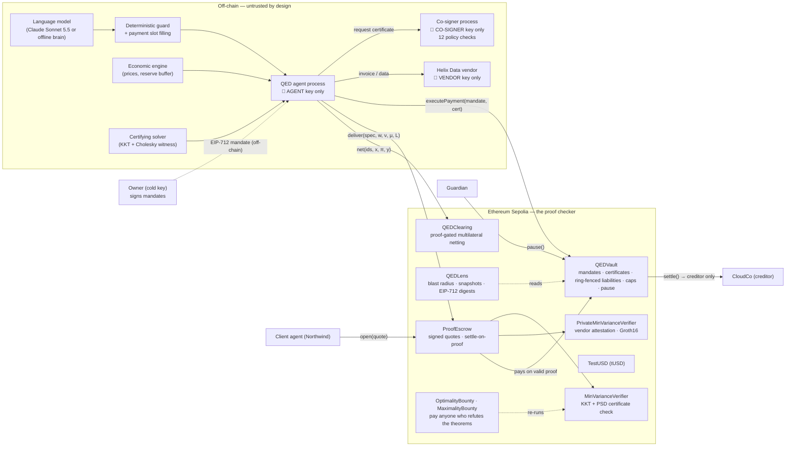
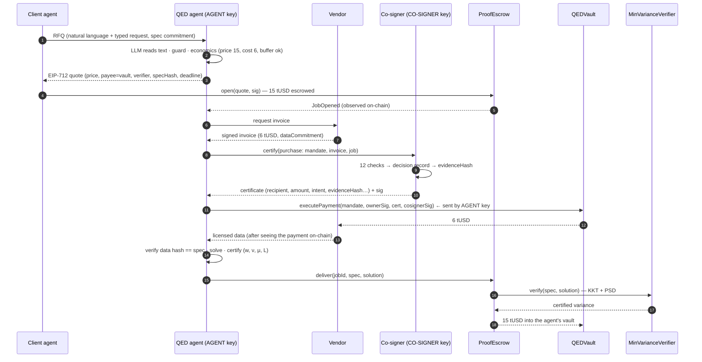
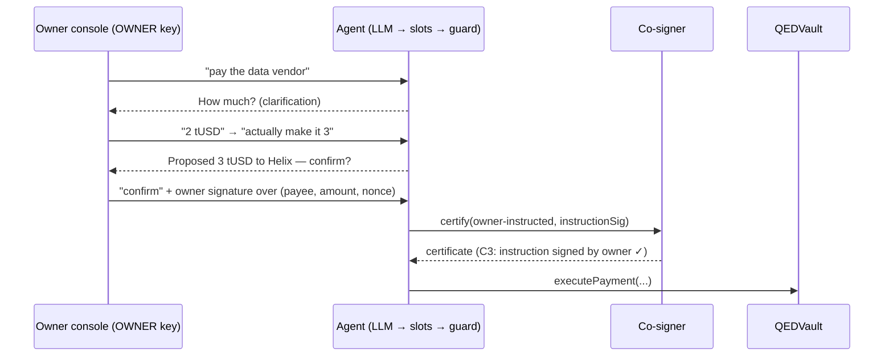
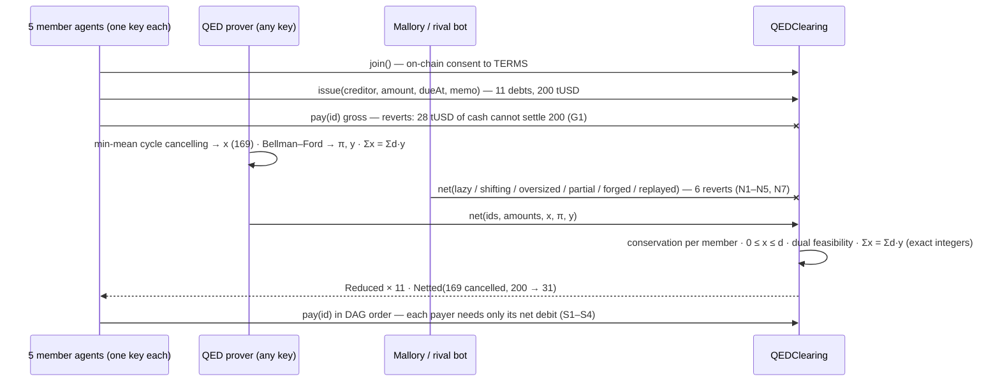
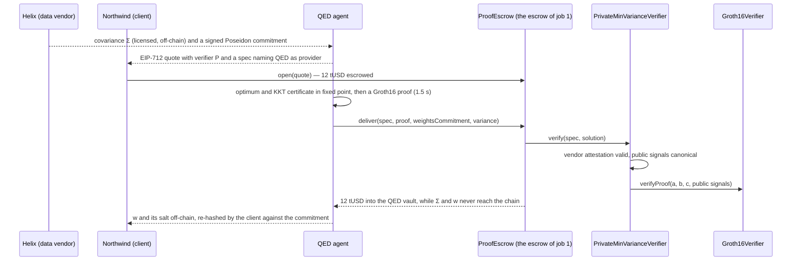
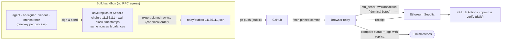

# QED — System Architecture

## 1. One picture

The design rule is a trust gradient: **everything that can be fooled is off-chain and holds at most one key;
everything that decides whether money moves is on-chain and checks proofs.**

## 2. Components

### On-chain (`contracts/src`, Solidity 0.8.26, via-IR, OpenZeppelin 5.1)

| Contract | Size | Responsibility |
|---|---|---|
| `QEDVault` | 9.1 KB | Treasury of one agent. Verifies owner mandates (EIP-712, EOA or ERC-1271) and co-signer certificates; enforces payee scope, per-payment/period/lifetime caps, a global 24 h window cap, the solvency invariant, single-use intents, epochs, pause. Holds ring-fenced liabilities that only creditors can be paid from. |
| `QEDLens` | 5.1 KB | Stateless views: `blastRadius(vault, horizon)`, `snapshot(vault)`, EIP-712 hashes/digests. Separate so the enforcement contract stays small (Sepolia's state-creation pricing + EIP-7825's 2²⁴ gas cap bound deployable code size). |
| `ProofEscrow` | 5.6 KB | Agent-to-agent work. Provider-signed EIP-712 quote binds price, payee, client, verifier, problem hash, deadline. `deliver` pays iff `IProofVerifier.verify(spec, solution)` succeeds. Refund after deadline. |
| `MinVarianceVerifier` | 2.4 KB | `IProofVerifier` for long-only minimum-variance portfolios: exact-integer KKT + PSD certificate check (docs/ALGORITHMS.md §4). |
| `QEDClearing` | 5.3 KB | Proof-gated multilateral netting for agent economies. Members `join` (on-chain consent to the terms) and record debts as debtors; `net` is permissionless and executes only if net positions are unchanged, nothing is created, the snapshot is complete and current, and an exact LP-duality certificate proves the netting maximal (ALGORITHMS §9). |
| `PrivateMinVarianceVerifier` + `Groth16Verifier` | 2.1 KB + 1.6 KB | `IProofVerifier` for the same problem **in zero knowledge**: checks the data vendor's attestation of a Poseidon commitment, binds the proof to its provider, then verifies a Groth16 proof of the KKT certificate (ALGORITHMS §10). Usable by the deployed `ProofEscrow` unchanged. |
| `OptimalityBounty`, `MaximalityBounty` | 2.0 KB, 2.6 KB | Standing offers that pay their whole balance to anyone who refutes, on-chain, Theorem 4.4 (via the deployed verifier) or the netting maximality theorem (ALGORITHMS §11). No owner, no withdrawal. |
| `TestUSD` | 2.1 KB | Valueless 6-decimal test token with a public 1 000 tUSD/day faucet for reviewers. |

### Off-chain (`agent/`, TypeScript, viem)

| Module | Process / key | Responsibility |
|---|---|---|
| `roles/agent.ts` | agent process · AGENT key | RFQ handling, autonomous job fulfilment (watches `JobOpened`), owner console, decision records |
| `roles/cosigner.ts` | co-signer process · CO-SIGNER key | 12-check policy engine; writes & hashes decision records; signs certificates |
| `roles/vendor.ts` | vendor process · VENDOR key | catalog, signed invoices, releases data only after seeing the on-chain payment |
| `brain/*` | inside agent | `AnthropicBrain` (live LLM) / `OfflineBrain`; `slots.ts` deterministic payment slot filling; `guard.ts` deterministic security layer; `evaluate.ts` red-team scoring |
| `engine/minvar.ts` | inside agent | certifying solver + bit-exact TS checker |
| `engine/economics.ts` | inside agent | pricing and acceptance rules |
| `engine/privateMinvar.ts` | inside agent | fixed-point witness, Poseidon commitments, Groth16 prover (snarkjs), bit-exact mirror of every circuit constraint |
| `circuits/private_minvar.circom` | build time | the zero-knowledge statement (12,569 constraints); `circuits/setup.sh` runs the two-phase trusted setup |
| `engine/netting.ts` | inside agent | certifying netting solver (min-mean cycle cancelling + Bellman–Ford dual), bit-exact checker, naive greedy rival |
| `scripts/clearing.ts` | orchestrator (5 member agents, QED prover, Mallory) | runs the clearing economy: gridlock, attacks, proven netting, settlement |
| `scripts/private.ts` | orchestrator (Helix, Northwind, QED, Atlas, Mallory) | runs the private economy and the bounty challenges on the main run's escrow and verifier |
| `scripts/live.ts` | orchestrator (owner, client, guardian, Mallory) | deploys and runs the whole economy, records evidence |
| `scripts/verify.ts` | anyone · no keys | independent re-derivation of every on-chain claim |

## 3. Key lifecycle flows

### 3.1 Paid work, end to end (Outcomes 1 & 2)

### 3.2 Owner conversation → signed confirmation → payment

### 3.3 Certified clearing of an agent economy (QEDClearing)

### 3.4 Private work, paid on a zero-knowledge proof (QED Private)

### 3.5 Defence in depth against a manipulated agent

| Layer | Who | Stops |
|---|---|---|
| 1. Guard | deterministic code in the agent | injection, scams, secret requests, escalation — before any proposal |
| 2. Co-signer | independent process & key | anything not justified by a signed invoice + funded job, or not owner-signed |
| 3. Vault | Ethereum | everything outside the owner's mandate, caps, solvency, replay, pause — even if layers 1 and 2 are both compromised |

## 4. Data & evidence model

* **Mandate** (owner-signed, off-chain): scope of authority. Hash is referenced by every certificate.
* **Certificate** (co-signer-signed): exact payment terms + `evidenceHash` of the decision record.
* **Decision record** (`evidence/…/records/cosigner/<hash>.json`): canonical JSON of inputs, treasury snapshot,
  all 12 checks and verdict. `keccak256(canonical(core)) == evidenceHash` on-chain.
* **Agent records** (`records/agent/*`): RFQ evaluations, fulfilment (solution + certificate stats), every chat turn
  with the LLM transcript.
* **Manifest** (`evidence/ethereum-sepolia/manifest.json`): every step, actor, expected outcome, tx hash, decoded
  events / errors, mapped to Outcomes O1–O4.

## 5. Execution & deployment topology

The transaction hashes in the evidence are the public-chain hashes (identical signed bytes). The relay compares each
public receipt with the replica (status and every log, excluding Sepolia's EIP-7708 system log for plain ETH
transfers), and the independent verifier re-derives every claim from a public RPC. A reviewer with RPC access
can also run the economy directly against Sepolia: `RPC_URL=… CHAIN_ID=11155111 GAS_LIMIT=16700000 npm run live`.

## 6. Gas profile on Sepolia (canonical run)

| Operation | Gas used |
|---|---|
| Deploy QEDVault | 14 963 244 |
| Deploy ProofEscrow | 9 051 450 |
| Deploy QEDLens | 8 026 770 |
| Deploy MinVarianceVerifier | 3 847 926 |
| Deploy TestUSD | 3 716 239 |
| Deploy QEDClearing | 8 579 134 |
| `QEDClearing.net` — 11 obligations, 5 members, certificate checked (N6) | 550 826 |
| `QEDClearing.issue` (first / later) | 795 367 / ≈ 501 600 |
| Deploy Groth16Verifier / PrivateMinVarianceVerifier | see `docs/EVIDENCE.md` (Run 3) |
| `ProofEscrow.deliver` with a zero-knowledge proof (attestation + Groth16) | see `docs/EVIDENCE.md` (Run 3, Z3) |

Sepolia's current schedule prices state creation far above the classic EVM (a plain ETH transfer to a fresh
account costs ≈ 205 k gas); local replicas don't model this, so all broadcasts use an explicit 16.7 M gas limit
(only gas used is charged).
