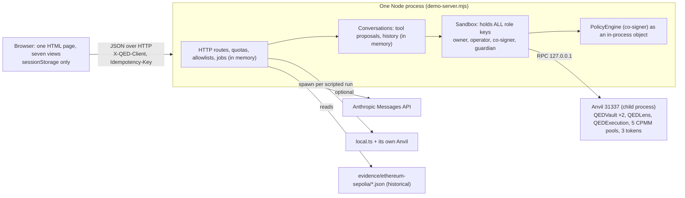
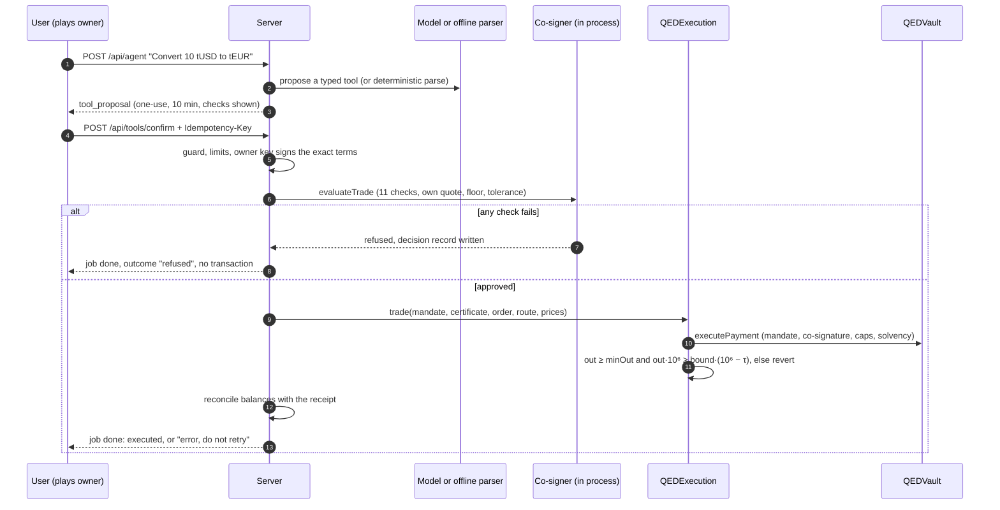

# Existing-QED feature baseline: release `qed-20261023-health-gate-v3`

Agent: qed-systems-architect (Claude Code) · Source read 2026-11-18, completed 2026-11-19 · Status: draft for the orchestrator
Purpose: the evidence-cited inventory of what exists today, so the rebuilt local application drops nothing by
accident (R5 mandate §1, `docs/mandate/20261118-R5-live-wallet-redesign-mandate.md:27-28`).

## Method, limits and how to read this

- **Read-only.** I read files in `~/qed-approved-release` and wrote nothing there. Nothing was
  built, installed, run or tested. No call was made to the public URL, Railway, GitHub, any RPC or any contract.
- **One integrity check.** `docs/shared/SOURCE_OF_TRUTH.md:4` says to re-hash before relying on a file. I hashed the
  201 files listed in the saved manifest `review/release-verification/release-manifest.json` with my own script
  (kept outside the release; it executes no release code). Result: digest
  `e4b2f571cbad67da357c268dffad044c118f10cdc4461091ef4ecca876914c6f`, 0 changed, 0 missing, 0 extra files under the
  runtime paths. The four document hashes in `SOURCE_OF_TRUTH.md:24-27` also match.
- **What "Verified" means here.** Unless a row says otherwise, every statement is **Verified by reading the cited
  lines on 18 Nov 2026**. It means "the source says this", not "I watched it run". Rows marked **Hypothesis**,
  **Conflict** or **Refuted** say so. Saved logs from October are historical evidence, not proof of present
  behaviour (`SOURCE_OF_TRUTH.md:36-37`).
- **Workspace graph.** For workspace questions I ran `graphify query` and `graphify section` first. The graph does
  not cover the release folder.
- **Automated browsing.** None (protocol §6 does not apply).

### Path aliases used in citations

`R/` is `~/qed-approved-release/`. A citation such as `SB:395-477` means file `SB`, lines 395–477.

| Alias | File |
|---|---|
| UI | `R/product/index.html` (the seven-view product page) |
| DS | `R/agent/scripts/demo-server.mjs` (HTTP server) |
| SB | `R/agent/src/sandbox.ts` (the live sandbox chain and its operations) |
| WB | `R/agent/src/workbench.ts` (configurable scenarios) |
| CV | `R/agent/scripts/conversation.mjs` (per-tab conversation, proposals, model tool use) |
| AC | `R/agent/scripts/agent-chat.mjs` (fallback chat, explanations) |
| CP | `R/agent/scripts/capabilities.mjs` (typed tool registry) |
| KN | `R/agent/scripts/knowledge.mjs` · AL `R/agent/scripts/amount-lexing.mjs` · PS `R/agent/scripts/public-safety.mjs` |
| RD | `R/agent/scripts/readiness.mjs` · RI `R/agent/scripts/release-identity.mjs` · ST `R/agent/scripts/submission-tracker.mjs` |
| CS | `R/agent/src/roles/cosigner.ts` · TR `R/agent/src/roles/treasury.ts` · TD `R/agent/src/roles/trader.ts` |
| AG | `R/agent/src/roles/agent.ts` · VD `R/agent/src/roles/vendor.ts` · ADV `R/agent/src/roles/adversary.ts` |
| GD | `R/agent/src/brain/guard.ts` · AN `…/brain/anthropic.ts` · OF `…/brain/offline.ts` · SL `…/brain/slots.ts` · BI `…/brain/index.ts` |
| EX | `R/agent/src/engine/execution.ts` · EC `…/engine/economics.ts` · ES `…/engine/executionScenario.ts` |
| MVT | `R/agent/src/engine/minvar.ts` · NT `…/engine/netting.ts` · PM `…/engine/privateMinvar.ts` · RM `…/engine/riskModel.ts` |
| EP | `R/agent/src/protocol/eip712.ts` · RC `R/agent/src/protocol/records.ts` |
| CH | `R/agent/src/chain.ts` · CF `R/agent/src/config.ts` · SC `R/agent/src/sandboxClock.ts` · SVC `R/agent/src/bin/services.ts` |
| LIVE | `R/agent/scripts/live.ts` · EXE `R/agent/scripts/execute.ts` · PP `R/agent/scripts/policy-phases.ts` · CLR `R/agent/scripts/clearing.ts` · PRV `R/agent/scripts/private.ts` · LOC `R/agent/scripts/local.ts` |
| QV | `R/contracts/src/QEDVault.sol` · QE `…/QEDExecution.sol` · QP `…/QEDTreasuryPolicy.sol` · QL `…/QEDLens.sol` |
| PE | `R/contracts/src/ProofEscrow.sol` · QC `…/QEDClearing.sol` · MV `…/verifiers/MinVarianceVerifier.sol` · PV `…/verifiers/PrivateMinVarianceVerifier.sol` |
| OB / MB / EB | `R/contracts/src/bounties/OptimalityBounty.sol` / `MaximalityBounty.sol` / `ExecutionBounty.sol` |
| PL / TU / TT | `R/contracts/src/venues/CPMMPool.sol` / `R/contracts/src/TestUSD.sol` / `R/contracts/src/venues/TestToken.sol` |
| T:… | a test file under `R/agent/test/` or `R/contracts/test/`, named in full where used |
| DOC:… | a document under `R/docs/`, named in full where used |

---

## 0. Headline findings

1. **The release is much wider than the one-paragraph summary in `docs/shared/QED_CONTEXT.md:41-47`.** Besides
   mandates, co-signed orders, the best-execution bound and the treasury policy, it contains: paid work that
   settles on an on-chain optimality proof (`PE`, `MV`), a zero-knowledge version of that proof (`PV`, Groth16),
   proof-gated multilateral debt clearing (`QC`), three self-adjudicating bounties (`OB`, `MB`, `EB`), ring-fenced
   liabilities with a guardian pause, an on-chain worst-case loss figure (`QL`), a six-attack Security Lab, six
   configurable scenarios, four scripted economies, a red-team corpus, a historical-evidence browser and a static
   proof ledger. The earlier architecture note says "Release code was not read"
   (`docs/research/qed-systems-architect/20261117-r4-architecture.md:87-88`); this document is the first code-level
   inventory in the workspace. **Verified.**
2. **Approved source equals deployed source, as far as saved evidence can show.** The folder hashes to the digest
   the 25 Oct production smoke test recorded (`R/review/release-verification/production-smoke.txt:3-7`).
   Present-day production behaviour is **not verified** (no agent may query it).
3. **Depth differs sharply by capability.** Only conversion, the standing policy, mandate signing, six attacks and
   read-only chat act on the shared live treasury. Payments, liabilities, escrow, clearing and the zero-knowledge
   job run only as isolated scenarios or scripts. The table below is the honest starting point for parity.
4. **Several owner-facing claims are stronger than the hosted code** (section 5): the co-signer is not a separate
   process in the live app; the live policy is not enforced on-chain; "τ = 1 ppm" is adaptive up to 100 ppm; the
   "400 model calls" cap is not global; chat does not stay in the tab.
5. **The largest structural weaknesses for a real wallet** (section 6): the server holds the owner key and any
   visitor can "confirm as owner"; signing a new mandate does not revoke the old one; nothing is persisted;
   autonomy is a button the user presses; there is no external price reference.

### 0.1 Where each capability actually runs

"Live" = acts on the one shared sandbox treasury through the app. "Scenario" = a confirmed, isolated run with fresh
contracts and fresh valueless tokens (`WB:22-35`). "Script" = a fixed scripted economy started from the Economies
view (`DS:32-37`). "Sepolia" = historical public-testnet evidence, read-only.

| Capability | Live | Scenario | Script | Sepolia (historical) | Evidence |
|---|---|---|---|---|---|
| Certified conversion tUSD → tEUR | yes | — | `execution` | Run 4 | SB:395-477; EXE:215-228 |
| Standing treasury policy (co-signer enforced) | yes, user presses each tick | — | `execution` | Run 4c | SB:480-530; PP:38-116 |
| Policy as a contract (`QEDTreasuryPolicy`) | **no** | no | `execution`, phase 7 | Run 4d | SB:23,197-230; EXE:321-328; PP:136-220 |
| Owner signs a new mandate | yes (per-conversion cap only) | — | fixed | Runs 1, 4 | SB:294-304 |
| Attacks from a genuine co-signed order | 6 kinds | — | 8 + 4 | 15 | SB:79-86,533-585; EXE:240-305 |
| Payment to an approved payee | **no** | `payment` (≤ 10 tUSD to CloudCo) | `economy` | Run 1 | WB:127-142; LIVE:214-225 |
| Ring-fenced liability, pause, settle | display only | `liability` | `economy`, `execution` | Run 1 | WB:143-153; LIVE:144,390-396 |
| Paid work: quote → escrow → proof → settlement | no | `portfolio` | `economy` | Run 1 | WB:52-99; LIVE:186-235 |
| Zero-knowledge paid work | no | `private_portfolio` | `privacy` | Run 3 | WB:64-77; PRV:148-202 |
| Multilateral clearing | no | `clearing` | `clearing` | Run 2 | WB:100-126; CLR:76-156 |
| Bounty challenges | no | `execution_bounty`; inside `portfolio` and `clearing` | `privacy` | Runs 3, 4b | WB:37-49,92-98,116-119 |
| RFQ pricing, vendor purchase, owner chat payment | no | no | `economy` | Run 1 | AG:131-304; LIVE:186-273 |
| Honeypot vault with published keys | no | no | `economy` | Run 1 | LIVE:358-375 |
| Read-only quote, limit check, explanations | yes | — | — | — | CV:17-23; AC:155-199 |
| Historical evidence browser | yes (read-only) | — | — | — | DS:197-211; UI:1467-1481 |

On the public deployment only the `execution` script is allowed by default (`PS:5-8`; `DS:65`;
`R/review/release-verification/production-smoke.txt:11-12`).

### 0.2 Runtime topology of the hosted app



Evidence: DS:7-21,180,245-252; SB:98-116,128,151,197-234; CV:69-76.

### 0.3 The primary workflow in one picture



Evidence: CV:45-101; DS:367-387; SB:395-477; CS:236-329; QE:179-223; QV:257-285.

---

## 1. User-facing features, by UI view

The product is one page with seven hash-routed views: Overview, Agent, Treasury, Execution, Security Lab, Economies,
Evidence (`UI:859-865`, `UI:1133`; asserted by `T:agent/test/ui-contract.test.mjs:11,19-25`).

### 1.0 Shell (present in every view)

| Element | What the user sees or can do | States and exact wording | Evidence |
|---|---|---|---|
| Side navigation | Seven links. An unknown hash shows Overview. The current link carries `aria-current="page"`; on navigation focus moves to the view heading and the page scrolls to top | Title becomes "QED — " plus the view heading | UI:858-866,1134-1146 |
| Brand and seal | Brand caption "Proof-carrying autonomy". Seal: "Intelligence proposes. Proof permits. Owner-defined authority. Independently enforced." | static | UI:857,867 |
| Standing disclaimer | "**Testnet only.** Valueless tokens on a disposable chain and on Ethereum Sepolia. Not audited; not for real funds." | static | UI:868 |
| Chain chip (top bar) | Chain health | "Connecting…" → "Sandbox chain live · block N" / "Sandbox chain starting…" / "Sandbox chain unavailable" / "Backend unreachable" | UI:874,1180-1193,1197 |
| AI chip (top bar) | Which engine answers | "Claude connected · actual response observed" / "Claude configured · not yet verified" / "AI offline · deterministic parser" / "AI status unavailable" | UI:875,1186-1189,1192 |
| Asset chip | "Valueless test assets" (tooltip: "Every amount here is a valueless test token") | static | UI:877 |
| Per-view chain badge | Badge in Agent, Treasury, Execution, Lab | CONNECTING → CHAIN LIVE / CHAIN STARTING / CHAIN UNAVAILABLE | UI:922,973,1005,1027,1173-1179 |
| Footer | "QED is a testnet prototype for FinTechathon 2026. The live sandbox is a shared, disposable local chain with development keys held by this server; the historical evidence is on Ethereum Sepolia. Nothing here is audited or suitable for real funds." plus a source link | static | UI:1076 |
| Refresh | State re-read every 6 s while the tab is visible and no job runs | — | UI:1485 |
| Busy lock | While a job runs every action button is disabled | — | UI:1349 |
| Toast | Short status line, 4.2 s | — | UI:1118 |
| Guest identity | A random UUID per tab in `sessionStorage`, sent as `X-QED-Client`. No account, no login | — | UI:1128-1130,1121; DS:163-166 |

### 1.1 Overview

| Control or panel | What it does | Outputs and states | Evidence |
|---|---|---|---|
| Hero | Headline "AI proposes. *Proof decides.*" Lead: "Tell the AI what you want your treasury to do. QED checks your owner-signed limits, has an independent co-signer verify the action, then proves the execution quality on-chain. You stay in control; the agent cannot move funds on its own." Buttons: "Try a real conversion →" (Agent), "Test the safeguards" (Lab), "Explore the evidence ↗" (Evidence) | static | UI:885-892 |
| Four-step flow | "1 · Proposes — AI agent: Reads your instruction, plans the route, builds the proof. Holds no key that can pay alone." "2 · Re-derives — Co-signer: Separate process and key. Re-quotes from the chain and signs only what the owner allowed." "3 · Enforces — Contracts: Mandate, caps, ring-fenced liabilities, and the best-execution inequality. A worse route reverts." "4 · Verifies — Anyone: Receipts, bounds and proofs can be re-derived from the chain without trusting QED." | static. Step 2's "Separate process" is a **Conflict** for the live app (section 5, X-04) | UI:893-898 |
| Live sandbox card | Free tEUR in the reserve; treasury balance and "spendable today"; mandate version and per-conversion cap; chain and block; AI engine; activity count. Links to Agent and Treasury. Note: "A shared, disposable local chain running the real QED contracts. Each action here sends a real transaction and waits for its receipt." | Before the first read every value is "—". Activity reads "none yet" or "N events · M transactions" | UI:900-912,1198-1203 |
| Capabilities grid | Nine cards, each a link, each badged LIVE ("your inputs, new transactions"), SCRIPTED ("fixed scenario, new transactions") or HISTORICAL ("Sepolia receipts") | LIVE: Certified token conversion; Autonomous treasury policy; Signed authority; Security lab; Grounded agent chat. SCRIPTED: Paid analysis, escrow and portfolio optimality; Certified multilateral clearing; Zero-knowledge optimality. HISTORICAL: 196 Sepolia transactions | UI:914-916,1149-1162 |

### 1.2 Agent

| Control or panel | What the user can do | Inputs | Outputs and states (exact wording) | Evidence |
|---|---|---|---|---|
| Header | — | — | "Your intent. Your authority." "Ask a question or propose a conversion. Review the details before you authorize execution." | UI:921 |
| Chat heading | See whose workspace this is; clear the chat | "Clear chat" button | "QED treasury agent — Guest workspace · private chat stays in this tab" (a **Conflict**, X-20). Clearing is refused while an operation is pending ("Wait for the current operation before clearing chat."); on success "This tab's chat was cleared. Sandbox transactions are unaffected." | UI:925,1376-1380; DS:361 |
| Workflow guide | — | — | "01 Instruct · 02 Review · 03 Confirm · 04 Inspect proof" | UI:926 |
| Welcome state (empty chat) | Start with one click | Four shortcuts: "Convert 10 tUSD" (execute), "Calculate a route" (read-only quote of 12.5 tUSD), "Test the limits" ("Would converting 80 tUSD violate my mandate?"), "Advanced economies" (link to Economies) | "PROPOSALS ARE NOT PAYMENTS". "Ask freely. *Move only with proof.*" "Every state-changing action remains yours to confirm, and every financial result must be verified." Trust line: "01 AI proposes → 02 Owner confirms → 03 Contract verifies" | UI:1356-1358 |
| Suggestions row | Send an example | 13 fixed prompts (quote, pay CloudCo, policy tick, convert, maximum, limit check, five explanations, attacker question, limitations) | Selecting one sends it | UI:1353,1381-1382 |
| Composer | Type a question or instruction | Text, 2–2,000 characters; Enter sends, Shift+Enter breaks the line | Button reads "Thinking…" while waiting; the reply fills its own placeholder so answers stay next to their question. Note under the box: "Test assets only · Confirm each proposal before execution · Chat stays in this tab and clears when the tab closes. On-chain sandbox activity is shared." | UI:931-936,1383-1397; DS:356 |
| Assistant message | Read the answer; follow a deep link | — | Text, the engine that answered (for example "anthropic:claude-sonnet-5-5 (live response)", "offline-deterministic", "deterministic limit check (chain state)"), a "Refused" badge for refusals, and an action link to Treasury, Economies, Lab, Execution or Evidence for knowledge topics | UI:1370-1372; AC:193-198 |
| Tool-proposal card | Review exact terms, then confirm or dismiss | "Confirm exact terms & execute" (or "Submit for refusal" when limits are broken); "Dismiss" | Header "TREASURY PROPOSAL" or "ISOLATED SCENARIO". Badge "Not executed" or "Outside limits". Terms listed field by field. Note: "Current owner mandate and independent co-signer checks apply." or "Fresh test assets and development signers. Main treasury is not spent." "Proposal expires after 10 minutes." After a click: "Submission requested; awaiting acceptance. Follow the execution status." then "Confirmed · 0x… · block N", "Refused: …", "Execution error; inspect the status panel." or "Dismissed. Nothing was sent." | UI:1366-1368,1398-1411 |
| Limit-check card | See which signed limits pass | — | "Limit check (nothing sent)", amount, badge "Within signed limits" or "Breaks signed limits", one line per rule with ✓ or ✕ | UI:1361-1364; AC:155-158 |
| Epoch note | Learn that the shared chain restarted | — | "The shared sandbox restarted or reset. Earlier messages may reference a prior disposable chain; current balances and on-chain history are authoritative." | UI:927,1165-1172 |
| Execution trail | Follow one operation step by step | — | Idle: "Awaiting your instruction — No transaction has been submitted. Once you confirm exact terms, authorization, proof checks and the mined receipt appear here." Conversion steps: AI interprets the instruction → Signed mandate and vault limits → Owner confirms the exact conversion → Independent co-signer re-derives and signs → Agent routes and builds the proof → Preflight & broadcast → Mined and checked on-chain → Balances reconciled. Policy tick and attack have their own step lists. A refused or reverted step stops the list; later steps read "Not reached" | UI:940-944,1237-1254; SB:413-476 |
| Job badge and result | Know the outcome precisely | Buttons when status is uncertain: "Check status again", "Find original operation", "Check original job", "Dismiss unresolved reference" | Idle; Preparing; Still running ("The operation has not finished. Its reference remains in this tab. Check the same job again rather than submitting a duplicate."); Confirmed on-chain; Refused — no transaction; Mined as a revert; No action needed; Signed in sandbox · no chain transaction; Receipt not verified; Execution error (with "Transaction mined as a revert", "Broadcast acknowledged; final outcome requires inspection", "Preflight or submission failed; broadcast not confirmed" or "Operation failed before completion"); Connection interrupted ("Status unavailable — do not resubmit"); Execution status unknown ("Execution may already be underway — do not submit again"); Request refused ("The request was not accepted"); Unresolved submission; "Reference dismissed · outcome unverified". A receipt block shows hash, status, block and "Disposable Anvil sandbox (31337), not Sepolia"; scenarios add "Inspect proof & exact balance reconciliation" | UI:1255-1288,1316-1348,1487-1539 |
| Certificate-window error | Understand one specific revert | — | For `0x4205b2b5` / `CertificateNotActive`: "The vault rejected a co-signer certificate because the current chain timestamp was outside its signed validity window. No successful payment is confirmed. Inspect the timestamps and refresh the authorization before trying again." | UI:1257-1261 |
| Live balances | Read four numbers | — | tUSD free in treasury; tEUR in euro reserve; max per conversion (signed); tUSD left today | UI:946-954,1204-1205 |
| Explore rail and Proof library | Jump to a preset scenario form or to the Lab | Four links (portfolio, clearing, private portfolio, Security Lab) | "More than a wallet." "Beyond a wallet. An entire verifiable economy." "Configurable scenarios use valueless local assets and require confirmation before execution." | UI:955-967,1427-1432 |

**Chat reply kinds** (what `/api/agent` returns and how each is shown):

| Kind | When | Wording or content | Evidence |
|---|---|---|---|
| refusal (guard) | The raw message matches a dangerous detector: privilege escalation, data extraction, prompt injection, induced transfer | "Request refused (<flags>). No tool ran and nothing was signed. Owner permissions and secrets cannot be changed through chat." Engine "deterministic security guard" | CV:47-48; GD:15-36 |
| cancel | "cancel", "never mind", "dismiss", "stop" | "Unsubmitted proposals in this tab were cancelled. Already accepted transactions are unaffected." | CV:49 |
| chat consent refused | "yes", "confirm", "go ahead", "do it", "execute it" | "Use the confirmation button on the exact proposal. A chat message cannot replace financial consent." | CV:50 |
| correction | "Actually make it 3.5" while a proposal is pending | The old proposal is deleted and a new one prepared; a bad number yields "Give one positive exact amount with at most six decimals. Nothing was changed." | CV:52-57 |
| quote | "quote / estimate / preview" with a tUSD amount | "Indicative quote at block N: X tUSD → Y tEUR, bound B. Nothing was signed or sent. Execution rechecks the market and all authorizations." or "This amount exceeds current signed limits. No quote or transaction was created." | CV:20-23,59-60; SB:381-388 |
| check | A hypothetical with an amount ("Would 80 tUSD violate…") | "Yes: … is within every signed limit right now. Nothing has been sent; ask me to convert it and confirm as the owner to execute." or "No: converting … would be refused before any signature — … The AI cannot raise these limits." | AC:113-117,155-158 |
| maximum | "maximum / largest / most" without an amount | "The largest amount permitted by the current per-conversion cap, free treasury funds and remaining daily allowance is X tUSD. This is an authorization ceiling, not a guaranteed executable quote: …" | AC:127-144 |
| tool_proposal | An action request | Card as above; `execution: "awaiting owner confirmation"` | CV:25-34,91 |
| plan | The model proposes two or three tools | "Review each action separately. Nothing runs automatically; later steps are revalidated against live state." Each tool is a separate card | CV:80-93; UI:1393 |
| answer | A question | Model prose grounded in sandbox state, or the deterministic explainer; "This is a question, so no financial action was proposed…" when the model tries to act on a question | CV:83,94; AC:186-201 |
| clarify | Missing, ambiguous or malformed amount | "Use one positive, unsigned amount in tUSD (for example, Convert 10 tUSD to tEUR). Malformed, negative, or explicitly signed amounts are not accepted. …" | AC:118,162-166 |
| unavailable | Sandbox not ready | "The sandbox chain is still starting. Try again in a few seconds." or "The sandbox chain is unavailable right now; historical Sepolia evidence is still available under Evidence." | AC:102 |
| HTTP errors | Limits and failures | 429 "Question limit reached for this connection (60 per hour)."; 422 "Ask something between 2 and 2,000 characters."; 503 "The agent could not answer: … No transaction was attempted." (this 503 also carries user errors such as "Sign a standing policy in Treasury first. The agent cannot create one for you.") | DS:353-359; CV:24 |

### 1.3 Treasury

| Control or panel | What the user can do | Inputs | Outputs and states | Evidence |
|---|---|---|---|---|
| Header | — | — | "Capital, with clear boundaries." "Read live balances. Sign spending limits. Set the reserve target your agent works toward." | UI:972 |
| Four KPIs | Read balances | — | Treasury (QEDVault): balance, free, ring-fenced. Euro reserve (QEDVault): balance, free, "agent cannot spend from it". Spent today and what is left in the window. "Worst case if keys are stolen — 24 h blast radius, computed on-chain" | UI:974,1206-1207; SB:348-349; QL:41-60 |
| Owner's signed mandate | Read the limits; sign a new per-conversion limit | Number 1–100 tUSD, up to 6 decimals; button "Sign as sandbox owner" | Table: Per conversion; Per day; In total; Payees ("QEDExecution (conversion module) · Euro reserve · CloudCo"); Co-signature "required on every payment"; Valid until. Chip shows version and mandate hash. Result is a job whose outcome reads "Signed in sandbox · no chain transaction" and a history line "Owner signed mandate vN: ≤ X tUSD per conversion (was Y), ≤ 100 a day, payees unchanged". Out-of-range: "The sandbox owner may sign a per-conversion limit between 1 and 100 tUSD." Note: "The owner key in this sandbox is a development key held by the demo server, so you can play the owner. In production the owner signs in their own wallet. The AI can never sign a mandate, and the vault's on-chain daily cap (100 tUSD) still applies." | UI:977-984,1208-1209,1414; DS:418-422; SB:294-304,350 |
| Standing treasury policy | Sign a reserve target; run ticks | Target 2–80 tEUR; "Sign policy"; "Run one tick"; "Run until the target is met" (up to six ticks from the browser) | Text: "The owner signs a target once. Each tick the agent decides how much to convert — X = min(need, market impact, policy cap, mandate cap, free funds) — the co-signer re-derives X, and the agent stops when the target is met." Badge "Not signed" / "Short N tEUR" / "Target met". Meter of free versus target, tick count, "Tranches 2.00–25.00 tUSD · at most 1.5% execution cost". Empty: "No standing policy yet. Sign one to let the agent act on its own." Without a policy the tick buttons toast "Sign a standing policy first." Ticks open the Agent view to show the trail | UI:987-994,1210-1214,1415-1418; DS:423-427; SB:307-318,480-530 |
| Activity table | Read shared history, newest first | — | Columns #, Event, Outcome, Transaction. Outcomes: Executed; Refused · no tx; Reverted on-chain; No action; Error; "Signed / recorded (off-chain)". Empty: "Nothing yet. Every conversion, refusal and attack appears here with its transaction." Caption "shared by everyone using this sandbox". Last 40 entries | UI:997-999,1215-1216; SB:354 |
| Reset sandbox | Return the shared chain to its initial state | Two clicks within 3 s ("Confirm shared reset") | On success the tab's chat is cleared and a toast reads "Sandbox reset. This tab's chat has been cleared." History then holds one line: "Sandbox reset to its initial state: 100 tUSD in the treasury, empty euro reserve, mandate v1 (≤ 25 tUSD per conversion)" | UI:973,1419-1420; DS:428; SB:251-269 |

### 1.4 Execution

| Control or panel | Content | States | Evidence |
|---|---|---|---|
| Header and proof intro | "A route is chosen. Its quality is proven." "A mathematical ceiling. An independently checked result. The contract compares actual output with a certified upper bound. The scope is the five owner-approved venues, with a tolerance of one part per million." | static; the tolerance sentence is a **Conflict** (X-05) | UI:1005-1006 |
| Verification rule | The formula for B(ν) and: "The contract recomputes B from live reserves, rounding every step upward, and accepts only if out·10⁶ ≥ B·(10⁶ − τ), τ = 1 ppm. Any ν is a valid bound, so a proof cannot be forged; at the right ν the bound meets the optimum. Scope: the five owner-approved venues, not all of DeFi." | static | UI:1009-1012 |
| Last trade | Instruction (canonical text, never a guest's free text), in, out, on-chain bound, gap in ppm with "(accepted if ≤ τ = N ppm)", co-signed floor, number of co-signer checks, transaction hash, block, gas, "Decided by" engine | Empty: "No trade yet in this sandbox. Convert something from the Agent screen." | UI:1014,1226-1227; SB:471-472 |
| Route and proof prices | One row per hop (venue, tokens, in, out); the price vector ν per token; solver sweeps | Empty "—" | UI:1017,1229-1230; SB:588-599 |
| Simpler routers | Bars showing the shortfall in bps of "direct-optimal", "equal-split" and "single-venue" against the certified route, on the same reserves | Empty "—" | UI:1018,1231-1232; TD:78-83 |
| Venues table | The five owner-approved venues with fee and live reserves | — | UI:1020-1021,1224; ES:22-28 |

### 1.5 Security Lab

| Control or panel | What the user can do | Outputs and states | Evidence |
|---|---|---|---|
| Header | — | "Challenge the agent. Inspect the defence." "Each attack starts from a genuine order the owner approved and the co-signer signed. The malicious transaction is mined with a fixed gas limit, so you get a real reverted receipt, not a simulation." | UI:1026-1027 |
| Six attack cards | "Launch on-chain" for one of: route over the direct pools only; skim 5% of one leg; "forged proof" prices; everything through one pool; redirect the output to Mallory; replay the order without the agent key | Each card names the expected error and the defending layer: `NotBestExecution` ×4, `OrderMismatch`, `NotOperator`. The run opens the Agent trail: Genuine co-signed order → Malicious transaction built (with what it would have delivered and the loss in bps) → "Mined and reverted: <error>" ("gas paid by the attacker… Nothing moved."). If the day's window is used up: "The treasury has no room left for a genuine order today; reset the sandbox first." | UI:1028,1219-1220,1421; SB:79-86,533-585 |
| Refusals table | Read past attacks in this sandbox | Attack, on-chain error, transaction. Empty: "No attacks launched yet in this sandbox." Link "48 more, mined on Ethereum Sepolia →" | UI:1029-1030,1217 |

### 1.6 Economies

| Control or panel | What the user can do | Inputs and limits | Outputs and states | Evidence |
|---|---|---|---|---|
| Header | — | — | "More than a conversion. An economy." "Set your own inputs for a proof-backed financial scenario. Review the terms, confirm, then inspect real receipts. These use fresh local test assets, separate from your main treasury." | UI:1035-1036 |
| Workbench form | Choose one of six mechanisms, set inputs, press "Review proposal →" ("Preparation signs nothing.") | Paid portfolio · KKT certificate: escrow price > 0 and ≤ 25 tUSD; 2–6 annual volatilities of 1–100%, zero correlations. Private portfolio · Groth16 proof: the same, exactly six volatilities. Multilateral debt clearing: 2–6 distinct member labels; 1–16 debts "debtor, creditor, tUSD", each ≤ 1,000 tUSD. Delegated payment · CloudCo: ≤ 10 tUSD. Protected liability · CloudCo: ≤ 95 tUSD. Execution bounty challenge: ≤ 25 tUSD | A proposal card appears in the Agent chat and the view switches there. Validation errors show under the form (for example "Use 2–6 annual volatilities between 1 and 100 percent; the private circuit requires exactly six."). After confirmation the trail lists every deployment, receipt and check; the result carries an evidence block. Caution: "Development identities sign only on Anvil. Custom scenarios are synthetic demonstrations, not investment recommendations." | UI:1037-1048,1423-1440; CP:6-48; WB:22-159 |
| Scripted economies | "Run demonstration" on one of four fixed runs | No inputs from the UI (the execution run sends one fixed instruction) | Cards: "Paid work, escrow and portfolio optimality"; "Certified multilateral clearing"; "Zero-knowledge optimality"; "The complete best-execution economy". A run panel shows a badge (Starting / Running · N steps / Complete · N steps / Failed), a step table (id, title, mined / reverted with error name / off-chain, short hash) and a collapsible process log. Errors arrive as toasts: "A local blockchain run is already in progress. Wait for it to complete."; "Demo limit reached: four runs per hour per connection."; "Global public demo budget exhausted; …"; on the public service "This scripted economy is disabled on the public service." (three of the four buttons) | UI:1050-1056,1446-1464; DS:62-84,435-452 |

### 1.7 Evidence

| Control or panel | What the user can do | Outputs and states | Evidence |
|---|---|---|---|
| Header | — | "Don't take our word. Follow the evidence." "Mined earlier by the QED team on the public testnet, before this app existed. These are not transactions your session created. Every claim can be re-derived with `npm run verify`, without keys." | UI:1061-1062 |
| Your execution records | Expand up to 15 completed operations kept in this tab | Label, outcome, summary, time, "Anvil 31337", and the JSON of the transaction, evidence and steps. "These are separate from the historical Sepolia ledger below; a sandbox reset invalidates their live chain context." Empty: "No completed operations in this tab yet. Execute a proposal in Agent to create a local record." | UI:1063,1310-1311,1441-1444 |
| Historical KPIs | Read four figures | "Transactions indexed here" (the count served, with "196 in total across all runs"); "Attacks reverted"; "Contracts verified"; "Independent re-check 244 / 244" | UI:1470-1472; DS:197-211 |
| Transactions table | Filter by text and by run; open a transaction on Etherscan | ID, what it proves, result (success / reverted · error), link. Up to 250 rows. "No match." when the filter is empty. If the index cannot load: "Historical evidence could not be loaded from this demo backend. … No results have been invented." | UI:1064-1069,1467-1481 |
| Verified contracts | Open each contract on Sourcify | Name, address, match | UI:1071-1072,1473 |
| Full proof ledger | Open the static dashboard on GitHub Pages | External link | UI:1067; `R/app/index.html:312-475` |

### 1.8 What the model does and what deterministic code decides

| Step | Who decides | Evidence |
|---|---|---|
| Refuse escalation, secret requests, injection, induced transfers | Code. Regular expressions over the raw message, in English and Chinese, run before any model call; the reply text is fixed | CV:47-48; GD:15-36,98-131 |
| Decide whether a message is a question or an action | Code (regular expressions); the model's attempt to act on a question is discarded | CV:58,83; AC:108-116 |
| Choose which typed tool fits and fill its parameters from free text and recent turns | **Model**, when configured (native tool use, at most three tools, last ten turns of history, current sandbox state in the system prompt) | CV:69-93 |
| Accept the tool arguments | Code. Exact field set, exact decimal strings, ranges, member labels; unknown tools are rejected | CP:18-48 |
| Keep the user's number | Code. The amount in the text must equal the model's amount for a single-tool proposal, or the proposal is not created. At execution the owner's explicit number governs over the model's | CV:85-90; SB:422-426 |
| Read an amount written in words | **Model**, only when the text has no digits; the proposal then shows a canonical instruction for confirmation | AC:146-152,171 |
| Write explanations | **Model** when configured, restricted to a facts object read from the chain plus a fixed mechanism note, at most 110 words; otherwise fixed deterministic text | AC:82-99,53-80; KN:6-47 |
| Interpret the canonical instruction at execution | Model or offline parser, then the guard; a result that is not "pay the euro reserve" is refused | SB:419-430; BI:24-28 |
| Resolve the payee | Code, against the owner-approved payee book only | GD:38-48,133-144 |
| Limits, buffer, daily window | Code and chain state | SB:360-371 |
| Owner confirmation | A signature by the sandbox owner key over the exact terms (server-held key) | SB:438-440; CS:89-90 |
| Co-signer verdict, floor, tolerance | Code (its own quote from chain reserves) | CS:236-329 |
| Route, split, price vector, tranche size | Code (solver and tranche rule) | EX:187-274; TR:105-145 |
| Whether money moves | Contracts | QV:257-285; QE:179-223 |

Model details: default model name `claude-sonnet-5-5` (configurable), Anthropic Messages API, timeouts 20–25 s,
automatic fall-back to the offline parser for a turn with the engine label saying so (CV:73-76,96; AC:17,84-88;
AN:39,60-64; BI:13-20). The model never receives a key (SB:14-15).

### 1.9 Modes the user meets

| Mode | Meaning | Evidence |
|---|---|---|
| LIVE | The one shared sandbox chain; the user's inputs produce new transactions | UI:915; SB:4-12 |
| Isolated scenario | Fresh contracts, tokens and development roles per confirmed run on the same chain; "Main treasury is not spent" | WB:22-35; CV:34 |
| SCRIPTED | A fixed scenario on a fresh chain started as a child process; one at a time | DS:245-280,436 |
| HISTORICAL | Sepolia receipts from 19–20 Oct, read from bundled JSON, "Not generated by your session" | DS:209; DOC:EVIDENCE.md:424 |
| AI live or offline | Claude when a key is set and `QED_OFFLINE` is not 1; otherwise the labelled deterministic parser | BI:24-28; UI:1188 |
| Public bounded or localhost | Public: binds all interfaces, allows only listed scripts, budgets heavy scenarios, health answers 503 until ready. Local: binds 127.0.0.1, all scripts allowed | DS:29-30,65,377-383; RD:8-21 |
| Idle reset | After 15 minutes with no operation and at least one non-reset history entry, the shared chain resets | DS:182-191 |

### 1.10 Quotas and allowlists as the user experiences them

| Limit | Value (default) | What the user sees | Evidence |
|---|---|---|---|
| Questions | 60 per hour per connection | "Question limit reached for this connection (60 per hour)." | DS:151-157,354 |
| Chain operations | 30 per hour per connection; 1,500 per process lifetime | "Operation limit reached (30 per hour per connection, global cap applies)." / "Operation rate limit reached." | DS:141-150,380,401 |
| Proposal preparation | Shares the question quota | "Proposal rate limit reached." | DS:363 |
| Heavy scenarios on the public service (portfolio, private portfolio, clearing, execution bounty) | 8 per hour overall, 2 per hour per IP | "Public advanced-scenario capacity reached. Try later; core conversion and policy demos remain available." | PS:4,9-24; DS:162,377-383 |
| Scripted runs | 4 per hour per connection; 40 per process lifetime; one at a time | "Demo limit reached: four runs per hour per connection." / "Global public demo budget exhausted; …" / "A local blockchain run is already in progress. …" | DS:41-42,223-228,436-438 |
| Scripted runs allowed publicly | `execution` only, unless configured | "This scripted economy is disabled on the public service." | PS:5-8; DS:65 |
| Sandbox queue | One writer at a time; at most four waiting | "The sandbox is busy with other requests; try again shortly." | SB:237-244 |
| Request body | 3 KB | "Invalid request." (HTTP 400) | DS:46,282-286 |
| Cross-origin | Same host, or one configured origin | "Cross-origin requests are not permitted." (HTTP 403) | DS:295-302 |
| Fixed operation list | convert, attack, policy-tick, mandate, policy, reset | "Not found." for anything else | DS:390 |
| Fixed attack list | six kinds | "Unknown attack." | SB:79-88; DS:414 |
| Tool registry | nine tools | "Unsupported capability. No arbitrary scripts, destinations or RPC endpoints are accepted." | CP:6-16,27 |
| Payees | Euro reserve and CloudCo in the book; the mandate lists the execution module, the reserve and CloudCo | "I can't pay X: it isn't an approved payee in any owner-signed mandate…" | SB:225-228,278; GD:91-96 |
| Conversion pair | tUSD into the tEUR reserve only | "The owner's mandate authorises conversions from the tUSD treasury into the euro reserve only." | AC:165-166; SB:425 |
| Scripted-run instruction | 12–240 characters; must contain a conversion verb and "reserve" or "euro"; escalation words refused; one explicit tUSD amount ≤ 25 | "Policy-escalation request refused. …" / "The demo owner authorized tUSD → euro-reserve conversions only. …" / "Owner mandate refuses this payment: X tUSD exceeds the signed per-payment limit of 25 tUSD. The AI cannot raise it. …" | DS:62-84 |
| Proposal lifetime | 10 minutes, one use, bound to the tab token and to the sandbox epoch | "Proposal expired. Prepare it again against current chain state." / "This proposal was already submitted. Recover its original job; do not repeat it." / "Sandbox session changed. Prepare and review a new proposal." / "Unknown proposal for this browser tab." | CV:25-27,36-44 |

---

## 2. Financial mechanisms

Each row gives the precise rule, where it is enforced, the tests that cover it and the pillar. "Contract" means
enforced by Solidity on whichever chain the contracts run on; in the hosted app that chain is a local Anvil instance.
Test line numbers refer to the test's first line.

**Pillar map, stated plainly.**

| Pillar | Mechanisms | Reach today (section 0.1) |
|---|---|---|
| Spend | M-06, M-07, M-11, M-25; settlement of debts in M-30 | Scenario and script only. The live treasury cannot make a payment |
| Save | M-12 (reserve account), M-15 to M-22 (conversion and treasury policy) | Live: conversion and the co-signer-enforced policy. The contract-enforced policy is script and history only |
| Grow | M-27 and M-28 (allocation computation with a proof); M-29 (no yield) | No owner money is invested anywhere. The computation is sold as work |
| Earn | M-23 to M-26; M-27 and M-28 as the products sold | Scenario and script only |
| Protect | M-01 to M-05, M-08 to M-10, M-13, M-14, M-31 to M-41 | Mandate, certificate, caps, bound, guard, quotas and idempotency are live; revocation, pause, liabilities and bounties are not reachable from the live treasury |

### 2.1 Authority (Protect; gates every Spend and Save action)

| # | Mechanism | Rule | Enforced where | Tests |
|---|---|---|---|---|
| M-01 | **Owner-signed mandate** | EIP-712, domain ("QEDVault", "1", chain id, vault). Fields: `vault, agent, payees[], maxPerPayment, maxPerPeriod, period, maxTotal, validFrom, validUntil, epoch, requireCosign, purpose, salt` (QV:39-53,99-101,440-442). Valid only if: vault and agent match; `period > 0`; 1–32 payees; `validFrom ≤ now ≤ validUntil`; `epoch` equals the vault epoch; not revoked; signed by the owner (EOA or ERC-1271) (QV:491-503). Sandbox values: ≤ 25 tUSD per payment (owner may re-sign 1–100), ≤ 100 per 86,400 s, ≤ 200 lifetime, valid 7 days, co-signature required, payees = execution module, euro reserve, CloudCo (SB:275-289) | Contract (binding). Re-checked by the co-signer, C1 and C2 (CS:137-138,247-248). Pre-checked by the server (SB:360-371) | `T:contracts/test/QEDVault.t.sol` 36, 53, 80, 131, 188, 339, 394; `T:agent/test/parity.test.ts` 38 |
| M-02 | **Mandate limits** | Per payment: `amount ≤ maxPerPayment` (QV:536). Per period: a fixed window that restarts at the first spend after the previous window ended; `amount ≤ maxPerPeriod − spentInPeriod` (QV:542-547). Lifetime: `amount ≤ maxTotal − spentTotal` (QV:548-549). Counters are keyed by the mandate hash, so a newly signed mandate starts from zero (QV:142,540) | Contract | QEDVault.t.sol 289, 296, 312 |
| M-03 | **Revocation** | One mandate: `revokeMandate(hash)` (QV:380-383). Everything: `bumpEpoch()` voids all mandates and certificates (QV:375-378,498,516). Key rotation: `setAgent`, `setCosigner`, `setGuardian` (QV:385-401). Stop: `pause()` by owner or guardian; only the owner can `unpause()` (QV:362-372). All owner-only, immediate, no time-lock | Contract. **Not exposed in the live app**: no endpoint calls any of them (DS:390) | QEDVault.t.sol 361, 370, 380, 440 |
| M-04 | **Replay protection** | Every certificate carries a single-use `intentId` (QV:520,276). Intent ids: `keccak("purchase:<invoice>:<job>")`, `keccak("owner:<nonce>")`, `keccak("trade:<nonce>")` (CS:152,173,301). The co-signer also refuses a nonce or invoice it has seen, in memory (CS:110-111,162,179,268). Quotes: `(provider, quoteId)` single use (PE:113-115). Clearing: a proof must match the current open set and amounts, so a replay fails (QC:149,165) | Contract (binding); co-signer memory (advisory) | QEDVault.t.sol 140; `T:agent/test/sandbox-clock.integration.mjs` 136; ProofEscrow.t.sol 130; QEDClearing.t.sol 163 |
| M-05 | **Co-signer certificate** | EIP-712 over `mandateHash, recipient, amount, dueAt, intentId, evidenceHash, ref, notBefore, expiresAt, epoch` (QV:57-68,103-105). Valid only if: mandate hash matches; signed by the registered co-signer when the mandate requires it; epoch current; `notBefore ≤ now ≤ expiresAt` (both inclusive); intent unused; amount > 0; `dueAt` is 0 or within 365 days ahead; recipient is a mandate payee (QV:505-537). **Validity windows issued**: payments now − 60 s to now + 2 h (CS:218-219); conversions now − 60 s to now + 4 h (CS:322) | Contract | QEDVault.t.sol 98, 106, 119, 148, 157, 172, 351; sandbox-clock.integration.mjs 136 |
| M-06 | **Co-signer payment policy** | Purchase (12 checks): C1 mandate signed by owner; C2 active, current epoch; C3 invoice signed by the payee's registered key; C4 invoice addressed to this vault, unexpired; C5 price ≤ published list price; C6 invoice unseen; C7 a funded escrow job for this vault whose price × 70% ≥ cost; C8 `job.specHash == invoice.dataCommitment`; C9 payee in mandate; C10 `free − amount ≥ 5 tUSD`; C11 payee not on the deny-list; C12 earned autonomy `spent + amount ≤ 10 tUSD + 50% × verified revenue` (CS:133-189,331-341). Owner-instructed payment: C1, C2, C3 (owner signed the exact instruction), C6, C9–C12, eight checks | Server (co-signer). Approval produces a certificate; refusal produces a hashed record and no certificate (CS:191-228) | `T:agent/test/workbench.integration.mjs` 7 (payment case); exercised by the `economy` script (LIVE:214-225,302-303) |
| M-07 | **Owner confirmation of exact terms** | EIP-191 messages: `QED owner instruction\nvault…\npay…\namount…\ndueInDays…\nnonce…` and `QED owner instruction\nvault…\nconvert: <amount> of <tokenIn>\ninto…\nfor…\nnonce…` (CS:89-93). The co-signer recovers the signer and requires the vault owner (CS:176-178,264-266) | Server (co-signer). In the hosted app the server itself signs with the owner key (SB:438-440) | sandbox-clock.integration.mjs 136 (forged signer, altered certificate) |
| M-08 | **Decision record and evidence hash** | Canonical JSON (sorted keys, bigints as decimal strings), hashed with keccak-256; the hash is the certificate's `evidenceHash` and is emitted in `PaymentExecuted` (RC:4-18; CS:192-205,303-318; QV:284). Schema `qed.decision-record/v1`. The chain does not check the record's content | Server writes the file; contract only anchors the hash | `npm run verify` re-hashes historical records (DOC:TESTING.md:100) |

### 2.2 Custody rules (Protect; underlies Save and Spend)

| # | Mechanism | Rule | Enforced where | Tests |
|---|---|---|---|---|
| M-09 | **Solvency invariant** | `free = balance − totalProtected`, floored at 0 (QV:426-429). Every outflow requires `amount ≤ free`: agent payment (QV:271-272), owner ring-fence (QV:297-298), owner withdrawal (QV:351-352) | Contract | QEDVault.t.sol 199, 231, 241; `T:contracts/test/Invariants.t.sol` 274, 279 |
| M-10 | **Ring-fenced liabilities** | The owner ring-fences free funds for a creditor with a due date within 365 days (QV:292-300,563-582). `settle(id)` pays the creditor once due, callable by anyone, even while paused (QV:304-314). Only the creditor may `release` or `assign` (QV:317-335). The owner cannot withdraw ring-fenced money | Contract | QEDVault.t.sol 241, 250, 266, 273, 440; Invariants.t.sol 300; workbench.integration.mjs 7 (liability case) |
| M-11 | **Forward payment** | A certificate with `dueAt > 0` creates a ring-fenced liability instead of paying now; it consumes the same caps (QV:278-282,522-524) | Contract | QEDVault.t.sol 61, 231 |
| M-12 | **Global daily cap** | Per vault, fixed 1-day window: `amount ≤ dailyCap − spentInWindow` (QV:108,551-560). Sandbox: treasury 100 tUSD, reserve 0 so the agent can never spend from the reserve (SB:208-209) | Contract | QEDVault.t.sol 323; Invariants.t.sol 311 |
| M-13 | **Blast radius** | Worst loss if agent and co-signer keys are both stolen within horizon h: 0 if paused, else `min(free, capacityNow + k·dailyCap)` where `capacityNow` is what remains in the current window and `k` counts further windows that can open within h, inclusive (QL:41-60). Shown as the "Worst case if keys are stolen" KPI (UI:1207) | View contract (`QEDLens`); display only | QEDVault.t.sol 477, 501 |
| M-14 | **Deposit, withdraw, ownership** | Anyone deposits; the owner withdraws free funds only; ownership moves in two steps (QV:341-355,408-418) | Contract | QEDVault.t.sol 462 |

### 2.3 Conversion and treasury policy (Save: reserves and treasury policy; Spend when a foreign-currency bill is the reason)

| # | Mechanism | Rule | Enforced where | Tests |
|---|---|---|---|---|
| M-15 | **Venue model** | Constant-product pools with the Uniswap V2 pair interface. Output for input x: `out = x·(10⁴ − f)·R_out / (R_in·10⁴ + x·(10⁴ − f))`, f in basis points on the input (QE:346-349; EX:52-55). Pool invariant check `(b0·10⁴ − in0·f)(b1·10⁴ − in1·f) ≥ r0·r1·10⁸` (PL:78-80). No LP shares, no flash swaps; liquidity is added by transfer and `sync` (PL:11-12,64,87-89). The vault owner names up to 16 venues; a pool that reports its fee must match the declared fee; the venue-set hash invalidates outstanding orders when it changes (QE:146-163). The demo market is five pools over tUSD, tEUR, tETH with illustrative rates (ES:8,22-28) | Contract | `T:contracts/test/QEDExecution.t.sol` 193, 234 |
| M-16 | **Co-signed order** | `Order(tokenOut, recipient, minOut, tolerancePpm, venueSetHash)`; its hash is the certificate's `ref` (QE:57-63,78-79,250-252). The certificate's recipient is the execution module, `dueAt = 0` (QE:258-261). The order's recipient must be a mandate payee and not the module; `tokenOut` differs from the vault asset; venue set current; `tolerancePpm ≤ 10,000` (QE:262-273) | Contract | QEDExecution.t.sol 164, 181, 207 |
| M-17 | **On-chain best-execution bound** | For any price vector ν with ν(tokenOut) = 10³⁶: `B(ν) = ν_in·A + Σ over venues [(√(ν_b R_b) − √(ν_a R_a/γ))₊² + (√(ν_a R_a) − √(ν_b R_b/γ))₊²]`, γ = 1 − fee, computed from the live reserves of **every** owner venue with every rounding step upward (QE:21-39,277-298). The trade is accepted only if `amountOut ≥ minOut` (else `InsufficientOutput`) and `amountOut·10⁶ ≥ bound·(10⁶ − tolerancePpm)` (else `NotBestExecution`) (QE:216-219). Output is measured as a balance change. Exactly the certified amount must arrive from the vault (`FundingMismatch`); no intermediate token may remain (`Leftover`); unspent input returns to the vault (QE:199-214). 1–32 hops (QE:190). The module holds nothing between transactions | Contract. The agent pre-flights with `quoteBound` and refuses to send if its bit-exact replica disagrees (TD:66-71,88-94) | QEDExecution.t.sol 82, 101, 110, 115, 120, 124, 140, 146, 150, 292, 311, 338, 368; `T:agent/test/execution.test.ts` 20, 31, 75, 93, 109, 125; `T:agent/test/sandbox.integration.mjs` 30 |
| M-18 | **Co-signer conversion policy** | 11 checks: C1, C2; C3 owner confirmed this conversion; C6 nonce unseen; C9 recipient in mandate; C9b module is the vault's agent and a payee; C10 `free − amountIn ≥ 5 tUSD`; C11 deny-list; T1 its own optimal route executes; T2 its quoted rate within 300 bps of the depth-weighted mid of the direct venues; T3 venue-set hash well formed (CS:247-289). It then sets `minOut = ⌊own quote × 0.99⌋` and `tolerancePpm = min(100, max(1, ⌈2 × own gap⌉))` (CS:82-87,291-299) | Server (co-signer) | sandbox.integration.mjs 30; QEDExecution.t.sol 292 (floor) |
| M-19 | **Route solver** | Minimises B(ν) by coordinate descent with bisection in log space, then damped Newton steps; reads each venue's best trade at the optimum; orders hops so inputs exist; splits the input exactly; simulates with integer arithmetic; recomputes the on-chain bound bit for bit (EX:187-274,281-329,353-422). Baselines for comparison: direct-optimal, equal split, single venue (EX:427-463) | Server (untrusted; the contract judges the result) | execution.test.ts 75, 93, 109, 125 |
| M-20 | **Standing treasury policy (signed text)** | The owner signs once (EIP-191): vault, reserve, "keep free in reserve at least T", token pair, tranche bounds, max impact bps, valid until, nonce (TR:41-52). Each tick: shortfall `S = (T − reserveFree)₊`; `available = min(vaultFree − 5 tUSD, dailyCap − spentInWindow)` (TR:154-164); `need` = smallest input whose certified output ≥ S; `impact` = largest input in [minTranche, cap] whose cost `1 − out/(x·mid)` ≤ κ; **`X = min(need, impact, policy cap, mandate cap, available)`**; `S = 0` → no action; `X < minTranche` → wait (TR:105-145). Sandbox parameters: target 2–80 tEUR chosen by the user, tranche 2–25 tUSD, κ = 150 bps, valid 30 days (SB:307-318) | Server: agent decides, co-signer re-derives. P1 a tranche is due; P2 `minTranche ≤ requested ≤ its own X`; P3 cost of the requested tranche ≤ κ (CS:250-262). The vault and execution contracts then apply M-01 to M-17 | `T:agent/test/treasury.test.ts` 21, 34, 50, 60; sandbox.integration.mjs 30 (policy stop) |
| M-21 | **Policy as a contract** | `QEDTreasuryPolicy` becomes the execution module's only operator. `convert` refuses: a lapsed policy (`PolicyLapsed`); an order not paying the reserve in the reserve's token (`WrongOrder`); `a` outside `[minTranche, maxTranche]` (`TrancheOutOfBounds`); `freeBefore ≥ target` (`NoShortfall`); after the trade, `out·10⁴ < midOut·(10⁴ − κ)` with `midOut = ⌊a·ΣR_out/ΣR_in⌋` over direct venues read before the trade (`ExecutionCostTooHigh`); `freeBefore·a + out·(a − ⌊a·σ/10⁴⌋) ≥ target·a` (`OverConversion`); `freeAfter ≠ freeBefore + out` (`ReserveMismatch`) (QP:129-166,183-197). Owner sets κ ≤ 1,000 bps, σ ≤ 1,000 bps, `0 < minTranche ≤ maxTranche`, `target > 0`; `revoke()` ends it at once (QP:100-115) | Contract. Present in the `execution` script and Sepolia Run 4d only; **not deployed in the live sandbox** (X-06) | `T:contracts/test/QEDTreasuryPolicy.t.sol` 80, 91, 99, 113, 118, 124, 130, 135, 146, 158, 167, 178, 202 |
| M-22 | **Reconciliation** | After a conversion the server re-reads balances: reserve rose by exactly `out`, treasury fell by exactly `amountIn`, the module holds zero of both tokens. A mismatch is recorded as outcome "error" with "Do not retry; inspect the receipt." (SB:461-470,517-524) | Server | sandbox.integration.mjs 30 (treasury reconciled) |

### 2.4 Paid work (Earn)

| # | Mechanism | Rule | Enforced where | Tests |
|---|---|---|---|---|
| M-23 | **Pricing and acceptance of work** | `price = ⌈cost × 2.5⌉` to a whole tUSD, at least 10 tUSD. Accept only if: client budget ≥ price; margin ≥ 30%; cost ≤ free balance; `free − cost ≥ 5 tUSD`; cost ≤ today's window; delivery ≤ 72 h; unsettled revenue is never counted as capital (EC:37-80). Only the typed request fields drive the decision; free text never does (AG:139-145) | Server (agent) | `T:agent/test/engine.test.ts` 56 |
| M-24 | **Proof escrow** | Provider signs an EIP-712 quote: `provider, payee, client, token, price, verifier, specHash, deliverBy, validUntil, quoteId` (PE:25-36,60-62). `open` pulls the price from the client (PE:100-134). `deliver` is provider-only, before the deadline, with the exact spec; it pays the payee only if `verifier.verify(spec, solution)` does not revert (PE:137-153). `refund` returns the price to the client: anyone after the deadline, or the provider earlier (PE:157-164). `check` is a dry run (PE:167-172). No reviewer, no arbitration, no fee | Contract | `T:contracts/test/ProofEscrow.t.sol` 36, 53, 62, 71, 79, 87, 97, 104, 130, 151, 160, 172, 187; workbench.integration.mjs 7 |
| M-25 | **Purchase of inputs for a job** | The agent buys the vendor's data only through M-06: a vendor-signed invoice whose data commitment equals the job's spec hash, for a funded job with margin (CS:147-168; AG:187-205). The vendor releases data only after it sees the matching `PaymentExecuted` event (VD:63-91) | Server roles; contract for the payment | `economy` script (LIVE:214-226) |
| M-26 | **Earned autonomy** | Discretionary spend is capped at 10 tUSD plus half of the revenue that settled into the vault through the escrow (CS:187-189,331-341) | Server (co-signer check C12) | workbench payment case (cap 10 tUSD, CP:46) |

### 2.5 Allocation logic (the nearest thing to Grow) and its proofs

| # | Mechanism | Rule | Enforced where | Tests |
|---|---|---|---|---|
| M-27 | **Long-only minimum-variance portfolio with an optimality certificate** | Problem: minimise ½wᵀΣw subject to Σw = 1, w ≥ 0. The provider attaches (ν, μ, L). The verifier checks in exact integers at tolerance τ: w ≥ 0, `abs(Σw − 1) ≤ τ`; μ ≥ 0; `abs((Σw)ᵢ − ν − μᵢ) ≤ τ`; `Σ wᵢμᵢ ≤ τ`; `abs(Σᵢⱼ − (LLᵀ)ᵢⱼ) ≤ τ`; Σ symmetric with positive diagonal; 2 ≤ n ≤ 16; τ ≤ 1%; inputs bounded (MV:50-75,95-152). Claimed consequence: ½wᵀΣw ≤ OPT + (2n + 3 + abs(ν))·τ + O(τ²) (MV:21). The solver enumerates supports for n ≤ 14 (MVT:83-114,138-169). **This is a service the agent sells; it does not invest the owner's funds.** Data are synthetic: an illustrative six-asset model (RM:5-27) or user-typed volatilities with zero correlations (WB:54) | Contract (verifier); server (solver) | `T:contracts/test/MinVarianceVerifier.t.sol` 32, 48, 64, 77, 111–152; engine.test.ts 9, 19, 35, 45 |
| M-28 | **The same certificate in zero knowledge** | A Groth16 proof over BN254 of the KKT certificate for a covariance matrix and portfolio known only by Poseidon commitments; n fixed at 6; τ = 10⁻¹⁰; fixed point 10¹² (PM:23-28; `R/circuits/private_minvar.circom:5-23`). The verifier requires: the data commitment attested by the registered vendor (EIP-191 over a chain-bound digest), canonical field elements, and a valid proof whose public signals are `[weightsCommitment, variance, dataCommitment, provider]`, which binds the proof to its author (PV:64-85). Trusted setup was a single-machine ceremony (DOC:SECURITY.md:191) | Contract (verifier); server (prover) | `T:contracts/test/PrivateMinVarianceVerifier.t.sol` 54–144; `T:agent/test/private.test.ts` 34–66; workbench.integration.mjs 7 |
| M-29 | **Yield** | **None exists.** No interest, staking, lending or yield logic appears in contracts, agent code or the product page (search of `R/contracts/src`, `R/agent/src`, `R/agent/scripts`, `UI` on 18 Nov; the only hit is the word "yield" in a narrative string, EXE:304) | — | — |

### 2.6 Coordination between agents (Spend and Earn settlement; Protect by proof)

| # | Mechanism | Rule | Enforced where | Tests |
|---|---|---|---|---|
| M-30 | **Proof-gated multilateral netting** | Members `join` (consent to fixed terms, ≤ 64 members). A member records its own debt with `issue` (≤ 128 open). `pay(id)` settles one debt in full with tokens. `net` is callable by anyone and executes only if: the proposal lists every open obligation in increasing id order with its current amount; `0 ≤ xᵢ ≤ dᵢ`; every member's cancelled payables equal its cancelled receivables; `π_debtor − π_creditor + yᵢ ≥ 1` for every obligation; `Σx = Σ d·y` exactly; `Σx > 0`; potentials and multipliers bounded by 2⁶⁴ (QC:102-201). No token moves in a netting. The solver uses minimum-mean cycle cancelling and Bellman–Ford potentials (NT:126-146); residual debts are paid in an order where each payer has been paid first (NT:235-253) | Contract; server (solver) | `T:contracts/test/QEDClearing.t.sol` 75–261; `T:agent/test/netting.test.ts` 49, 59, 70; workbench.integration.mjs 7 |

### 2.7 Assurance (Protect)

| # | Mechanism | Rule | Enforced where | Tests |
|---|---|---|---|---|
| M-31 | **Bounties** | Optimality: pays its whole balance if the verifier accepts (spec, solution) and a feasible x has `F(w) − F(x) > 2·t·W·(abs(ν) + 3W + t) + n·t·(2W + t)²`; otherwise `TheoremHolds` (OB:43-76). Maximality: pays if a netting the clearing rule accepts as maximal is beaten by a strictly larger valid netting (MB:60-125). Execution: runs the claimant's route on the bounty's own funds through the module's venues and pays everything if the output exceeds `quoteBound` (EB:47-105). No owner, no withdrawal | Contract | `T:contracts/test/Bounties.t.sol` 79–233; QEDExecution.t.sol 379–433; workbench.integration.mjs 7 |
| M-32 | **Guard and slot filling** | Detectors for data extraction, privilege escalation, prompt injection and urgency pressure in English and Chinese; transfer bait; transfers to addresses or names outside the payee book are refused with fixed text; payee, amount, due date, confirm and cancel are extracted by code (GD:15-36,77-182; SL:11-82). The documentation calls it defence in depth, never the binding control (DOC:KNOWN_LIMITATIONS.md:46) | Server | `T:agent/test/guard.test.ts` 13–37 with the 32-case corpus `T:agent/test/redteam.corpus.ts` 19-61 |
| M-33 | **Honeypot** | A vault whose agent and co-signer private keys are published; mandate ≤ 1 tUSD a day to one payee; 90 tUSD ring-fenced (LIVE:358-375). Historical on Sepolia and replayed by the `economy` script | Contract | LIVE H3–H6 |
| M-34 | **Attack catalogue** | Six live attacks (SB:79-86); in scripts: 8 on execution plus 4 on the policy contract (EXE:240-305; PP:174-213), 19 reverted transactions in the main economy (LIVE:292-392), 6 on clearing (CLR:118-146), 3 on the private job and 5 bounty claims (PRV:204-245) | Contract; each sent as a real transaction that reverts with a named error (CH:152-166) | sandbox.integration.mjs 30; sandbox-clock.integration.mjs 78 |

### 2.8 Money representation, fees, service limits, identity

| # | Mechanism | Rule | Enforced where | Tests |
|---|---|---|---|---|
| M-35 | **Tokens and decimals** | tUSD 6 decimals with a public faucet of 1,000 tUSD per address per day and deployer mint (TU:12-13,25-42); tEUR 6 and tETH 18 decimals, deployer mint only (TT:16-28; SB:202-204; ES:11). All valueless. Fee-on-transfer and rebasing tokens are unsupported (DOC:SECURITY.md:182) | Contract | — |
| M-36 | **Amounts** | One exact parser everywhere: accepts `10`, `22.5`, `0.000001`, `$10`, `1,000`, `10tUSD`; rejects `.5`, `1e2`, `1_000`, `0x10`, more than six decimals, misplaced separators, any sign, or more than one number; addresses and hashes are not amounts (AL:11-40). Amounts are `bigint` micro-units end to end and formatted without floating point (AL:43-49; UI:1096-1113). Fixed-point scales: WAD 10¹⁸ for portfolios (MV:29), 10³⁶ for prices (QE:80), 10¹² in the circuit (PM:26) | Server and client | `T:agent/test/amount-parsing.test.mjs` 7–88; `T:agent/test/capabilities.test.mjs` 5; `T:agent/test/knowledge-and-interaction.test.mjs` 96 |
| M-37 | **Fees** | The only fee is each venue's swap fee in basis points on the input, kept in the pool (PL:20-21,78-80). QED charges no protocol, conversion, payment or escrow fee. Gas is paid by the operator key, not the vault (DOC:SECURITY.md:198). The price of work is the escrow price (M-23) | Contract | — |
| M-38 | **Quotas and allowlists** | See section 1.10. All counters live in process memory (DS:38-44,141-162) | Server | `T:agent/test/release-safety.test.mjs` 7, 13, 33; `T:agent/test/demo.test.mjs` 14–46 |
| M-39 | **Proposal binding and idempotency** | A proposal is one-use, expires after 10 minutes, belongs to one tab token and one sandbox epoch (CV:25-44). A mutating request may carry an `Idempotency-Key` (UUID v4); the same key with the same payload returns the original job, with a different payload it is a conflict; the browser never re-sends, it looks the job up (ST:12-38; DS:369-373,394-400; UI:1326-1335,1500-1518) | Server memory | `T:agent/test/submission-tracker.test.mjs` 8–33; capabilities.test.mjs 13, 22; `T:agent/test/ui-contract.test.mjs` 39, 73 |
| M-40 | **Release-identity manifest and readiness gate** | Release id plus SHA-256 over the sorted lines "<sha256>  <path>" of every runtime file; staged with a manifest; re-verified in the image build and at server start; reported by `/api/health` (RI:20-114; `R/Dockerfile:19-26`). In public mode `/api/health` answers 503 until the sandbox is ready, Anvil answers, the vault and execution contracts exist and the manifest verifies (RD:8-21; SB:169-178) | Server and build | `T:agent/test/release-identity.test.mjs` 12–65; `T:agent/test/readiness.test.mjs` 10–51; `T:agent/test/health-gate.integration.mjs` 65, 130, 150 |
| M-41 | **Clock for validity windows** | On a public chain the co-signer uses block time; on the local chain it uses `max(block time, wall time)` (SC:11-16). After a sandbox reset one block is mined at wall time so certificates are not "not yet active" (SB:184-195) | Server | `T:agent/test/sandbox-clock.test.ts` 5–26; sandbox-clock.integration.mjs 78, 136, 191 |

---

## 3. End-to-end workflows

Each workflow lists the screen, the endpoint, the contract function and the failure branches.

### WF-1 Conversion from the Agent (primary path)

1. Agent view: the user types "Convert 10 tUSD to tEUR" → `POST /api/agent` (UI:1385-1397; DS:353-359).
2. Server: guard scan; question test; if a model is configured it proposes the `convert` tool; the amount must equal
   the text; `validateCapability` normalises it (CV:47-91; CP:25-48). Offline: the deterministic path builds the same
   proposal (CV:102-106; AC:160-183).
3. Server: `checkLimits` (per-conversion cap, today's window, free balance minus the 5 tUSD buffer, positive
   amount) (SB:360-371). Response `tool_proposal` with `proposalId`, `allowed`, `checks`, `expiresAt` (CV:25-34).
4. Agent view: the card shows the exact terms. The user presses "Confirm exact terms & execute" →
   `POST /api/tools/confirm {proposalId}` with a fresh `Idempotency-Key` saved in the tab before sending
   (UI:1398-1411,1326-1333).
5. Server: idempotency check; public heavy-work budget (not for conversions); operation quota; `claim` marks the
   proposal used; a job starts and the response is `202 {id}` (DS:367-387).
6. Job, on the single-writer queue (SB:237-244), emitting steps the browser polls every 350 ms from
   `GET /api/jobs/:id` (UI:1289-1307):
   a. amount check and language layer plus guard on the canonical instruction (SB:413-430);
   b. signed limits (SB:433-435);
   c. the owner key signs the exact conversion (SB:438-440);
   d. co-signer `evaluateTrade`: 11 checks, own quote, floor, tolerance, decision record, certificate (SB:443-445);
   e. `planTrade`: route, price vector, `quoteBound` pre-flight; `decide` (SB:448-451);
   f. `QEDExecution.trade(mandate, ownerSig, certificate, cosignerSig, order, route, prices)` from the operator key,
      which calls `QEDVault.executePayment` (SB:455-459; QE:179-223; QV:257-285);
   g. reconciliation (SB:461-470).
7. Result: `executed` with hash, block, gas; the Execution view shows the trade; Treasury activity gains a line; the
   tab keeps a local receipt (SB:472-476; UI:1308-1311).

Failure branches: malformed or ambiguous amount → refused at 6a, no signature; not a conversion or dangerous flag →
refused; over a limit → "Refused before signing: … No transaction was sent."; co-signer refusal → reasons listed, no
transaction; plan below the floor or outside the tolerance → "The agent declined to submit"; estimate-gas revert →
job `failed` with the first paragraph of the error (DS:170,177); balance mismatch → outcome `error`, "Do not retry";
lost HTTP response → WF-12. Each refusal is appended to the shared history (SB:407-410).

### WF-1b Direct conversion (older path, still exposed)

`POST /api/sandbox/convert {instruction}` starts the same job without a prior proposal (DS:408-412). The UI uses it
only for the legacy `proposal` card (UI:1405); tests call it directly (`T:agent/test/sandbox.integration.mjs:60`).
See W-04.

### WF-2 Question, limit check or quote (read-only)

`POST /api/agent` → answer, check or quote; no job is created and nothing is signed (DS:353-359 contains no job call;
CV:20-23; AC:155-158). A quote calls `planTrade` on live reserves and returns expected output, bound and gap, marked
"Read-only indicative quote" (SB:381-388).

### WF-3 Owner signs a new mandate

Treasury view → `POST /api/sandbox/mandate {maxPerPayment}` (1–100, up to six decimals) → the server builds a new
mandate with the same other fields and signs it with the owner key; the version increments; no chain transaction
(DS:418-422; SB:272-304). Failure: out of range → 422. The previous mandate is not revoked (W-02).

### WF-4 Standing policy

1. Treasury view → `POST /api/sandbox/policy {targetFree}` → the owner key signs the policy text (SB:307-318).
2. "Run one tick" → `POST /api/sandbox/policy-tick` (or the `policy_tick` tool) → observe, `decideTranche`
   (SB:491-495).
3. If `convert`: co-signer re-derives (P1–P3 plus the 11 trade checks), plan, `QEDExecution.trade`, receipt, reserve
   re-read (SB:501-528).
4. If `none`: "target met … the agent stops", no transaction. If `wait`: reason shown, no transaction (SB:496-500).
5. "Run until the target is met" repeats step 2 from the browser up to six times and stops at the first tick that
   does not execute (UI:1417-1418).

Failure branches: no policy → job fails with "No standing policy yet: the owner must sign one first." (SB:488);
co-signer refusal → outcome `refused`; reserve mismatch → `error`.

### WF-5 Security Lab attack

Lab view → `POST /api/sandbox/attack {kind}` → a genuine order for min(10 tUSD, cap) is owner-signed and co-signed;
the route, prices, order or sender is then altered; the transaction is sent with a fixed gas limit and must revert;
the error is decoded at the mined block (SB:533-585; CH:152-166). Failure: no room in today's window → job fails
with a request to reset.

### WF-6 Configurable scenario (workbench)

1. Economies view → form → `POST /api/tools/prepare {tool, parameters}` → validated proposal (UI:1433-1440;
   DS:362-366).
2. Agent view → confirm → `POST /api/tools/confirm` → `runWorkbench` on the sandbox chain, restricted to chain
   31337 on 127.0.0.1, with fresh roles and contracts (WB:22-35).
3. By tool:
   - `portfolio`: deploy token, escrow, verifier; solve and certify; signed quote; client funds the escrow; a wrong
     provider's delivery reverts `NotProvider`; the provider's delivery settles; balances reconciled; an
     `OptimalityBounty` claim with the certified optimum reverts `TheoremHolds` (WB:52-99).
   - `private_portfolio`: as above with Poseidon commitments, vendor attestation, a locally generated Groth16
     proof and the private verifier; weights and covariance never enter calldata (WB:64-77).
   - `clearing`: members join; each debtor issues its debts; the solver's netting executes; net positions checked
     unchanged; a `MaximalityBounty` claim reverts `TheoremHolds`; residual debts paid in order; final balances
     equal net credits (WB:100-126).
   - `payment`: fresh vault with 100 tUSD and a 25 tUSD daily cap; mandate ≤ 10 tUSD to CloudCo; owner-signed
     instruction; co-signer `evaluate`; `executePayment`; a replay reverts; balances reconciled (WB:127-142).
   - `liability`: owner ring-fences for CloudCo; the agent's `release` reverts `NotCreditor`; owner pauses; after
     the due time a third party settles and CloudCo is paid while paused (WB:143-153).
   - `execution_bounty`: a bounty funded on the live market; the optimal route's claim reverts `TheoremHolds`; the
     pool is unchanged (WB:37-49).

Failure branches: validation error → 422 at prepare; expired, used, foreign or stale-epoch proposal → 409; public
heavy-work budget exhausted → 429; any reconciliation mismatch throws and the job fails.

### WF-7 Scripted economy

Economies view → `POST /api/run {scenario}` → validation, quotas, one run at a time → the server spawns `local.ts`
with a scrubbed environment and its own Anvil → evidence manifest written step by step → the browser polls
`GET /api/run/:id` every 1.5 s (an SSE stream at `/api/run/:id/events` also exists) (DS:435-466,229-280;
UI:1453-1464). A run that exits 0 without evidence is marked failed (DS:272-274). On the public service only
`execution` is accepted.

### WF-8 Paid-work economy (script `economy`, Sepolia Run 1)

1. Deploy token, verifier, escrow, vault (25 tUSD daily cap), honeypot vault, lens (LIVE:93-104).
2. Owner deposits 100 tUSD, ring-fences 70 tUSD for CloudCo, signs the operating mandate off-chain (LIVE:142-171).
3. Co-signer, vendor and agent start as separate processes, one key each (LIVE:181-184; SVC:22-71).
4. Client sends an RFQ; the agent evaluates economics and signs a quote of 15 tUSD (LIVE:190-205; AG:131-170).
5. Client checks the quote and funds the escrow: `ProofEscrow.open` (LIVE:207-210).
6. The agent sees `JobOpened`, requests an invoice, obtains a co-signer certificate (12 checks) and pays the vendor
   6 tUSD with `QEDVault.executePayment` (AG:175-197; LIVE:214-225).
7. The vendor sees the payment and releases the data; the agent checks the data hash against the spec (AG:199-205).
8. The agent solves, certifies, dry-runs `check`, then `deliver`; the escrow verifies and pays 15 tUSD into the
   vault (AG:207-219; LIVE:227-234).
9. Owner conversation: clarify, correct, confirm with an owner signature, a forward payment, then four attack
   prompts and three benign questions (LIVE:253-274; AG:257-304).
10. Attacks X1–X18, honeypot H1–H6, refund X19, pause P1–P2, settlement while paused P3, unpause P4
    (LIVE:276-396).

### WF-9 Clearing economy (script `clearing`, Sepolia Run 2)

Join (CLR:78-80) → issue 11 debts totalling 200 tUSD (CLR:82-85) → gross payment fails (CLR:90) → solver proves
169 can be cancelled, naive netting reaches 162 (CLR:94-116) → five bad nettings revert (CLR:122-133) → proven
netting executes with positions unchanged (CLR:137-145) → replay reverts (CLR:146) → residual 31 tUSD paid in order
(CLR:150-156).

### WF-10 Private job and bounties (script `privacy`, Sepolia Run 3)

Deploy Groth16 verifier, private verifier, two bounties (PRV:132-139) → fund both with 1,000 tUSD (PRV:143-146) →
vendor attests a commitment (PRV:150-154) → two quotes (PRV:175-180) → client funds both jobs (PRV:185-188) → QED
proves and is paid 12 tUSD (PRV:193-202) → copied proof, understated variance and self-attested data all revert
(PRV:208-222) → five bounty claims revert (PRV:231-245).

### WF-11 Best-execution economy (script `execution`, Sepolia Runs 4, 4c, 4d)

Deploy tokens, five pools, treasury vault, reserve vault, execution module (EXE:97-114) → owner sets the module as
agent and names the venues (EXE:120-121) → liquidity (EXE:125-139) → mandate signed (EXE:146-162) → instruction
read, owner confirms, co-signer signs, plan, `trade` E1 (EXE:217-228) → owner ring-fences part of the reserve for
CloudCo (EXE:229-238) → seven attacks inside order 2, then the honest route E2 (EXE:241-282) → front-run, EA8
reverts on the floor, the agent re-plans and declines (EXE:286-310) → local only: standing-policy loop with an
over-eager request refused (PP:57-113), then the policy contract with four attacks from both hot keys and one
honest tranche (PP:144-213).

### WF-12 Lost response and recovery

The tab stores `qed-pending-submission {key, kind}` before the POST and `qed-active-job {id, kind}` after acceptance
(UI:1326-1333). On reload: an active job is polled again; a pending submission is resolved with
`GET /api/submissions/:key`, never by re-sending (UI:1487-1543; DS:342-348). Outcomes: found → poll; 404 "No
accepted submission was found in this server session. This is not proof that no chain transaction occurred."; 410
"…its job status is no longer retained. Inspect on-chain sandbox history before taking another action." The user
may dismiss the reference after a warning.

### WF-13 Reset and epoch change

Manual reset (WF Treasury) or idle reset → `evm_revert`, clock re-anchored, new snapshot, history cleared, mandate
v1 re-signed, co-signer state recreated (SB:251-269). Tabs detect the changed `startedAt:resets` epoch and show the
epoch note; pending proposals from the old epoch are refused (UI:1165-1172; CV:41-42).

### WF-14 Evidence browsing

Evidence view → `GET /api/evidence` → four bundled manifests are flattened into a transaction list plus the
Sourcify contract list (DS:197-211) → filter, open Etherscan or Sourcify links (UI:1467-1481).

### WF-15 Release identity and health gate (deploy time; not a user workflow)

Stage the runtime files with a manifest → image build re-verifies → server start re-verifies → `/api/health`
reports `releaseId`, `sourceDigest`, `sourceVerified`, `ready`, `readiness` → the smoke test compares them with the
staged manifest and exercises two conversions (RI:104-114; `R/Dockerfile:22-26`; DS:307-311;
`R/POST_DEPLOY_SMOKE.py:101-155`).

### WF-16 Incident response (contract level; exercised in scripts and tests, not in the live app)

Guardian `pause()` → agent payments revert `VaultPaused` while anyone can still `settle` a due liability → owner
`bumpEpoch()` or `revokeMandate` → owner rotates keys → owner `unpause()` (LIVE:390-396; DOC:SECURITY.md:249-254).

---

## 4. Interfaces

### 4.1 HTTP API of the product server

There is **no authentication** on any route (DOC:INTERACTIVE_DEMO.md:89-90). Scoping uses a tab token the client
chooses (`X-QED-Client`, 36 hex-and-dash characters; otherwise the client IP) (DS:163-166). Every response carries
`nosniff`, `X-Frame-Options: DENY`, a referrer policy and a CSP that allows inline script and style (DS:291-294). A
request with an `Origin` that is neither the request host nor the configured origin gets 403 (DS:295-302). Bodies
are JSON, at most 3 KB (DS:282-286).

| Method and path | Request | Success response | Errors | Evidence |
|---|---|---|---|---|
| GET `/`, `/index.html` | — | the product page, `no-store` | — | DS:303-306 |
| GET `/api/health` | — | `status, ready, readiness{sandbox, anvil, contracts, manifest, checkedAt}, releaseId, sourceDigest, sourceVerified, mode, network, modelConfigured, aiEngine, claudeObserved, sandbox, sandboxError, active` | 503 in public mode until ready | DS:307-311; RD:8-21 |
| GET `/api/config` | — | `public, modelConfigured, scenarios[], caveat` | — | DS:467-469 |
| GET `/api/capabilities` | — | the tool registry with JSON schemas | — | DS:360; CP:6-16 |
| GET `/api/sandbox/state` | — | `status, network{chainId, name, block, timestamp, valueless}, startedAt, resets, ai{engine, live}, roles, contracts, treasury{token, balance, ringFenced, free, dailyCap, spentInWindow, blastRadius24h, paused, availableToday}, reserve{…}, mandate{version, hash, maxPerPayment, maxPerPeriod, maxTotal, validUntil, requireCosign, payees}, policy or null, venues[], lastTrade or null, history[≤ 40], attacks[]`; amounts are decimal strings of raw units | 503 `{status:"failed"}` | DS:338-340; SB:332-357 |
| GET `/api/evidence` | — | `network, explorer, note, transactions[], contracts[], ledger` | — | DS:341,197-211 |
| POST `/api/agent` | `{message}` 2–2,000 chars | reply object: `kind` (answer, check, clarify, refusal, tool_proposal, plan, unavailable), `engine`, `reply`, `execution`, plus kind-specific fields | 429 (60 per hour), 422, 503 | DS:353-359; CV:45-101 |
| POST `/api/agent/clear` | `{}` | `{cleared:true}`; drops the tab's server-side history and unused proposals | — | DS:361; CV:16 |
| POST `/api/tools/prepare` | `{tool, parameters}` | `{kind:"tool_proposal", proposalId, tool, parameters, expiresAt, allowed, checks, reply, execution:"awaiting owner confirmation"}`; for `quote_conversion` an answer with a quote | 422 with the validation message; 429 | DS:362-366; CV:17-35 |
| POST `/api/tools/confirm` | `{proposalId}`; header `Idempotency-Key` (UUID v4, optional) | 202 `{id, kind, status}`; a repeat with the same key returns the same job with `duplicate:true` | 409 invalid or conflicting key, unknown, used, expired or stale-epoch proposal; 410 original job no longer retained; 429 quotas; 400 | DS:367-387 |
| POST `/api/sandbox/convert` | `{instruction}` 4–240 chars | 202 job | 503 sandbox not ready; 400; 422; 409; 410; 429 | DS:388-412 |
| POST `/api/sandbox/attack` | `{kind}` one of six | 202 job | 422 "Unknown attack." | DS:413-416 |
| POST `/api/sandbox/policy-tick` | `{}` | 202 job | as above | DS:417 |
| POST `/api/sandbox/mandate` | `{maxPerPayment}` 1–100, ≤ 6 decimals | 202 job | 422 | DS:418-422 |
| POST `/api/sandbox/policy` | `{targetFree}` 2–80 | 202 job | 422 | DS:423-427 |
| POST `/api/sandbox/reset` | `{}` | 202 job | as above | DS:428 |
| GET `/api/jobs/:id` | tab token must match the job's owner | `{id, kind, status (running, done, failed), steps[], result, error, createdAt}`; `result = {outcome (executed, refused, reverted, no-action, error), summary, steps[], tx?, evidence?}` | 404 "Unknown job." | DS:349-352,171-179; SB:63-68 |
| GET `/api/submissions/:key` | tab token | `{id, status}` | 404; 410 | DS:342-348 |
| POST `/api/run` | `{scenario, instruction?, impact?}`; `impact` 50 or 150 | 202 `{id, status:"running", url}` | 409 a run is active; 429; 422 | DS:435-452,62-84 |
| GET `/api/run/:id` | none; no owner check | report: `id, scenario, status, exitCode, network, modelRequested, aiEngine, emittedSteps, final, policyRun, policyChain, plans, steps[], lastLines[], error` | 404 | DS:453-455,117-135 |
| GET `/api/run/:id/events` | — | server-sent events (buffered, then live) | — | DS:456-465 |
| GET `/api/latest` | tab token | `{run: id or null}` for the caller's own runs | — | DS:430-434 |
| POST `/api/chat` | `{message}` 2–1,000 chars | older read-only language-layer evaluation; not used by the page | 429 (12 per hour; 80 per process lifetime), 422, 503 | DS:312-336 |

The documented API table (DOC:INTERACTIVE_DEMO.md:43-55) omits eight of these routes and the event stream (X-11).

### 4.2 Internal role services (script `economy` only, bound to 127.0.0.1)

| Service | Routes | Evidence |
|---|---|---|
| Co-signer, port 7701 | POST `/certify` (a `CertRequest`), GET `/health` | SVC:22-34; LIVE:181 |
| Vendor, port 7702 | GET `/catalog`, POST `/invoice`, POST `/deliver`, GET `/health` | SVC:35-46 |
| Agent, port 7703 | POST `/rfq`, POST `/poll`, POST `/chat`, GET `/health` | SVC:47-71 |

JSON with bigints encoded as `{"$big": "…"}` (EP:129-132; `R/agent/src/net.ts:7-42`).

### 4.3 External calls made by the release

| Destination | Purpose | Evidence |
|---|---|---|
| `https://api.anthropic.com/v1/messages` | tool proposals, grounded explanations, instruction interpretation; only when a key is set | CV:74; AC:84; AN:60 |
| Google Fonts | fonts for the product page | UI:9-10 |
| Etherscan, Sourcify, GitHub Pages, GitHub | links opened by the user | UI:1067,1076,1473,1479 |
| Public Sepolia RPC | only the independent verifier and the static ledger, never the product server | `R/agent/scripts/verify.ts:1-17`; `R/agent/scripts/build-app.ts:1-6` |

### 4.4 Contract interfaces that matter

Compiled ABIs and bytecode for all fifteen contracts are embedded in `R/agent/src/abi/contracts.ts:2-31`
(generated by `R/agent/scripts/export-abi.mjs:4-27`; solc 0.8.26, via-IR, optimizer 200, EVM cancun,
`R/foundry.toml:8-14`).

| Contract | State-changing functions | Views | Events | Custom errors (named in UI or tests) |
|---|---|---|---|---|
| QEDVault | `executePayment(Mandate, ownerSig, Certificate, cosignerSig)`; `ringFence`; `settle`; `release`; `assign`; `deposit`; `withdraw`; `pause`; `unpause`; `bumpEpoch`; `revokeMandate`; `setAgent`; `setCosigner`; `setGuardian`; `setDailyCap`; `transferOwnership`; `acceptOwnership` (QV:257-418) | `freeBalance`, `getLiability`, `domainSeparator`, public state (QV:124-143,426-438) | `PaymentExecuted`, `LiabilityCreated/Settled/Released/Assigned`, `Deposited`, `Withdrawn`, `Paused`, `Unpaused`, `EpochBumped`, `MandateRevoked`, setters (QV:149-175) | `NotAgent`, `VaultPaused`, `MandateNotActive`, `StaleEpoch`, `MandateIsRevoked`, `BadOwnerSignature`, `BadCosignerSignature`, `CertificateNotActive`, `IntentAlreadyUsed`, `PayeeNotInMandate`, `ExceedsPerPaymentCap`, `ExceedsMandatePeriodCap`, `ExceedsMandateTotalCap`, `ExceedsDailyCap`, `SolvencyViolation`, `NotCreditor`, `NotDueYet` and others (QV:181-208) |
| QEDLens | — | `blastRadius(vault, horizon)`, `snapshot(vault)`, `hashMandate`, `hashCertificate`, `mandateDigest`, `certificateDigest` (QL:41-131) | — | — |
| QEDExecution | `trade(m, ownerSig, c, cosignerSig, Order, Hop[], Price[])`; `pay`; `setVenues`; `setOperator` (QE:146-235) | `quoteBound(amountIn, tokenOut, Price[])`, `venues`, `hashOrder`, `venueSetHash`, `operator` (QE:242-252) | `BestExecution`, `VenuesSet`, `OperatorSet` (QE:92-103) | `NotOperator`, `NotATradeCertificate`, `OrderMismatch`, `RecipientNotInMandate`, `VenueSetChanged`, `ToleranceTooLoose`, `Leftover`, `BadNormalization`, `InsufficientOutput`, `NotBestExecution`, `FundingMismatch`, … (QE:105-125) |
| QEDTreasuryPolicy | `convert(…same arguments as trade…)`; `setPolicy`; `revoke`; `setAgent` (QP:100-166) | `policy`, `shortfall`, `midOut` (QP:173-181) | `PolicySet`, `PolicyConversion`, `AgentSet` (QP:54-64) | `PolicyLapsed`, `WrongOrder`, `TrancheOutOfBounds`, `NoShortfall`, `NoDirectVenue`, `ExecutionCostTooHigh`, `OverConversion`, `ReserveMismatch` (QP:66-77) |
| ProofEscrow | `open(Quote, sig)`; `deliver(jobId, spec, solution)`; `refund(jobId)` (PE:100-164) | `check`, `getJob`, `hashQuote`, `quoteDigest` (PE:167-202) | `JobOpened`, `JobSettled`, `JobRefunded` (PE:68-83) | `BadProviderSignature`, `QuoteAlreadyUsed`, `NotProvider`, `DeadlinePassed`, `SpecMismatch`, `NotRefundableYet`, … (PE:85-95) |
| IProofVerifier | — | `verify(spec, solution) → bytes32`, `problemClass()` (`R/contracts/src/interfaces/IProofVerifier.sol:10-17`) | — | verifier-specific |
| QEDClearing | `join`; `issue`; `pay`; `net(Netting)` (QC:102-201) | `getObligation`, `openObligations`, `positions`, `allMembers` (QC:205-243) | `Joined`, `Issued`, `Paid`, `Reduced`, `Netted` (QC:70-74) | `IncompleteSnapshot`, `StaleAmount`, `ExceedsObligation`, `DualInfeasible`, `NetPositionChanged`, `NothingToNet`, `NotProvablyMaximal`, … (QC:76-93) |
| Bounties | `claim(…)` on each (OB:51; MB:114; EB:47) | `scaledBound` (OB:43), `accepts`, `validNetting` (MB:60,97) | `Refuted` | `TheoremHolds` |
| CPMMPool, TestUSD, TestToken | `swap`, `sync`; `faucet`, `mint` (PL:63-89; TU:29-42; TT:25-28) | `getReserves`, `feeBps`, ERC-20 | `Swap`, `Sync` | `K`, `FaucetCoolingDown`, … |

### 4.5 Data model and persistence

**Nothing is stored in a database.** State is one of four kinds.

| Where | What | Bound and lifetime | Evidence |
|---|---|---|---|
| Server memory | scripted runs (`sessions`, ≤ 12); jobs (≤ 300, finished ones evicted first) and their owners; conversations per tab (≤ 400 tabs, last 12 turns); proposals (≤ 500, 10 min); idempotency records (never pruned); four per-IP quota maps (never pruned); sandbox history (≤ 200); last trade; current mandate, policy and counters; co-signer seen-nonce sets | lost on restart; history, policy and co-signer sets also lost on reset | DS:38-44,141-162,171-179; CV:9-16,25-29; ST:13; SB:95-113,246-269; CS:110-111 |
| Local chain (Anvil 31337) | every contract's state; a snapshot taken after deployment is the reset point | lost on restart; rolled back on reset | SB:128,153,254-256 |
| Server disk | co-signer decision records `evidence/demo-runs/sandbox/records/<evidenceHash>.json`; workbench records under `evidence/demo-runs/workbench/<uuid>/records`; scripted-run manifests and records under `evidence/demo-runs/<runId>/` | unbounded; ephemeral in the container; excluded from the release manifest | SB:116,127; WB:25; DS:26,238,246; RI:41 |
| Browser `sessionStorage` | `qed-client-token`, `qed-chat` (≤ 40 messages), `qed-active-job`, `qed-pending-submission`, `qed-local-receipts` (≤ 15), `qed-sandbox-epoch`, `qed-sandbox-epoch-warning`, `qed-run` | per tab; no `localStorage`, no cookies | UI:1128-1130,1168-1171,1311,1329-1333,1374,1455,1486; ui-contract.test.mjs 32 |
| Bundled read-only files | Sepolia manifests, receipts, records, relay outboxes, Sourcify inputs, the Run 1 deployment file | part of the release fingerprint | RI:36-37 |

Record schemas: `qed.decision-record/v1` (CS:193,304), `qed.evidence/v1` (LIVE:84; EXE:89; `R/agent/src/evidence.ts:12-35`),
`qed.release-manifest/v1` (RI:22).

Key typed objects: `Mandate`, `Certificate`, `Quote` (EP:8-48); `Order`, `Hop`, `Price`, `Venue` (QE:49-76);
`TreasuryPolicy` (TR:27-38); `TrancheDecision` (TR:88-99); `Step`, `OpResult`, `HistoryEntry` (SB:53-77);
`Invoice` (RC:20-32); proposal `{id, owner, name, input, expiresAt, epoch, used}` (CV:26).

### 4.6 Configuration and environment variable names (names only)

| Group | Names | Evidence |
|---|---|---|
| Server | `PORT`, `QED_PUBLIC_DEMO`, `QED_TRUST_PROXY`, `QED_ALLOWED_ORIGIN`, `QED_SANDBOX`, `QED_SANDBOX_PORT`, `QED_SANDBOX_RECORDS`, `QED_DEMO_ANVIL_PORT`, `QED_IDLE_RESET_MIN`, `QED_PUBLIC_SCENARIOS`, `NODE_ENV` | DS:28-31,138,185,298,476; SB:116; PS:6; `R/Dockerfile:3,28-34` |
| Quotas | `QED_MAX_DEMO_RUNS`, `QED_MAX_CHAT_CALLS`, `QED_MAX_OPS_PER_HOUR`, `QED_MAX_TOTAL_OPS`, `QED_MAX_QUESTIONS_PER_HOUR`, `QED_MAX_PUBLIC_HEAVY_PER_HOUR`, `QED_MAX_PUBLIC_HEAVY_PER_IP_HOUR`, `QED_MAX_LLM_CALLS` | DS:41-43,142-143,155,162; CV:70; AC:19 |
| Model | `ANTHROPIC_API_KEY` (secret), `LLM_MODEL`, `QED_OFFLINE` | BI:25-26; CV:69,73; AC:17,20 |
| Scripted runs | `SCRIPT`, `EVIDENCE_DIR`, `ANVIL_PORT`, `QED_DEMO_INSTRUCTION`, `POLICY_IMPACT_BPS`, `POLICY_TARGET`, `KEYS_FILE`, `EXTRA_KEYS`, `LIABILITY_DELAY_S`, `MALLORY_JOB_WINDOW_S` | DS:229-243; LOC:18-23,75-77; PP:62-65; LIVE:37-38 |
| Chain and replica | `RPC_URL`, `CHAIN_ID`, `GAS_LIMIT`, `REQUIRE_FIXED_GAS`, `MAX_FEE_GWEI`, `PRIORITY_FEE_GWEI`, `SHADOW`, `SHADOW_OF`, `SHADOW_DIR`, `START_STATE`, `ANVIL_GENESIS_TS`, `DEPLOYER_START_WEI`, `DEPLOYER_START_ETH`, `DEPLOYER_START_NONCE`, `OUTBOX_NAME`, `OUTBOX_SKIP`, `ARCHIVE_RPC`, `EVIDENCE`, `RUN`, `MIN_GAS`, `GITHUB_ACTIONS` | CF:59-70; CH:81-86,108; LOC:21,41,54-58,73-74,90,114 |
| Role keys (secrets on a public network) | `<ROLE>_PK` and `<ROLE>_ADDR` for DEPLOYER, OWNER, AGENT, COSIGNER, GUARDIAN, CLIENT, VENDOR, CREDITOR, ADVERSARY, HONEYPOT_AGENT, HONEYPOT_OWNER, HONEYPOT_COSIGNER; execution roles OPERATOR, LP1, LP2, LP3, MALLORY, CLOUDCO; clearing roles NORTHWIND, QEDM, CLOUDCO, HELIX, ATLAS, MALLORY | CF:6-18,29-51; EXE:43-49; CLR:25-28 |
| Role services | `QED_SHARED_FILE`, `QED_RECORDS_DIR`, `VENDOR_URL`, `COSIGNER_URL` | SVC:19,32,56-57 |
| QA and deploy scripts | `QED_DEPLOY_CONFIRM`, `QA_LOG_DIR`, `QED_NODE22_BIN`; build arguments `TARGETARCH`, `FOUNDRY_VERSION` | `R/RUN_FULL_LOCAL_QA.sh:10`; `R/Dockerfile:6-7`; DOC:RELEASE_READINESS_20261023.md:128 |

### 4.7 Secrets encountered (locations only; no values reproduced)

| What | Where | Note |
|---|---|---|
| Honeypot agent and co-signer private keys | `R/evidence/ethereum-sepolia/honeypot.json:5-6`; also embedded in `R/site/data.json:1` | Published on purpose (`R/README.md:91,143`; LIVE:367). They control a Sepolia vault. Do not copy them into the workspace without an owner decision; secret scanners will flag them |
| A fake `sk-ant-…` string | `R/agent/test/deploy-script.test.mjs:88` | Test fixture, not a credential |
| Real credentials | none found | No `.env`, `.keys.env*` or `.pem` file exists in the folder; no API-key, bearer or token pattern was found outside the two items above (pattern search, 18 Nov) |
| Hosting identifiers (not secrets) | `R/RELEASE_STATUS.md:12-14`; DOC:RELEASE_READINESS_20261023.md:80 | Railway project, environment and service ids; not reproduced here |
| Development keys | derived in code from public strings such as `qed-sandbox-<ROLE>` | SB:151; CF:38; EXE:48; CLR:28; WB:26. Anyone can derive them; they must never hold value |

---

## 5. Approved source versus documented and deployed behaviour

**Which source wins.** `docs/shared/SOURCE_OF_TRUTH.md:6-15` ranks: (1) the owner's instructions; (2) live,
re-verified evidence with a date, of which there is none; (3) the approved application. It does not rank prose
against code inside the release. The rule applied below is mine and is stated so it can be overruled: **for
behaviour, executable source and saved machine logs are taken over prose in the same release**. Saved October logs
are historical (`SOURCE_OF_TRUTH.md:36-37`), so every statement about the deployed service means "as recorded on
25 Oct". Workspace summaries such as `QED_CONTEXT.md` rank below the release.

### 5.1 Checked and consistent

| Item | Result | Evidence |
|---|---|---|
| Source fingerprint | The folder's 201 runtime files hash to `e4b2f571…`, the digest the live service reported on 25 Oct. No changed, missing or extra file. **Verified** (re-hash, 18 Nov) | `R/review/release-verification/release-manifest.json`; `R/review/release-verification/production-smoke.txt:3-7` |
| Release id | `qed-20261023-health-gate-v3` in code and in the smoke log | RI:20; production-smoke.txt:5 |
| Public restrictions | Smoke log: only `execution` offered; other scripts refused; cross-origin refused; oversized body refused; unknown proposal refused. Source does each of these | production-smoke.txt:11-15; DS:65,284,295-302,381,467-468 |
| Conversions on the deployed service | 10 tUSD → 9.107516 tEUR (bound 9.107519) and 22.50 tUSD → 20.034819 tEUR (bound 20.034823), duplicates returned the original job, another tab could not read the job | production-smoke.txt:20-31; DS:349-351,369-373 |
| Real model on the deployed service | engine `anthropic:claude-sonnet-5-5 (live response)` recorded once | production-smoke.txt:18; CV:95 |
| Test totals in the saved logs | 147 Solidity, 64 TypeScript engine, 62 UI and contract-of-UI, 8 backend unit, 10 real-chain end to end, 10 workbench and capability, 4 release safety = 305. My count of test functions in source gives the same 147, 64 and 62 | `R/review/deploy-20261025/qa-node22/SUMMARY.txt`; `…/qa-node22/solidity.txt` (last line); DOC:RELEASE_READINESS_20261023.md:46-56 |
| Not in the fingerprint | Tests, documents, `app/`, `site/`, benchmarks and review logs are outside the 201 files, so their integrity is not covered by the digest | RI:25-39 |

### 5.2 Disagreements (both sides kept)

| # | Topic | Document or claim | Source or saved evidence | Label and which side wins |
|---|---|---|---|---|
| X-01 | Scripted economies | Four are runnable: "`execution`, `economy`, `clearing`, `privacy`" (DOC:INTERACTIVE_DEMO.md:28,54). The page shows four enabled buttons (UI:1446-1452). A clearing run on the public URL is recorded for 20 Oct (DOC:VERIFICATION_MATRIX.md:23) | Since 21 Oct the public service allows only `execution` unless configured (PS:5-8; DS:65); confirmed on 25 Oct (production-smoke.txt:11-12). The release notes admit the three buttons still look enabled (DOC:RELEASE_READINESS_20261023.md:36-38) | **Conflict.** Source and the 25 Oct log win for the deployed service. Locally all four run |
| X-02 | Test and attack counts | "145 Solidity tests" and "60 TypeScript tests" (`R/README.md:103,212-213`; DOC:SECURITY.md:121-123; `R/.github/workflows/ci.yml:15,26`); "`QEDVault.t.sol` — 34 tests" and "18 attacks" (DOC:TESTING.md:23,94; UI:1447); "19 attack transactions" (README.md:102) | 147 and 64 in source and in the saved logs; `QEDVault.t.sol` has 36 test functions; the main economy sends 19 transactions that revert (LIVE:292-392) | **Conflict** (stale prose). Source and logs win |
| X-03 | Model-call cap | "global caps on … model calls (400)" (DOC:INTERACTIVE_DEMO.md:57,83; `R/Dockerfile:30-32`) | Two separate counters each capped at the value (CV:70; AC:18-20,83) and one path with no counter: `Sandbox.interpret` calls the model for every fallback reply and every conversion (SB:374-379,420; AC:120; AN:44-72) | **Refuted** as a global cap. Source wins |
| X-04 | Co-signer independence | "Co-signer: Separate process and key" (UI:895); "separate engine with its own key" (DOC:INTERACTIVE_DEMO.md:79); "Each off-chain role is a separate OS process that receives exactly one private key" (README.md:139) | In the hosted app the co-signer is an object in the server process, and that process derives every role key including the owner's (SB:151,232-233). Separate processes exist only in the `economy` script (LIVE:56-76,181-183) | **Conflict.** True for the script and Sepolia Run 1; **Refuted** for the live app |
| X-05 | Tolerance | "a tolerance of one part per million", "τ = 1 ppm" (UI:1006,1012; AC:67,92; README.md:28); "`tolerancePpm = 1`" (DOC:PROTOCOL_SPECIFICATION.md:55) | The co-signer sets `min(100, max(1, ⌈2·gap⌉))` ppm (CS:297; PROTOCOL_SPECIFICATION.md:87); the contract accepts up to 10,000 ppm (QE:82,273). The limitations page says "adaptively (1–100 ppm)" (DOC:KNOWN_LIMITATIONS.md:25). The Last-trade panel shows the real value (UI:1227) | **Conflict.** Source wins: 1 ppm is the usual value, not the rule |
| X-06 | On-chain treasury policy | "treasury policy enforcing safety clauses on-chain" (`docs/shared/QED_CONTEXT.md:44`); "Since Run 4d `QEDTreasuryPolicy` enforces the policy's safety clauses on-chain" (DOC:KNOWN_LIMITATIONS.md:34) | The live sandbox does not deploy `QEDTreasuryPolicy` and its ticks call `QEDExecution.trade` directly (SB:23,197-230,513). The contract is used in the `execution` script's last phase on a local chain and on Sepolia (EXE:321-328; PP:136-220) | **Conflict** of scope. True historically and in the script; **Refuted** for the live Treasury view |
| X-07 | "Autonomous" policy | Card "Autonomous treasury policy — … the agent decides each tranche and stops when the target is met" badged LIVE (UI:1151) | Each tick is a user click or a browser loop of at most six (UI:1416-1418); "No scheduler in the repository" (DOC:KNOWN_LIMITATIONS.md:38) | **Conflict** of wording. The agent decides the size; a person decides when |
| X-08 | Attack count shown | "48 attacks, 48 reverts" (README.md:102; UI:1029; KN:13) | The Evidence KPI "Attacks reverted" counts every reverted transaction in the served index (UI:1470-1472). The four bundled manifests hold 161 transactions with a hash, 49 of them reverted (19 + 7 + 8 + 15; counted from the saved manifests, 18 Nov). The 49th is the gridlock demonstration G1, not an attack (CLR:90) | **Conflict** (minor; computed from saved files, not rendered) |
| X-09 | Chat privacy | "private chat stays in this tab"; "Chat stays in this tab and clears when the tab closes" (UI:925,936) | The server keeps the last 12 turns per tab token and sends recent turns and sandbox state to the model provider when a key is set (CV:11-15,74-76,99) | **Refuted.** Source wins |
| X-10 | `execution` field | "`POST /api/agent` … `execution: "none"` always" (DOC:INTERACTIVE_DEMO.md:49; DOC:PROGRESS.md:17) | Proposals return `"awaiting owner confirmation"`; plans return `"awaiting individual owner confirmations"` (CV:33,92). The route still starts no job (DS:353-359) | **Conflict** (stale prose). The safety property holds |
| X-11 | API documentation | A table of nine rows covering 13 routes (DOC:INTERACTIVE_DEMO.md:43-55) | Eight more routes exist: `/api/tools/prepare`, `/api/tools/confirm`, `/api/capabilities`, `/api/agent/clear`, `/api/submissions/:key`, `/api/latest`, `/api/config`, `/api/chat`, plus the event stream (section 4.1) | **Conflict** (incomplete prose). Source wins |
| X-12 | Hosting status in the README | "Interactive agent (development preview) … intentionally localhost-only … not yet a hosted production agent" (README.md:189-202) | Deployed publicly on 25 Oct in public mode (DOC:RELEASE_READINESS_20261023.md:146-163; `R/Dockerfile:28`) | **Conflict** (stale prose) |
| X-13 | Top-level release status | "PUBLIC RELEASE NOT YET PERFORMED"; "Do NOT overwrite or rotate" the model key (`R/RELEASE_STATUS.md:17,49`) while its own header says the key "must now be **rotated**" (`R/RELEASE_STATUS.md:8`) | Deployed and verified 25 Oct; replacement key applied, old key not revoked, risk accepted by the owner (DOC:PROGRESS.md:49; DOC:VERIFICATION_MATRIX.md:37). `SOURCE_OF_TRUTH.md:24` lists this file as the authoritative release status | **Conflict.** The later-dated progress log and matrix win; the workspace mirror `docs/shared/RELEASE_STATUS.md:8-16` already follows them |
| X-14 | Co-signer check counts | "12 policy checks" for payments (README.md:87; DOC:SECURITY.md:33; DOC:ALGORITHMS.md:226) | 12 for a purchase against an invoice; 8 for an owner-instructed payment; 11 for a conversion; 14 under a policy (CS:133-189,247-289). The README repository map says "12 payment checks, 14 trade and policy checks" (README.md:241) | **Conflict** (imprecise prose) |
| X-15 | What "live product" means | "Live product: testnet prototype (Ethereum Sepolia, valueless tokens) deployed 25 Oct 2026" (`docs/shared/QED_CONTEXT.md:31-32`) | The 25 Oct deployment is the web app running a local chain inside its container (`R/Dockerfile:1`; SB:128). The Sepolia transactions date from 19–20 Oct and are shown as historical (DOC:EVIDENCE.md:424; UI:1062) | **Conflict** of wording in a workspace summary. The release wins |
| X-16 | Files and signatures named in prose | "copy `.env.example`" (README.md:225; DOC:DEPLOYMENT.md:40); "`scripts/relay.ts`" (LOC:9); "`quoteBound(amountIn, tokenIn, tokenOut, prices)`" (DOC:DEPLOYMENT.md:77) | No `.env.example` or `relay.ts` exists in the folder; `quoteBound(uint256 amountIn, address tokenOut, Price[] prices)` takes three arguments (QE:242) | **Conflict** (minor) |
| X-17 | "Zero loss to unapproved addresses" | "the loss to any address the owner never approved is provably **zero**" (README.md:89; QL:39-40) | True of transfer recipients (QV:526-535). Once conversion through public pools is enabled, value can leave through price impact; see W-09 | **Conflict** of scope; the loss path is a **Hypothesis**, not executed |

### 5.3 Claimed in documents, not found in the hosted source

| Claim | Finding |
|---|---|
| A payment from the user's treasury in the live app | Not present. Payments exist only as the isolated `payment` scenario and in the `economy` script (section 0.1) |
| Revoke, pause or rotate from the app | Not present. The contracts support them; no route calls them (DS:390) |
| A background agent loop | Not present (X-07) |

---

## 6. Unsafe, incorrect or weak mechanisms

Severity is for a wallet that would hold value; for the valueless demo most are accepted limits. "Replacement" is
the corrected mechanism in one or two sentences.

### 6.1 Already disclosed by the release (the starting list)

Source: `R/docs/KNOWN_LIMITATIONS.md` (cited below as `KL:line`) and the hosted-app risks in
DOC:INTERACTIVE_DEMO.md:87-96. All **Verified** as disclosed text; I add the replacement.

| # | Limit as disclosed | Evidence | Consequence | Replacement |
|---|---|---|---|---|
| L-01 | Testnet prototype, valueless tokens, not audited, no HSM or KMS signers, no monitoring, no co-signer quorum, no upgrade path | KL:9-15 | Not usable with value | Paper capital clearly labelled; signing behind a separate signer process; monitoring and alerts; independent review before any production phase |
| L-02 | The proof is about the state the trade executes on; moves smaller than the co-signed 1% floor are not caught | KL:21; DOC:SECURITY.md:196 | A front-runner keeps up to the floor | Tie each order to an external reference price and a size-aware floor (see W-09) |
| L-03 | Venues must be honest constant-product pools with the declared fee | KL:22 | A malicious pool defeats the bound | On the chain rail pin venues by code hash; elsewhere record the data source and entitlement of every quote |
| L-04 | Constant-product venues only; the bound covers the owner's venue set, not the market | KL:23-24 | "Best" is narrow | State the scope at the decision point; decide F-039 for other market types |
| L-05 | Integer granularity; tolerance set adaptively 1–100 ppm | KL:25 | "1 ppm" is not universal | Show the actual tolerance and floor of each order |
| L-06 | Gas is not in the objective; prices and route are public | KL:26-27 | Cost can exceed the gain on small trades | Paper execution model that includes fees, slippage and partial fills (R5 §5) |
| L-07 | Path deficiency is taken from the literature and tested, not proved | KL:28 | The theorem rests on a cited lemma | Keep the tests; mechanise later (research track) |
| L-08 | Policy liveness is off-chain; a slow or idle agent costs time | KL:34 | Missed top-ups go unnoticed | Scheduler with deadlines and disclosure of missed runs (R5 §6) |
| L-09 | Impact is measured per tranche against the current mid; no cumulative budget or time-weighted reference | KL:35 | Successive tranches can walk the price | Cumulative impact budget, minimum interval, external reference |
| L-10 | One objective type (keep a reserve topped up) | KL:36 | Narrow autonomy | Typed programs (D-027) with the same check-then-execute loop |
| L-11 | The language model is a parser, not a planner | KL:37 | Deliberate | Keep |
| L-12 | No scheduler in the repository | KL:38 | Autonomy needs a person | Backend scheduler and executor (see W-07) |
| L-13 | Clearing obligations are acknowledgements, not escrowed funds; griefing by tiny obligations fails safe | KL:42 | A debtor can still default after netting | Pair obligations with reservations in the ledger; per-member caps |
| L-14 | Single-machine Groth16 setup; circuit fixed at six assets | KL:43-44 | The proof system must be trusted | Owner decision F-052; if kept, a public ceremony before any real use |
| L-15 | One problem class has a certificate verifier | KL:45 | Paid work is narrow | Add verifiers per problem class; keep the escrow interface |
| L-16 | The guard is regex-based and heuristic | KL:46 | False negatives are possible | Keep as defence in depth; binding control stays in the authority service |
| L-17 | Benchmarks on synthetic markets; the red-team corpus is the team's own; no user study | KL:50-55 | No external validity | Live data with recorded sources; independent red team; user study (QB7) |
| L-18 | Evidence was produced through a relay; first-run keys were lost | KL:59-62 | Historical only | Keep as labelled historical evidence |
| L-19 | Not verified: mainnet gas, real MEV, fee-on-transfer tokens, dashboard liveness, long-running operation | KL:66-69 | Unknown behaviour over days | Wall-clock tests with restarts and stale data (R5 §6) |
| L-20 | Hosted app: one shared chain for all visitors; development keys held by the server; limits rely on the edge's IP header; no authentication | DOC:INTERACTIVE_DEMO.md:87-96 | No custody, no isolation | Authenticated owners, per-owner state, object-level authorisation |

### 6.2 Found in this review

| # | Weakness | Evidence | Consequence | Replacement | Label |
|---|---|---|---|---|---|
| W-01 | **Owner authority is simulated.** The server derives the owner key from a public string and signs mandates, policies and each "owner confirmation" when any visitor posts | SB:151,294-318,438-440; DS:408-428; UI:984 | Approval is not independent of the server or the UI; whoever reaches the API is the owner | The owner authenticates and signs a hash of the exact terms with a key the server does not hold; an authority service verifies it before anything is reserved or sent | Verified |
| W-02 | **A new mandate or policy does not revoke the old one.** Signing only replaces an object in server memory; the contract accepts any unexpired, unrevoked mandate; the co-signer accepts any unexpired signed policy | SB:272-304; QV:491-503,540; CS:252-254; DOC:PROTOCOL_SPECIFICATION.md:112-113 | Lowering a limit leaves the higher one usable for up to 7 days (policy: 30 days) by anyone holding the hot keys; per-mandate counters restart | One active version per authority; version n+1 supersedes n atomically (registry row, and `revokeMandate` on the chain rail) | Verified by reading; not executed |
| W-03 | **Stop, revoke and rotate are unreachable in the app** | DS:390; pause appears only in a scenario and a script (WB:148; LIVE:390) | The only stop is resetting the shared chain | First-class pause, revoke and amend that take effect on queued and running work (R5 §3, §6) | Verified |
| W-04 | **Two authorisation paths.** `POST /api/sandbox/convert` executes from free text with no reviewed, expiring, one-use proposal; mandate, policy, tick, attack and reset are also direct | DS:408-428 against DS:367-387 | The weaker path defeats the binding the stronger one adds | One path only: propose → bind → approve → execute; no execute-from-text route | Verified |
| W-05 | **Idempotency is optional and volatile.** A request without a key is accepted; keys and jobs live in memory; idempotency records are never pruned | ST:13,16,29-32; DS:171-179 | Duplicate protection disappears for some clients and after every restart | Mandatory key on every mutating route, stored with the request hash under a unique constraint; results kept as long as receipts | Verified |
| W-06 | **Nothing is durable.** Jobs, history, proposals, conversations, quotas and replay sets are in memory; decision records are files on an ephemeral disk | section 4.5 | A restart or reset erases what happened; the app cannot show day-five activity on day ten (R5 §5) | A database ledger and event log as the system of record; append-only receipts and decision records | Verified |
| W-07 | **Autonomy depends on an open browser tab** | UI:1416-1418; DS:417; KNOWN_LIMITATIONS.md:38 | No authorised action happens while the device is closed | Backend scheduler and deterministic executor; missed runs disclosed, never invented (R5 §6) | Verified |
| W-08 | **The checker is not independent in the live app.** Same process, keys derived together, same solver and tranche code as the maker | SB:151,232-233; CS:19,21,257,278 | One compromise takes maker, checker and owner; one solver bug misleads both | Checker in its own process with its own credential and an independently written check (D-037); keep one rule that needs neither (contract bound or ledger invariant) | Verified |
| W-09 | **No external price reference.** The co-signer's screen compares its own quote with the mid of the same pools; the policy contract's mid comes from the same pools; the bound follows whatever state the trade meets | CS:280-288; QP:183-197; QE:277-290; DOC:SECURITY.md:213 | A consistent move of every venue before signing passes all checks. With both hot keys an attacker can sign `minOut` near zero and a tolerance up to 1% (QE:82) and trade against its own price move, so value can leave through the pools although every recipient is approved | Bind each order to a sourced, time-stamped reference price with a maximum deviation and a staleness limit; state that the worst-case figure covers transfers, or extend it | Mechanism Verified; loss path **Hypothesis** (not executed) |
| W-10 | **"1 ppm" is not the enforced tolerance** | CS:297; QE:82,273; PP:183 | Owner copy overstates the guarantee; with a stolen co-signer key it is 1% | Show each order's tolerance and floor before approval; let the owner cap them | Verified |
| W-11 | **A zero over-conversion slack makes the on-chain policy unable to finish.** `setPolicy` accepts σ = 0; then `smaller = a` and any tranche with `freeBefore + out ≥ target` reverts | QP:101,159-160 | Fails closed, but the target can never be reached | Require σ ≥ 1 bp, or test strictly smaller tranches; add a boundary test | Verified by arithmetic; not executed |
| W-12 | **Wiring the policy contract removes ordinary payments.** `pay` is operator-only, the operator becomes the policy contract, and that contract exposes only `convert` | QE:226-235; QP:129-166; EXE:120; PP:149 | Under that wiring the mandate's payee CloudCo cannot be paid until the owner rewires | Authority per action type in one service, so a savings policy and payments coexist | Verified by reading |
| W-13 | **Fixed windows.** Period and daily windows restart at the first spend after expiry | QV:542-545,551-554; DOC:SECURITY.md:176 | Up to twice the cap around a boundary | Rolling window, or show the doubled figure as the worst case | Verified (disclosed as K3) |
| W-14 | **No delay on protection-reducing owner changes** (`setDailyCap`, `setAgent`, `setCosigner`, `setVenues`, `setPolicy`) | QV:385-406; QE:146-169; QP:100-109 | A stolen or coerced owner session takes effect at once | Time-locks and out-of-band notice for changes that reduce protection (D-026, D-030) | Verified |
| W-15 | **The pre-signing check omits enforced limits.** It checks the per-conversion cap, today's window and the buffer, not the mandate's lifetime cap, its own period usage or its expiry | SB:360-371 against QV:495-497,546-549 | A request passes the preview and then fails at submission with a raw error | One limits function used by preview and enforcement, returning every rule with usage and remaining amount | Verified |
| W-16 | **The model-call cap is not global** | CV:70; AC:18-20,83; SB:374-379,420 | Model spend is bounded only by per-IP limits | One persisted budget charged at a single model gateway | Verified |
| W-17 | **Lifetime counters never reset** (1,500 operations, 40 runs, 80 legacy chat calls, the last incremented before validation) | DS:41-44,143-150,314-315,437,449 | A long-running service refuses everyone after the cap; cheap to exhaust | Windowed budgets per authenticated user, persisted | Verified |
| W-18 | **Identity and limits rest on client-chosen values.** Any 36-character token is a "tab"; the IP comes from a header when a flag is set; quota maps are never pruned | DS:136-166 | Limits are advisory; memory grows | Sessions, object-level authorisation, bounded stores | Verified (partly disclosed) |
| W-19 | **Scripted-run reports are readable by id alone and include raw log lines** | DS:132,258-259,453-455 | Anyone with a run id reads the report; error dumps can leak internals | Owner check on every object read; structured, filtered logs | Verified |
| W-20 | **Chat privacy copy is wrong** | UI:925,936 against CV:11-15,74-76,99 | Users are told text stays in the tab while it is stored server-side and sent to a third party | Say where conversation text goes and for how long; let the owner delete it | Verified |
| W-21 | **Failed attempts are not journaled.** An exception during send leaves no history entry; only the in-memory job records it | SB:456-459; CH:144; DS:177 | The shared activity table can omit a mined revert | Write a durable attempt record before submission and a terminal state after | Verified by reading |
| W-22 | **Floating point in money decisions.** Execution cost, the mid-price screen and the impact search use `Number`; the model returns an amount as a JSON number; the mandate limit travels as a `Number` | TR:71-74,127; CS:283-288; AN:19,87; DS:58-61; SB:294-299 | "Deterministic re-derivation" holds only inside one runtime; boundary cases may differ between implementations | Integer or decimal arithmetic for every money and threshold comparison; amounts as strings on the wire | Verified |
| W-23 | **Clearing due dates are stored and never used** | QC:37,111-122 against QC:125-201 | A due date has no effect | Obligations carry due dates that drive earmarks and ordering, or the field is removed | Verified |
| W-24 | **Two clocks decide validity.** Certificates use wall time on the local chain; the chain uses its own time; a reset rewound the chain | SC:11-16; SB:184-195; DOC:RELEASE_READINESS_20261023.md:18 | Production conversions failed with `CertificateNotActive` until the fix | One authoritative clock per rail, recorded with each decision; refuse when skew exceeds a limit (R5 §6) | Verified |
| W-25 | **Operations are refused on a non-secure origin.** `runJob` requires `crypto.randomUUID` although a secure fallback exists | UI:1325 against UI:1086-1093 | On plain HTTP other than localhost every action fails in the browser | One identifier helper | Verified by reading |
| W-26 | **Loose content policy and third-party fonts** | DS:294; UI:9-10 | Inline script is allowed; each page load calls a third party | Strict policy with external or hashed scripts; self-hosted fonts | Verified |
| W-27 | **Published private keys in the tree** | section 4.7 | Copying them trips secret scanners and spreads live testnet keys | Do not copy; owner decision F-060 | Verified |
| W-28 | **"Optimal portfolio" is computed on synthetic inputs**; the configurable scenario forces zero correlations | RM:5-8; WB:54; UI:1041 | Proves a computation, says nothing about investment quality | Label it so; decide F-054 before any Grow claim | Verified |
| W-29 | **The decision record is anchored, not checked.** With a stolen co-signer key the evidence hash can point to nothing | QV:63,284; ADV:35 | The audit trail is only as good as the checker's honesty | The ledger refuses an action without a stored record whose hash matches | Verified |
| W-30 | **Child processes inherit the server environment** apart from a short deny-list | DS:229-244 | The model credential reaches scripted runs that may not need it | Pass an explicit allowlist of variables | Verified |

---

## 7. Parity checklist

### 7.0 How parity can be delivered: three options

The "faithful equivalent" column below depends on one architectural choice, so the options are stated first. This
is a proposal for the orchestrator and owner; nothing here is decided.

| | Option A: chain-first | Option B: port everything | Option C: ledger-first core with an unmodified chain rail |
|---|---|---|---|
| What it is | The release contracts on a local Anvil chain stay the enforcement kernel for every feature; the new backend only replaces the single process around them | Re-implement every mechanism in TypeScript over a database ledger; Solidity sources and fixtures become conformance vectors only | A database ledger and authority service are the system of record for the wallet (accounts, mandates, programs, paper execution on live data). A "chain rail" adapter runs the release's compiled contracts, unmodified, for the mechanisms whose guarantee is on-chain; every rail action is mirrored into the ledger with its receipt |
| For | No semantic drift; the 147 contract tests keep their meaning | One system of record; durable; no chain process at runtime | Keeps each on-chain guarantee word for word; adds persistence, live data and device-independent execution where R5 §5–§6 demand them; original tests remain the acceptance checks |
| Against | A development chain is a poor system of record: state is lost on restart unless managed, the clock coupling that broke production recurs (W-24), and it has no real instruments or live prices | The guarantees whose point is "the chain checks it" (best-execution bound, proof escrow, clearing, zero-knowledge job, bounties, reverted attacks) become server claims. That is a material reduction and needs owner approval; high risk of silent drift | Two enforcement surfaces whose mandate semantics must agree; the rail's lifecycle (persistence, clock) must be managed; more parts |
| Fits R5 | Fails §5 (persistent state, live data across instruments) | Fails §1 (no silent reduction) unless the owner approves | Meets §1, §5 and §6 if the rail is treated as one adapter among several |

**Recommendation: option C.** It is the only one that preserves every existing guarantee without asking the owner
to accept a reduction, while giving the new wallet a durable ledger. Options A and B stay in the record as rejected
for the reasons in the table. Two points would change the recommendation: if the owner prefers to drop on-chain
enforcement as a product direction (then B, with explicit approval per F-row), or if the rail cannot be made to
survive restarts acceptably. Rail persistence (state dump and load, or deterministic redeploy and replay) is a
**Hypothesis** to confirm against the Foundry version in use before relying on it.

### 7.1 The checklist

Disposition is one of: **must keep**; **keep but correct** (the change is stated); **needs owner decision** (the
reason is stated). Nothing is marked droppable. "Rail" means the chain rail of option C. Evidence for each
capability is the mechanism (M), workflow (WF) or section cited, plus direct lines.

#### A. Agent and intent

| ID | Capability today | Pillar | Faithful equivalent in the new local app | Acceptance check | Disposition |
|---|---|---|---|---|---|
| F-001 | Free text becomes a typed, validated proposal; the model proposes, code validates (CV:69-91; CP:25-48) | Protect, serving all pillars | A backend route that stores a proposal produced through a schema-validated tool registry; the model holds no credential | With a real configured model, "Convert 12.5 …" yields a stored proposal for exactly 12.5; a model reply with a different amount creates no proposal; an unknown tool or an extra field is rejected | must keep |
| F-002 | Labelled deterministic parser when no model is available (BI:24-28; OF:37-119; UI:1188) | Protect | The same fallback, labelled on every answer | With the model off, the fixed phrases still produce proposals and every answer is labelled offline; the parity report does not count them as model-assisted | keep but correct: R5 §5 says scripted answers cannot satisfy the "actual configured model" criterion, so this is a labelled degraded mode only |
| F-003 | Deterministic guard in English and Chinese with fixed refusal text (M-32; CV:47-48) | Protect | The same detectors, run server-side before any model call | The 32-case corpus passes in the automated suite: 25 of 25 attacks refused, 7 of 7 benign requests allowed (`R/agent/test/redteam.corpus.ts:19-61`) | must keep |
| F-004 | Questions and hypotheticals never execute; limit-check card (AC:113-117,155-158; `R/agent/test/sandbox.integration.mjs:52-55`) | Protect | A read-only answer path that cannot create a run | "Would converting 80 violate my mandate?" returns a check with allowed = false; ledger, outbox and proposal tables are unchanged | must keep |
| F-005 | Read-only quote with expected output, bound and gap (SB:381-388; CV:20-23) | Save | Quote endpoint | A quote shows provider, instrument, price type, source time, receipt time and freshness; a stale quote is marked stale and cannot be approved | keep but correct: quotes carry source and freshness (R5 §5) |
| F-006 | Tool registry: nine tools with exact schemas and ranges (CP:6-48) | Protect | The registry, extended with new program types | Each of the nine tools exists with the bounds in section 1.6; the cases of `R/agent/test/capabilities.test.mjs:5-12` pass against the new validator | must keep |
| F-007 | Proposal binding: one use, 10-minute expiry, bound to the requester and the state epoch; a chat "yes" is not consent (M-39; CV:50) | Protect | A stored proposal with a hash of its exact terms; approval references the hash | A second approval is refused; an expired proposal is refused; another user's approval is refused; typing "yes" creates no approval | keep but correct: bound to the authenticated owner and the terms hash, persisted (W-01, W-04) |
| F-008 | Exact amounts: strict parser; the owner's number governs; a model-changed amount is rejected (M-36; SB:422-426; CV:85-90) | Protect | The same parser, generalised to each currency's decimals | The cases of `R/agent/test/amount-parsing.test.mjs:7-92` pass; 12,345,678,901.000001 round-trips exactly; `.5`, `1e2` and `-10` are refused before any model call | must keep |
| F-009 | Multi-turn context, correction and cancel (CV:49-57,76,99) | Protect | The same, with history stored per owner | "Actually make it 3.5" replaces the pending proposal and the old one can no longer be approved (`capabilities.test.mjs:22-29`) | must keep |
| F-010 | "Maximum allowed amount" from live limits including the buffer (AC:127-144) | Save | The same figure from the shared limits function | The answer equals the smallest remaining amount over all limits and changes after a spend (`R/agent/test/knowledge-and-interaction.test.mjs:52-69,109-120`) | must keep |
| F-011 | Grounded explanations with an engine label and a deep link; ten knowledge topics and eight state topics (AC:30-39,53-99; KN:6-63) | Protect | The same topics, grounded in ledger facts | Each topic question returns an answer linking to the right screen; no answer contains a figure absent from the facts object; questions about historical numbers create no proposal (`knowledge-and-interaction.test.mjs:23-31,82-94`) | must keep |
| F-012 | A compound request becomes up to three separately confirmed actions (CV:80-93) | Protect | The same | A two-action request yields two proposals; approving one does not run the other | must keep |
| F-013 | Honest engine status: configured, observed or offline (DS:310; UI:1186-1189) | Protect | The same three states | "Observed" appears only after a real model response id has been stored | must keep |

#### B. Authority and custody

| ID | Capability today | Pillar | Faithful equivalent in the new local app | Acceptance check | Disposition |
|---|---|---|---|---|---|
| F-014 | Owner-signed mandate with thirteen fields (M-01) | Protect | A versioned, signed authority record with the same fields; the same EIP-712 mandate on the rail | Every field is stored, shown and enforced; a mandate signed by a non-owner key is refused; TypeScript and Solidity digests agree (`R/agent/test/parity.test.ts:38`) | keep but correct: signed with a key the server does not hold (W-01) |
| F-015 | Mandate limits: payee allowlist up to 32, per payment, per period, lifetime, validity window, co-signature flag (M-02) | Protect | The same limits, enforced server-side before any reservation and by the contract on the rail | One test per limit: one unit over is refused with the limit named; `R/contracts/test/QEDVault.t.sol` tests at 289, 296, 312, 339 pass unchanged | keep but correct: preview shows every limit with usage (W-15); window behaviour rolling or disclosed (W-13) |
| F-016 | Revoke one mandate, void all, rotate keys, pause, owner-only resume (M-03) | Protect | Pause, revoke, amend and rotate as product actions | After revoke, an approved but unsent action is refused; after pause no agent action executes while a due liability still settles; `QEDVault.t.sol` 361, 370, 380, 440 pass | keep but correct: reachable from the app (W-03); a new version supersedes the old (W-02); effect on queued work (R5 §6) |
| F-017 | Per-action certificate: single-use intent, inclusive validity window, every field bound, evidence hash (M-04, M-05) | Protect | A single-use authorisation token per action with the same fields | Valid at exactly the first and last second of its window, refused one second outside; a second use is refused; changing any field invalidates it (`R/agent/test/sandbox-clock.integration.mjs:136-189`) | must keep |
| F-018 | Independent checker with named checks and a hashed decision record for approvals and refusals (M-06, M-08, M-18) | Protect | A checker service in its own process with its own credential | Each check (C1–C12, T1–T3, P1–P3) has a test that fails only that check and leaves a stored refusal record whose hash matches | keep but correct: separate process, independently written logic (W-08); durable replay store (W-05) |
| F-019 | Owner confirmation bound to exact terms and a nonce (M-07) | Protect | Owner approval signature over the terms hash | An approval for 10 cannot authorise 11 or another payee; a replayed approval is refused | keep but correct: real owner authentication (W-01) |
| F-020 | Solvency invariant: only free funds move (M-09) | Protect | Ledger invariant, available = balance − reserved ≥ 0, checked in the same database transaction as each reservation | Property test over random pay, reserve, settle and release sequences never makes available negative; `R/contracts/test/Invariants.t.sol` 274–316 pass on the rail | must keep |
| F-021 | Ring-fenced liabilities: creditor-only destination; settle by anyone when due, even while paused; release or assign by the creditor only (M-10) | Protect, Save | Reservations in the ledger with the same rules | A reserved amount cannot be spent, withdrawn or released by owner or agent and settles to the creditor when due while the agent is paused (`R/agent/test/workbench.integration.mjs:14`; `QEDVault.t.sol` 241–273, 440) | keep but correct: available on the main wallet, not only in a scenario (section 0.1) |
| F-022 | Forward payment: a promise funded at creation, due within 365 days (M-11) | Spend | A scheduled payment that reserves funds when approved | Creating one reduces available funds at once and counts against caps; it pays on the due date without a new approval | must keep |
| F-023 | Daily outflow cap per account; a reserve the agent can fill and never spend (M-12) | Protect, Save | Per-account agent outflow cap; reserve cap zero | An agent action from the reserve is refused; agent outflow in a window never exceeds the cap (`Invariants.t.sol` 311) | must keep |
| F-024 | Worst-case loss figure computed from enforced limits and displayed (M-13; UI:1207) | Protect | The same figure computed by the authority service | The figure equals the enforced maximum outflow in three states: fresh window, partly used window, paused (zero) (`QEDVault.t.sol` 477, 501) | keep but correct: state what it covers, or extend it to market leakage (W-09) |
| F-025 | Guardian pause that stops the agent and never creditors (M-03; LIVE:390-396) | Protect | A second principal who can pause and cannot resume | Guardian pause blocks agent actions; the guardian cannot resume; settlement still works | must keep |
| F-026 | Deposit; owner withdrawal of free funds only; two-step ownership transfer (M-14) | Protect | The same on the paper wallet and on the rail | A withdrawal above available is refused with both figures; `QEDVault.t.sol` 241, 462 pass | must keep |
| F-027 | Smart-account owner, ERC-1271 (QV:500; `QEDVault.t.sol` 80) | Protect | Unchanged on the rail | The original test passes on the rail | must keep |
| F-028 | Owner changes the per-conversion limit in the UI, 1–100 tUSD (UI:977-984; DS:418-422) | Protect | The owner edits limits and signs a new version | Out-of-range values are refused; the new version takes effect and the old one stops working | keep but correct: authenticated owner, supersession, other fields editable (W-01, W-02) |
| F-029 | Limit preview before signing, naming the rule that fails (SB:360-371,433-435) | Protect | One limits function for preview and enforcement | For each limit, preview and enforcement give the same verdict on the same state | keep but correct: include lifetime, period usage and expiry (W-15) |

#### C. Spend

| ID | Capability today | Pillar | Faithful equivalent in the new local app | Acceptance check | Disposition |
|---|---|---|---|---|---|
| F-030 | Payment to an approved payee under mandate and checker certificate; replay refused (WB:127-142) | Spend | Payment from the main paper wallet: propose → approve → reserve → execute → reconcile → receipt | A payment of 3.123456 reaches only the approved payee and the ledger balances; a replay is refused; a payee outside the mandate is refused | keep but correct: live on the main wallet; today it is an isolated scenario |
| F-031 | Purchase against a vendor-signed invoice tied to a funded job: price ≤ list, data commitment equals the job's spec, margin ≥ 30% (M-06, M-25) | Spend, Earn | The same checks on a stored invoice and job | Each of C3–C8 has a failing case that is refused and recorded | must keep |
| F-032 | Owner chat payment: ask for the amount, accept a correction, require a signed confirmation; forward payment by chat (AG:257-304; LIVE:253-262) | Spend | The same conversation, live in the app | "pay the data vendor" → asks how much; "2" then "actually make it 3" → a proposal for 3; approval executes 3; "schedule 4 next week" creates a funded promise | keep but correct: live, not only in the script |
| F-033 | Deny-list screening of payees (CS:186,273) | Protect | A configurable list with source and date | A listed payee is refused with C11 named | keep but correct: labelled as a local list; real screening is an integration (D-004) |
| F-034 | Earned-autonomy cap: spend ≤ 10 + 50% of verified revenue (M-26) | Protect, Earn | The same rule as a registry parameter (D-023) | Spend above the allowance is refused; settling a job raises the allowance by half its price | must keep |
| F-035 | Vendor releases goods only after seeing the payment (VD:63-91) | Spend | The same in the paid-work scenario | A delivery request before payment is refused | must keep |

#### D. Save and treasury

| ID | Capability today | Pillar | Faithful equivalent in the new local app | Acceptance check | Disposition |
|---|---|---|---|---|---|
| F-036 | Two accounts: an operating treasury and a reserve in another currency (SB:208-209; EXE:111-112) | Save | Multi-currency accounts with per-account agent caps | Balances per account and currency reconcile to the ledger; the reserve can be filled and cannot be spent by the agent | must keep |
| F-037 | Conversion pipeline with eight visible steps, reconciliation and a "do not retry" state (WF-1) | Save | The same steps for a paper conversion at live prices, plus the original on the rail | A conversion shows each step with its time; receipt amounts equal ledger entries; an injected mismatch yields the error state and blocks retry | keep but correct: live market data and a paper execution model on the product path (R5 §5) |
| F-038 | On-chain best-execution bound with its error set (M-16, M-17) | Save, Protect | `QEDExecution` unmodified on the rail | The fixture route is accepted bit for bit and each attack reverts with the same error (`R/contracts/test/QEDExecution.t.sol` 82–368); a rail conversion's output is within its order's tolerance of the on-chain bound | must keep |
| F-039 | Best execution outside constant-product pools | Save, Grow | not defined today | — | needs owner decision: the bound is a theorem about constant-product pools (KL:23). No equivalent proof exists for order-book or quote-driven markets. Options: claim only "within x of a recorded reference quote"; keep the claim to the rail; or research a bound per venue type |
| F-040 | Checker's conversion checks: own quote, floor at 99% of it, adaptive tolerance, mid-price screen, venue-set binding (M-18) | Protect | The same checks plus an external reference | A quote that deviates from the reference beyond the limit is refused; the order shows its floor and tolerance before approval | keep but correct: external, time-stamped reference price (W-09); the real tolerance shown (W-10) |
| F-041 | Owner-named venue set with a fee cross-check; a change voids outstanding orders (M-15) | Protect | A venue allowlist per program; unchanged on the rail | An order signed before a venue change is refused after it (`QEDExecution.t.sol` 193, 234) | must keep |
| F-042 | Route planner with pre-flight and comparison against simpler routers (M-19; TD:66-94) | Save | The same engine on the rail; the comparison shown at the decision point | The plan's bound equals the contract's `quoteBound`; three baselines are listed with their shortfall (`R/agent/test/execution.test.ts` 109, 125) | must keep |
| F-043 | Standing policy signed once; tranche rule; convert, wait or do nothing (M-20; WF-4) | Save | A versioned program run by a backend scheduler | With the UI closed the program converts when short, waits when the market is too thin and stops at the target; each tick stores the five candidates; `R/agent/test/treasury.test.ts` 21–60 pass | keep but correct: backend scheduler and durable runs (W-07); policy-level revoke (W-02) |
| F-044 | Checker re-derives the tranche and refuses an over-sized request (CS:250-262; PP:76-83) | Protect | The same | A request above the checker's own tranche is refused before anything is sent, with P2 named | must keep |
| F-045 | Policy enforced by contract: four clauses, revoke, lapse (M-21) | Protect | `QEDTreasuryPolicy` on the rail, used by the live rail path | `R/contracts/test/QEDTreasuryPolicy.t.sol` 80–202 pass; with agent and checker credentials both misused, over-conversion, excess cost and a tranche after the target are refused | keep but correct: deployed for the live path (X-06); zero slack forbidden (W-11); a payment path restored (W-12) |
| F-046 | "Run until the target is met" (UI:1417-1418) | Save | A server-side loop with stop conditions | The loop continues after the browser closes and stops at the target, on a refusal or at a limit; each tick is recorded | keep but correct: not a browser loop (W-07) |
| F-047 | Execution details: last trade, route per hop, price vector, alternatives, venues with reserves (section 1.4) | Save | The same content on a trade's detail screen | Every figure on the screen equals the stored receipt and plan (D-033) | must keep (content; layout free) |

#### E. Earn

| ID | Capability today | Pillar | Faithful equivalent in the new local app | Acceptance check | Disposition |
|---|---|---|---|---|---|
| F-048 | RFQ evaluation and pricing rule; signed quote (M-23; AG:131-170) | Earn | The same rule on a typed request | A cost of 6 prices at 15; each of E1–E6 has a declining case; free text never changes the price (`R/agent/test/engine.test.ts` 56) | must keep |
| F-049 | Proof escrow: open, deliver, refund, dry-run check (M-24) | Earn | `ProofEscrow` unmodified on the rail | `R/contracts/test/ProofEscrow.t.sol` 36–187 pass; the configurable scenario pays 7.123456 to the provider and leaves the escrow at zero (`workbench.integration.mjs:12,22`) | must keep |
| F-050 | Certified minimum-variance solver and on-chain verifier (M-27) | Earn, Grow | Unchanged engine and verifier | `R/contracts/test/MinVarianceVerifier.t.sol` 32–152 and `engine.test.ts` 9–50 pass; a 1/N answer and a 0.01% nudge are rejected | must keep |
| F-051 | Configurable paid-portfolio scenario: price and 2–6 volatilities (WB:52-99; CP:10) | Earn | The same scenario from the app | Inputs at each bound are accepted and one outside is refused; the bounty self-challenge reverts `TheoremHolds` | must keep |
| F-052 | Zero-knowledge paid work: Groth16 proof, vendor attestation, provider binding (M-28; WB:64-77) | Earn, Protect | The same artefacts on the rail | The scenario settles and neither weights nor covariance appear in calldata or stored evidence (`workbench.integration.mjs:15,24`) | needs owner decision: it brings GPL-3.0 components (snarkjs, circomlib templates, the generated verifier), a single-machine trusted setup and heavy proving into the build. Options: default build, optional module, or fixture only |
| F-053 | Paid-work economy script: RFQ to settlement, conversation, attacks, honeypot, pause (WF-8) | Earn, Protect | The script run against the rail, labelled scripted | It completes with the step ids and outcomes of the bundled Run 1 manifest (47 steps, 19 reverts) | must keep |

#### F. Grow

| ID | Capability today | Pillar | Faithful equivalent in the new local app | Acceptance check | Disposition |
|---|---|---|---|---|---|
| F-054 | Allocation logic: long-only minimum variance with an optimality certificate, on synthetic covariance (M-27; RM:5-27; WB:54) | Grow | not defined today | — | needs owner decision: today this is a computation the agent sells, not investment of the owner's money, and there is no yield mechanism (M-29). R5 asks for Grow on live data; D-006 forbids a general investment promise. Decide whether the new Grow uses this engine on live paper portfolios and what it may claim |

#### G. Coordination between agents

| ID | Capability today | Pillar | Faithful equivalent in the new local app | Acceptance check | Disposition |
|---|---|---|---|---|---|
| F-055 | Proof-gated multilateral clearing with configurable members and debts (M-30; WB:100-126) | Spend, Earn | `QEDClearing` unmodified on the rail; the same input limits | The three-member example clears 21.75 and ends with no open debts (`workbench.integration.mjs:13,23`); `R/contracts/test/QEDClearing.t.sol` 75–261 and `R/agent/test/netting.test.ts` 49–70 pass | must keep |
| F-056 | Residual settlement in an order where each payer has been paid first (NT:235-253) | Spend | The same | Final balances equal net credits exactly | must keep |
| F-057 | Clearing economy script (WF-9) | Protect | The script on the rail, labelled scripted | 169 of 200 cleared; the naive 162 netting is refused; the replay is refused | must keep |

#### H. Assurance, evidence and service

| ID | Capability today | Pillar | Faithful equivalent in the new local app | Acceptance check | Disposition |
|---|---|---|---|---|---|
| F-058 | Security Lab: six real attacks from a genuine order (WF-5) | Protect | The same six on the rail, plus attacks on the new backend (replay, expired approval, revoked authority, duplicate event) | Each attack ends in a recorded refusal with the expected error; none changes a balance | must keep |
| F-059 | Three bounties with challenge flows (M-31) | Protect | Unmodified on the rail | `R/contracts/test/Bounties.t.sol` 79–233 and `QEDExecution.t.sol` 379–433 pass, including the positive controls | must keep |
| F-060 | Honeypot vault with published keys (M-33) | Protect | Inside the economy script, with development keys | H3 succeeds and H4–H6 revert in the script | needs owner decision: the Sepolia honeypot's private keys are in the release tree (section 4.7). Decide whether any copy enters the workspace and whether a published-key demonstration belongs in the new app |
| F-061 | Red-team corpus and report (`redteam.corpus.ts`; `R/evidence/redteam/report.md:1-14`) | Protect | The corpus in the automated suite; a live-model run when a model is configured | 25 of 25 attacks blocked and 7 of 7 benign allowed, offline and with the real model | must keep |
| F-062 | Decision records and evidence manifests (M-08; `R/agent/src/evidence.ts:40-77`) | Protect | Append-only, hash-chained records in the database | Every action, refusal and failed attempt has a record; altering one breaks the chain check | keep but correct: durable and complete (W-06, W-21, W-29) |
| F-063 | Independent verifier of the Sepolia evidence, "244 checks" (`R/agent/scripts/verify.ts:1-17`) | Protect | not runnable under current rules | — | needs owner decision: it needs a public RPC, which agents may not call. Keep the script and its last saved result as assets; a run needs the owner's authorisation (related to Q-004) |
| F-064 | Historical evidence browser and static proof ledger (section 1.7; `R/app/index.html:312-475`) | Protect | A read-only screen over the bundled manifests, labelled historical | 161 transactions and 24 contracts listed; the filter works; every row is labelled as not created by this session | must keep |
| F-065 | Per-user receipts and shared activity history (UI:1310-1311; SB:246-249) | Protect | Receipts and activity stored server-side per owner | A receipt created today is shown unchanged after a restart and on another device | keep but correct: persisted (W-06) |
| F-066 | Idempotent submission; recovery by lookup, never by re-sending (M-39; WF-12) | Protect | A mandatory idempotency key stored in the database | The same key twice yields one execution and the same result; the same key with a different payload is a conflict; killing the server between accept and reply still yields one execution | keep but correct: mandatory and durable (W-05) |
| F-067 | Job model with a step timeline and precise outcome states (section 1.2) | Protect | Durable run states | Each state listed in section 1.2 is reachable in a test and shown with its own wording, including "status unknown, do not resubmit" | must keep |
| F-068 | Post-execution reconciliation (M-22) | Protect | Reconciliation against the provider or rail statement before "done" (D-040) | A mismatch produces an error state, never "done" | must keep |
| F-069 | Rate limits and budgets (section 1.10) | Protect | Limits per authenticated user plus global budgets | The 61st question in an hour is refused; budgets survive a restart; one counter covers every model call | keep but correct: per user, persisted, one true model budget (W-16, W-17, W-18) |
| F-070 | Allowlists: operations, tools, scripts, payees, venues, attack kinds (section 1.10) | Protect | The same lists as data | Anything outside each list is refused with the list named | must keep |
| F-071 | Public bounded mode (PS:4-24; DS:29-30) | Protect | not needed for a local build | — | needs owner decision: hosting is a separately approved phase (R5 §6). Decide whether the switch and its tests are built now or with hosting |
| F-072 | Readiness gate and release identity (M-40) | Protect | A health endpoint that reports a build digest and is unready until its dependencies answer | Unready while the database or the rail is down, recovering alone; a changed file changes the digest (`R/agent/test/readiness.test.mjs:10-51`; `R/agent/test/release-identity.test.mjs:12-65`) | must keep (the pattern) |
| F-073 | Transport hardening: security headers, origin check, body limit, sanitised errors, escaped output (DS:170,282-302; UI:1094) | Protect | The same, behind real sessions | A foreign origin is refused; an oversized body is refused; a script injected into any field renders as text; errors carry no internal address | keep but correct: strict content policy and self-hosted fonts (W-26) |
| F-074 | Sandbox reset, idle reset and the epoch warning (WF-13) | Protect | not defined | — | needs owner decision: R5 §5 requires persistent state, which a shared reset contradicts. Option: an explicit "reset paper account" owner action with a recorded epoch, and no idle reset |
| F-075 | Exact money formatting without floating point (AL:43-49; UI:1096-1113) | Protect | The same | 12,345,678,901.000001 displays exactly | must keep |
| F-076 | Test tokens: tUSD and tEUR with 6 decimals, tETH with 18, a faucet, deployer mint (M-35) | Save | Unchanged on the rail | The rail deploys the three tokens from the embedded bytecode and the faucet rule holds | must keep |
| F-077 | Four scripted economies with a live step stream and log (WF-7 to WF-11) | all five | The scripts run against the rail, one at a time, labelled scripted | Each completes with the step ids of its bundled manifest; a second run while one is active is refused | must keep |
| F-078 | Six configurable scenarios (WF-6) | Spend, Earn, Protect | The same six with the same input bounds | The six cases of `workbench.integration.mjs:11-17` pass and leave the main wallet unchanged | must keep |
| F-079 | The functions of the seven views and their navigation (section 1) | all five | Every control of section 1 reachable in the new navigation | A traceability table maps each row of sections 1.0–1.7 to a screen and a test | must keep (function; layout free under R5 §3) |
| F-080 | Honest labelling: LIVE, SCRIPTED, HISTORICAL; the network on every receipt; the valueless-asset notice (UI:868,877,915,1287) | Protect | Labels for live data, paper execution, simulation and history (R5 §9 integration matrix) | No screen shows a simulated fill or a historical figure without its label | must keep |
| F-081 | Interaction and accessibility contracts: live regions, focus on navigation, no duplicate ids, controls not rebuilt by polling, tab-scoped storage (`R/agent/test/ui-contract.test.mjs:13-128`) | Protect | The same properties in the new UI | A keyboard-only run of WF-1 succeeds; focus survives a refresh cycle; automated accessibility checks pass | must keep |
| F-082 | Regression suites and fixtures: 147 contract tests, 64 engine tests, 62 UI-contract tests, 32 integration and safety tests (section 5.1) | Protect | Contract and engine suites run unchanged on copied fixtures; UI tests re-targeted | 147 of 147 and 64 of 64 pass in the workspace with `SOLC_VERSION=0.8.26`; each re-targeted UI test is listed | keep but correct: of the 62, 25 (`ui-contract`, `final-polish`, `agent-scrolling-regression`) assert the rejected page's markup and 7 (`deploy-script`) assert the old hosting script; these are rewritten for the new app. The other 30 are behaviour tests that carry over, though a few assert source text of the old server (`R/agent/test/amount-parsing.test.mjs:22-27,79-86`) |
| F-083 | Fee disclosure: venue fee only, no QED fee, gas paid by the operator (M-37) | Spend, Save | Fees, spread and slippage shown per action on both rails | Receipt lines for fee and slippage sum to the difference between mid value and delivered value | must keep |
| F-084 | Validity clock (M-41) | Protect | One authoritative clock per rail, stored with each decision | A run after a rail restart or reset settles; a skew above the limit is refused with both times shown | keep but correct: one clock, recorded (W-24) |
| F-085 | Benchmarks B1–B5 with fixed seeds (`R/benchmarks/run.ts`; DOC:BENCHMARKS.md:7-109) | Protect | Kept as reproducible research artefacts, labelled synthetic | `results.json` regenerates identically | must keep |
| F-086 | Readable guidance for known failures: certificate window, unreachable server, uncertain status (UI:1119-1126,1255-1268) | Protect | The same care for the new failure classes | Each state in R5 §9 (pending, partial, rejected, failed, cancelled) has specific wording and a next step | must keep |

**Totals:** 86 rows. 52 must keep; 27 keep but correct; 7 need an owner decision (F-039, F-052, F-054, F-060,
F-063, F-071, F-074).

---

## 8. Assets worth reusing

Copying out is allowed; the release must not change. The release's own code is MIT (`R/LICENSE:1-3`); exceptions
and third-party licences are in `R/ATTRIBUTIONS.md:7-24`.

| Asset | Path in the release | Use in the workspace | Licence and cautions |
|---|---|---|---|
| Contract sources (15 contracts) | `R/contracts/src/**` | The chain rail; reading reference for ports | MIT, except `verifiers/zk/Groth16Verifier.sol`, which is GPL-3.0 (generated by snarkjs). Workspace rule: compile only with `SOLC_VERSION=0.8.26` per command; settings in `R/foundry.toml:8-14` |
| Compiled ABIs and bytecode | `R/agent/src/abi/contracts.ts:2-31` | Deploy the rail without compiling | Generated from the sources above; part of the fingerprinted release. The Groth16 verifier's bytecode derives from GPL-3.0 source |
| Contract tests and fixtures | `R/contracts/test/*.t.sol`; `R/contracts/test/fixtures/{minvar,clearing,private}.json`; `fixtures/ExecutionFixture.sol` | The first parity gate (147 tests) | MIT. Needs OpenZeppelin Contracts 5.1.0 (MIT) and forge-std 1.9.7 (MIT or Apache-2.0) at the revisions in `R/foundry.lock:2-7`; both are present under `R/lib/` |
| Engines | `R/agent/src/engine/{execution,executionMarkets,executionScenario,minvar,netting,economics,riskModel,clearingScenario}.ts` | Solver, tranche inputs, pricing rule, scenarios | MIT. `privateMinvar.ts` and `privateScenario.ts` need snarkjs and circomlibjs (GPL-3.0) |
| Roles and protocol | `R/agent/src/roles/{cosigner,treasury,trader,agent,vendor,adversary}.ts`; `R/agent/src/protocol/{eip712,records}.ts`; `R/agent/src/chain.ts` | Checker logic, tranche rule, typed data, canonical records | MIT. Replace in-memory replay sets and file writes with the database |
| Language layer | `R/agent/src/brain/{guard,slots,offline,anthropic,evaluate,types,index}.ts` | Guard detectors, slot filling, system prompt, scoring | MIT |
| Server utilities | `R/agent/scripts/{amount-lexing,capabilities,submission-tracker,public-safety,readiness,release-identity,knowledge}.mjs` | Amount parser, tool schemas, idempotency logic, readiness pattern, topic catalogue | MIT. `submission-tracker` and the budgets are memory-only by design (ST:2-8) |
| Engine and behaviour tests | `R/agent/test/*.test.ts`; `amount-parsing`, `capabilities`, `knowledge-and-interaction`, `submission-tracker`, `readiness`, `release-identity` `.test.mjs`; the integration tests | Regression gates (64 engine tests and the behaviour tests) | MIT. `ui-contract`, `final-polish` and `agent-scrolling-regression` assert the old page's markup and CSS |
| Red-team corpus | `R/agent/test/redteam.corpus.ts:19-61`; `R/evidence/redteam/report.{md,json}` | Guard acceptance; baseline for a live-model run | MIT. The corpus is the team's own (KL:54) |
| Scripted economies | `R/agent/scripts/{live,execute,policy-phases,clearing,private,local,fixtures*}.ts` | The four scripts on the rail | MIT. `live.ts` writes the honeypot keys it is given into its evidence folder (LIVE:367); with development keys that is harmless |
| Circuit and proving artefacts | `R/circuits/private_minvar.circom`; `R/circuits/build/private_minvar_js/*`; `R/circuits/build/private_minvar_final.zkey`; `R/circuits/private_minvar.vkey.json`; `R/circuits/ceremony-transcript.txt` | Only if F-052 is approved | The circuit includes circomlib templates (GPL-3.0). Single-machine setup (DOC:SECURITY.md:191) |
| Historical evidence | `R/evidence/ethereum-sepolia/**` except `honeypot.json`; `R/verification/**`; `R/relay/**`; `R/deployments/11155111.json` | The historical evidence screen | MIT repository data. **Exclude** `honeypot.json` and `R/site/data.json` unless the owner decides otherwise (section 4.7) |
| Smoke test | `R/POST_DEPLOY_SMOKE.py:82-155` | Template for the new app's journey checks (identity, restrictions, conversions, idempotency, isolation) | MIT. It targets the production URL by default (`:17`); never run it as is |
| Specification text | `R/docs/{ALGORITHMS,PROTOCOL_SPECIFICATION,SECURITY,KNOWN_LIMITATIONS,BENCHMARKS,TESTING}.md` | Rules, proofs, risk list K1–K29, test catalogue | MIT. Stale counts noted in X-02 |
| Owner-facing wording | strings quoted in section 1; refusal texts in GD:91-175 and CV:48-50 | Precise state and refusal wording | MIT. Correct the claims in X-04, X-05, X-07, X-09 before reuse |
| Dependency set | `R/package.json:40-55`; `R/package-lock.json` | Versions known to work together | The manifest uses caret ranges; D-038 requires exact pins at least two weeks old, installed with scripts disabled. The saved audit shows 0 critical, 0 high, 15 low through circomlibjs (DOC:RELEASE_READINESS_20261023.md:61) |

Not worth copying: `node_modules`, `out`, `cache` (build output); screenshots and the layout tooling at the top
level (the design is rejected); pitch decks and PDFs.

---

## 9. HANDOFF BLOCK

```
=== HANDOFF BLOCK ===
agent: qed-systems-architect            tool: claude       date: 2026-11-19 02:40 IST
task: Existing-QED feature baseline from the approved release (read-only), for parity in the rebuilt local app
deliverables: docs/research/qed-systems-architect/20261118-release-feature-baseline.md
claims:
  - id: C-1 | status: Verified | confidence: High
    claim: The release folder's 201 runtime files hash to e4b2f571…, the digest the live service reported on 25 Oct; no file changed, missing or extra.
    evidence: re-hash on 18 Nov against ~/qed-approved-release/review/release-verification/release-manifest.json; review/release-verification/production-smoke.txt:3-7
  - id: C-2 | status: Verified | confidence: High
    claim: The release holds 15 contracts and far more capability than QED_CONTEXT lists: proof escrow, a zero-knowledge job, multilateral clearing, three bounties, ring-fenced liabilities, a Security Lab, six scenarios and four scripted economies.
    evidence: ~/qed-approved-release/contracts/src; baseline sections 0.1, 2 and 3
  - id: C-3 | status: Verified | confidence: High
    claim: Only conversion, policy ticks, mandate signing, six attacks and read-only chat act on the live shared treasury; payments, liabilities, escrow, clearing and the zero-knowledge job run only as isolated scenarios or scripts.
    evidence: agent/src/sandbox.ts:395-585; agent/src/workbench.ts:22-159; agent/scripts/demo-server.mjs:32-37
  - id: C-4 | status: Refuted | confidence: High
    claim: The live app's treasury policy is enforced on-chain. It is not: QEDTreasuryPolicy is not deployed in the sandbox; it runs in one script phase and on Sepolia Run 4d.
    evidence: agent/src/sandbox.ts:23,197-230,513; agent/scripts/execute.ts:321-328
  - id: C-5 | status: Refuted | confidence: High
    claim: The co-signer is a separate process in the hosted app. It is an in-process object, and the same process derives the owner key.
    evidence: agent/src/sandbox.ts:151,232-233; product/index.html:895
  - id: C-6 | status: Conflict | confidence: High
    claim: Owner copy says the tolerance is 1 ppm; the co-signer sets 1–100 ppm and the contract accepts up to 10,000 ppm.
    evidence: product/index.html:1006,1012; agent/src/roles/cosigner.ts:297; contracts/src/QEDExecution.sol:82
  - id: C-7 | status: Refuted | confidence: High
    claim: "400 model calls" is a global cap. There are two separate counters and one uncapped call path.
    evidence: agent/scripts/conversation.mjs:70; agent/scripts/agent-chat.mjs:18-20,83; agent/src/sandbox.ts:374-379,420
  - id: C-8 | status: Verified | confidence: High
    claim: The server holds the owner key and signs for any visitor; no route is authenticated.
    evidence: agent/src/sandbox.ts:151,438-440; docs/INTERACTIVE_DEMO.md:89-95
  - id: C-9 | status: Verified | confidence: Med
    claim: Signing a new mandate or policy does not revoke the previous one, which stays valid until it expires (read from source, not executed).
    evidence: agent/src/sandbox.ts:272-304; contracts/src/QEDVault.sol:491-503; agent/src/roles/cosigner.ts:252-254
  - id: C-10 | status: Verified | confidence: High
    claim: The release has no durable state and no scheduler; every "autonomous" tick is started by a user in an open browser tab.
    evidence: baseline section 4.5; product/index.html:1416-1418; docs/KNOWN_LIMITATIONS.md:38
  - id: C-11 | status: Hypothesis | confidence: Med
    claim: With both hot keys an attacker could extract value through the pools by trading against its own price move, because no external price reference exists; the "zero loss to unapproved addresses" statement covers transfer recipients only.
    evidence: agent/src/roles/cosigner.ts:280-288; contracts/src/QEDTreasuryPolicy.sol:183-197; contracts/src/QEDExecution.sol:82,277-290
  - id: C-12 | status: Verified | confidence: High
    claim: A zero over-conversion slack makes the on-chain policy unable to reach its target (arithmetic read from source, not executed).
    evidence: contracts/src/QEDTreasuryPolicy.sol:101,159-160
  - id: C-13 | status: Conflict | confidence: High
    claim: Documents and the page offer four scripted economies; the public deployment allowed only "execution" on 25 Oct.
    evidence: docs/INTERACTIVE_DEMO.md:28,54; agent/scripts/public-safety.mjs:5-8; review/release-verification/production-smoke.txt:11-12
  - id: C-14 | status: Conflict | confidence: High
    claim: README, SECURITY and CI say 145 Solidity and 60 TypeScript tests; source and saved logs have 147 and 64.
    evidence: README.md:103; review/deploy-20261025/qa-node22/solidity.txt (last line); docs/RELEASE_READINESS_20261023.md:50-51
  - id: C-15 | status: Refuted | confidence: High
    claim: "Chat stays in this tab." The server keeps recent turns and sends them to the model provider when a key is set.
    evidence: product/index.html:925,936; agent/scripts/conversation.mjs:11-15,74-76,99
  - id: C-16 | status: Verified | confidence: High
    claim: No yield or QED fee mechanism exists; Grow is represented only by a minimum-variance computation on synthetic data that the agent sells as paid work.
    evidence: baseline M-27, M-29, M-37; agent/src/engine/riskModel.ts:5-8
  - id: C-17 | status: Verified | confidence: High
    claim: Private keys of the Sepolia honeypot are in the release tree at two locations (published on purpose; values not reproduced); no other credential was found.
    evidence: evidence/ethereum-sepolia/honeypot.json:5-6; site/data.json:1; README.md:91,143
decisions_proposed:
  - D-parity-rail: deliver parity with a ledger-first core plus an unmodified chain rail running the release's contracts (option C in section 7.0); options A (chain-first) and B (port everything) kept as rejected with reasons.
  - D-parity-register: adopt F-001…F-086 as the parity register; removing or weakening a row needs the owner's approval; 7 rows already need an owner decision.
  - D-copy-corrections: the new app's copy must not repeat the claims in X-04, X-05, X-07 and X-09.
  - D-keys: do not copy honeypot.json or site/data.json into the workspace until the owner decides.
risks_found:
  - High: owner authority is simulated by a server-held key (W-01)
  - High: a new mandate or policy does not revoke the old one (W-02)
  - High: no durable state, no scheduler (W-06, W-07); both are R5 requirements
  - High (Hypothesis): no external price reference, so market manipulation is not bounded by any check (W-09)
  - Med: two authorisation paths, the older one unbound (W-04); optional, volatile idempotency (W-05)
  - Med: the checker shares process and code with the maker in the live app (W-08)
  - Med: GPL-3.0 components and a single-machine trusted setup come with the zero-knowledge job (F-052)
  - Low: zero-slack policy cannot finish (W-11); policy wiring blocks payments (W-12); model-call cap not global (W-16)
  - Low: 25 of the 62 UI-suite tests assert the rejected page's markup and 7 the old hosting script; they must be rewritten (F-082)
open_questions:
  - F-039: what may the product claim about best execution outside constant-product pools?
  - F-052: is the zero-knowledge job in the default build, an optional module, or fixture only (GPL-3.0, trusted setup)?
  - F-054: what is Grow in the new app, given that today's allocation logic is a paid computation on synthetic data?
  - F-060: may the honeypot keys be copied, and does a published-key demonstration belong in the new app?
  - F-063: may the Sepolia verifier be run (it needs a public RPC)?
  - F-071: build the public bounded mode now or with hosting?
  - F-074: replace the shared sandbox reset with an owner-only "reset paper account"?
  - Shared docs: QED_CONTEXT.md:31-32,44 and the top-level release RELEASE_STATUS.md read as stale against source (X-06, X-13, X-15); should the orchestrator append corrections?
next_action: Copy the assets of section 8 (without the two key-bearing files) into the workspace, deploy the chain rail from the embedded bytecode, and run the 147 contract tests and 64 engine tests there as the first parity gate before mapping F-rows to the new implementation.
=== END HANDOFF BLOCK ===
```

